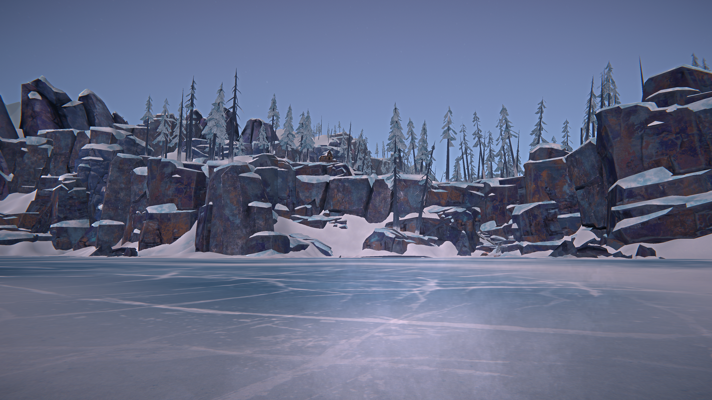

# Drift Island

**Categories:** Islands, Landmarks, Locations, Locations in Forsaken Airfield, Outdoor locations · **Source:** [Fandom](https://thelongdark.fandom.com/wiki/Drift_Island)

**Drift Island**

| Property | Details |
| --- | --- |
|  | [Drift Island](../assets/Drift_Island.png) |
| **Location** |  |
|  | [Drift Island Location](../assets/Drift_Island_Location.png) |
| Region | [Forsaken Airfield](./Forsaken%20Airfield.md) |
| Location | North of [Shoulder Lake](./Shoulder%20Lake.md). |
| Description | A tall island in a lake. |
| **General** |  |
| Type | Landmark |
|  | Has no shelter |

**Drift Island** is the largest island inside [Shoulder Lake](./Shoulder%20Lake.md), located in the north of [Forsaken Airfield](./Forsaken%20Airfield.md). It is home to [Island Cottage](./Island%20Cottage.md), [Cove](./Cove.md), and [Archie's Crawlspace](./Archie%27s%20Crawlspace.md).

## Overview

The island itself is very steep on its south side, and can be accessed by climbing the stairs at the [Cove](./Cove.md) via a short cave, or by walking towards the gentler east and north sides. Several rabbit groves can be found on the island not far from the cabin, and an abandoned camp, with a backpack, possible deer carcass, and a [snow shelter](./Snow%20Shelter.md), may be found towards the center of the island. Placing several snares on the island will provide the player with food for a long time. Birch and maple saplings may appear on the island.

## Gallery

_Drift Island from the lake. The [Cove](./Cove.md) and [Island Cottage](./Island%20Cottage.md) are clearly visible._
