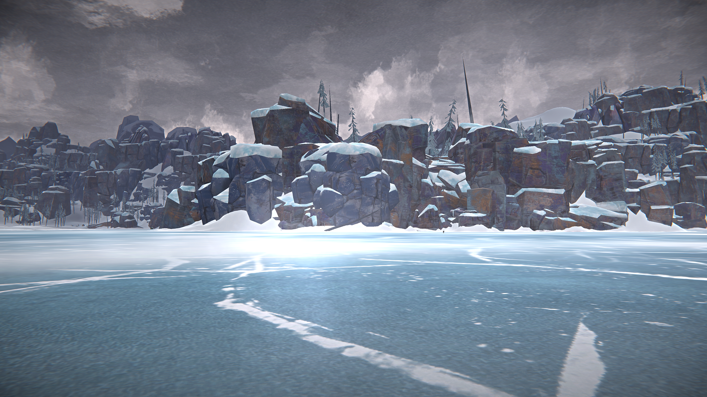

# Drift Island

**Drift Island**

| Property | Details |
| --- | --- |
|  |  / *Drift\_Island.png* |
| **Location** |  |
|  |  / *Drift\_Island\_Location.png* |
| Region | [Forsaken Airfield](./Forsaken%20Airfield.md)\|- |
| Description | A tall island in a lake. |
| **General** |  |
| Type | Landmark\|- |
