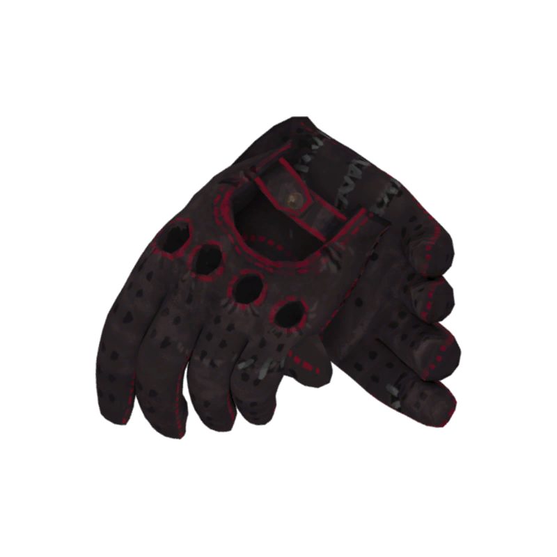

# Driving Gloves

**Driving Gloves**

| Property | Details |
| --- | --- |
|  |  / *Driving\_Gloves\_icon.png* |
| **General** |  |
| Item Type | Clothing\|- |
| Clothing Slot | Hands |
| **Statistics** |  |
| Weight | 0.10 kg(0.22 lbs) |
| Warmth bonus | 0.5 °C(0.9 °F) |
| Windproof bonus | 0.5 °C(0.9 °F) |
| Waterproof bonus | 0% |
| Protection | 1% |
| Mobility | 0% |
| Harvest | 1 × [Cured Leather](./Cured%20Leather.md) / 10 minutes |
| Repair | 1 × [Cured Leather](./Cured%20Leather.md) / 30 minutes / 25% condition |

> “**Thin leather gloves designed for driving. Not much use in the cold.**”
>
> — In-game description

**Driving Gloves** are a type of [Clothing](./Clothing.md) in *[The Long Dark](./The%20Long%20Dark.md)*.

## Overview

Driving Gloves can commonly be found in [cars](./Car.md) and buildings, but offer very little protection against the [cold](./Warmth.md). Only [Improvised Hand Wraps](./Improvised%20Hand%20Wraps.md) offer less protection from the elements. However, wearing leather gloves if there are no other options will at least prevent [Frostbite](./Frostbite.md).

More notably, driving gloves weigh relatively little and can be harvested for [Cured Leather](./Cured%20Leather.md). Harvesting Driving Gloves is also less time-consuming than harvesting boots or many other common sources of Cured Leather.

## Gallery

| Column 1 | Column 2 | Column 3 |
| --- | --- | --- |
|  / *Pre alpha model.* |  / *Clothing model* |  / *Clothing model damaged* |

## Update history

- UPDATE **19 December 2016 ([Update](./The%20Long%20Dark%20%E2%80%94%20Early%20Access%20Changelog.md#0.386)):**
  - Added to game

**Lua execution error in Module:Navbox function navbox** [ru:Водительские перчатки](ru:%D0%92%D0%BE%D0%B4%D0%B8%D1%82%D0%B5%D0%BB%D1%8C%D1%81%D0%BA%D0%B8%D0%B5_%D0%BF%D0%B5%D1%80%D1%87%D0%B0%D1%82%D0%BA%D0%B8)
