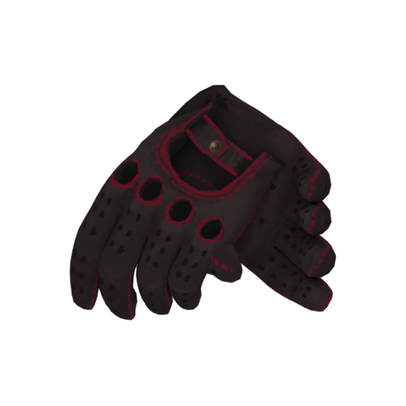

# Driving Gloves

**Categories:** Clothing, Pages with update history · **Source:** [Fandom](https://thelongdark.fandom.com/wiki/Driving_Gloves)

**Driving Gloves**

| Property | Details |
| --- | --- |
| | [Driving Gloves icon](../assets/Driving_Gloves_icon.png) |
| **General** | |
| Item Type | Clothing |
| Wintermute | No |
| Clothing Slot | Hands |
| **Statistics** | |
| Weight | [Weight icon](../assets/Weight_icon.png)0.10 kg(0.22 lbs) |
| Warmth bonus | [Temp icon](../assets/Temp_icon.png)0.5 °C(0.9 °F) |
| Windproof bonus | [Windproofness icon](../assets/Windproofness_icon.png)0.5 °C(0.9 °F) |
| Waterproof bonus | [Waterproofness icon](../assets/Waterproofness_icon.png)0% |
| Protection | [Protection icon](../assets/Protection_icon.png)1% |
| Mobility | [Mobility icon](../assets/Mobility_icon.png)0% |
| Harvest | 1 × [Cured Leather](./Cured%20Leather.md) / 10 minutes |
| Repair | 1 × [Cured Leather](./Cured%20Leather.md) / 30 minutes / 25% condition |

> “**Thin leather gloves designed for driving. Not much use in the cold.**”
>
> — In-game description

**Driving Gloves** are a type of [Clothing](./Clothing.md) in _[The Long Dark](./The%20Long%20Dark.md)_.

## Overview

Driving Gloves can commonly be found in [cars](./Car.md) and buildings, but offer very little protection against the [cold](./Warmth.md). Only [Improvised Hand Wraps](./Improvised%20Hand%20Wraps.md) offer less protection from the elements. However, wearing leather gloves if there are no other options will at least prevent [Frostbite](./Frostbite.md).

More notably, driving gloves weigh relatively little and can be harvested for [Cured Leather](./Cured%20Leather.md). Harvesting Driving Gloves is also less time-consuming than harvesting boots or many other common sources of Cured Leather.

## Gallery

## Update history

- UPDATE **19 December 2016 ([Update](./The%20Long%20Dark%20%E2%80%94%20Early%20Access%20Changelog.md#0-386-resolute-outfitter-update)):**
  - Added to game
