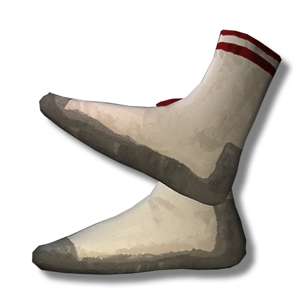
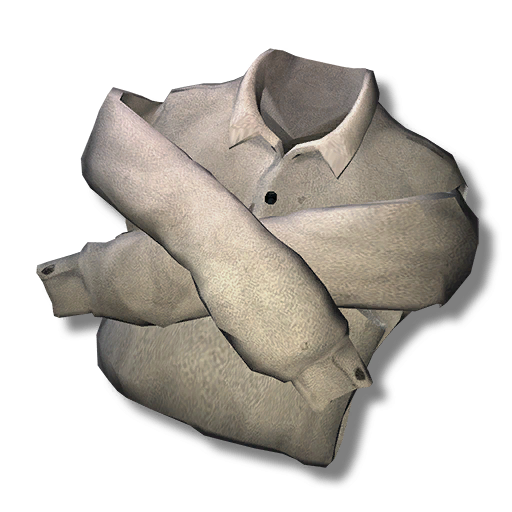
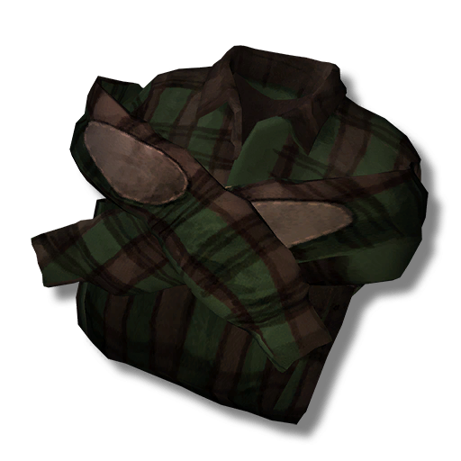
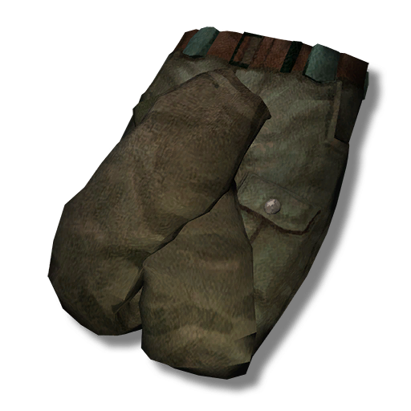

# Dryer

<table class="infobox">
<caption>Dryer</caption>
<colgroup>
<col style="width: 50%" />
<col style="width: 50%" />
</colgroup>
<tbody>
<tr>
<td colspan="2"><figure>
[Missing image: Dryer.jpg]
<figcaption>Dryer.jpg</figcaption>
</figure></td>
</tr>
<tr>
<td>
Release
</td>
<td>
TBD
</td>
</tr>
<tr>
<td>
Update
</td>
<td>
<a href="./The%20Long%20Dark%20%E2%80%94%20Changelog.md#0.00" class="wikilink" title="0.00">0.00</a>
</td>
</tr>
<tr>
<td>
Story item
</td>
<td>
No
</td>
</tr>
<tr>
<td colspan="2" class="section">
<strong>Container</strong>
</td>
</tr>
<tr>
<td>
Capacity
</td>
<td>
30.0 kg(66 lbs)
</td>
</tr>
<tr>
<td colspan="2" class="section">
<strong>Advanced data</strong>
</td>
</tr>
<tr>
<td>
Object key
</td>
<td>
GAMEPLAY_Dryer
</td>
</tr>
</tbody>
</table>

A **Dryer** is a stationary interactable object in <a href="./The%20Long%20Dark.md" class="wikilink" title="The Long Dark">The Long Dark</a>. They are found in the basements of abandoned homes, and are always accompanied by a <a href="./Washer.md" class="wikilink" title="Washer">Washer</a>. They are both located in the basements of <a href="./Pleasant%20Valley%20Farmstead.md" class="wikilink" title="Pleasant Valley Farmstead">Pleasant Valley Farmstead</a>, <a href="./Skeeter%27s%20Ridge.md" class="wikilink" title="Skeeter&#39;s Ridge">Skeeter's Ridge</a>, and <a href="./Basement%20%28Crumbling%20Highway%29.md" class="wikilink" title="Abandoned Harris Home">Abandoned Harris Home</a>. They sometimes have clothes on top of them, but will always contain <a href="./Clothing.md" class="wikilink" title="Clothing">Clothing</a> as loot.

## Loot

<table>
<colgroup>
<col style="width: 33%" />
<col style="width: 33%" />
<col style="width: 33%" />
</colgroup>
<thead>
<tr>
<th></th>
<th>
Item
</th>
<th>
Rarity
</th>
</tr>
</thead>
<tbody>
<tr>
<td><figure>

<figcaption>Sports_Socks_icon.png</figcaption>
</figure></td>
<td>
<a href="./Sports%20Socks.md" class="wikilink" title="Sports Socks">Sports Socks</a>
</td>
<td>
14.47%
</td>
</tr>
<tr>
<td><figure>

<figcaption>Wool_Socks_icon.png</figcaption>
</figure></td>
<td>
<a href="./Wool%20Socks.md" class="wikilink" title="Wool Socks">Wool Socks</a>
</td>
<td>
14.47%
</td>
</tr>
<tr>
<td><figure>

<figcaption>T-Shirt_icon.png</figcaption>
</figure></td>
<td>
<a href="./T-Shirt.md" class="wikilink" title="T-Shirt">T-Shirt</a>
</td>
<td>
13.16%
</td>
</tr>
<tr>
<td><figure>

<figcaption>Thermal_Underwear_icon.png</figcaption>
</figure></td>
<td>
<a href="./Thermal%20Underwear.md" class="wikilink" title="Thermal Underwear">Thermal Underwear</a>
</td>
<td>
6.58%
</td>
</tr>
<tr>
<td><figure>

<figcaption>Dress_Shirt_icon.png</figcaption>
</figure></td>
<td>
<a href="./Dress%20Shirt.md" class="wikilink" title="Dress Shirt">Dress Shirt</a>
</td>
<td>
6.58%
</td>
</tr>
<tr>
<td><figure>

<figcaption>Hoodie_icon.png</figcaption>
</figure></td>
<td>
<a href="./Hoodie.md" class="wikilink" title="Hoodie">Hoodie</a>
</td>
<td>
6.58%
</td>
</tr>
<tr>
<td><figure>

<figcaption>Cargo_Pants_icon.png</figcaption>
</figure></td>
<td>
<a href="./Cargo%20Pants.md" class="wikilink" title="Cargo Pants">Cargo Pants</a>
</td>
<td>
3.29%
</td>
</tr>
<tr>
<td><figure>

<figcaption>Thick_Wool_Sweater_icon.png</figcaption>
</figure></td>
<td>
<a href="./Thick%20Wool%20Sweater.md" class="wikilink" title="Thick Wool Sweater">Thick Wool Sweater</a>
</td>
<td>
3.29%
</td>
</tr>
<tr>
<td><figure>

<figcaption>Sweatshirt_icon.png</figcaption>
</figure></td>
<td>
<a href="./Sweatshirt.md" class="wikilink" title="Sweatshirt">Sweatshirt</a>
</td>
<td>
3.29%
</td>
</tr>
<tr>
<td><figure>

<figcaption>Thin_Wool_Sweater_icon.png</figcaption>
</figure></td>
<td>
<a href="./Thin%20Wool%20Sweater.md" class="wikilink" title="Thin Wool Sweater">Thin Wool Sweater</a>
</td>
<td>
3.29%
</td>
</tr>
<tr>
<td><figure>

<figcaption>Jeans_icon.png</figcaption>
</figure></td>
<td>
<a href="./Jeans.md" class="wikilink" title="Jeans">Jeans</a>
</td>
<td>
3.29%
</td>
</tr>
<tr>
<td><figure>

<figcaption>Plaid_Shirt_icon.png</figcaption>
</figure></td>
<td>
<a href="./Plaid%20Shirt.md" class="wikilink" title="Plaid Shirt">Plaid Shirt</a>
</td>
<td>
3.29%
</td>
</tr>
<tr>
<td><figure>

<figcaption>Wool_Longjohns_icon.png</figcaption>
</figure></td>
<td>
<a href="./Wool%20Longjohns.md" class="wikilink" title="Wool Longjohns">Wool Longjohns</a>
</td>
<td>
3.29%
</td>
</tr>
<tr>
<td><figure>

<figcaption>Work_Pants_icon.png</figcaption>
</figure></td>
<td>
<a href="./Work%20Pants.md" class="wikilink" title="Work Pants">Work Pants</a>
</td>
<td>
3.29%
</td>
</tr>
<tr>
<td><figure>

<figcaption>Climbing_Socks_icon.png</figcaption>
</figure></td>
<td>
<a href="./Climbing%20Socks.md" class="wikilink" title="Climbing Socks">Climbing Socks</a>
</td>
<td>
3.29%
</td>
</tr>
<tr>
<td><figure>

<figcaption>Wool_Shirt_icon.png</figcaption>
</figure></td>
<td>
<a href="./Wool%20Shirt.md" class="wikilink" title="Wool Shirt">Wool Shirt</a>
</td>
<td>
3.29%
</td>
</tr>
<tr>
<td><figure>

<figcaption>Work_Pants_icon.png</figcaption>
</figure></td>
<td>
<a href="./Work%20Pants.md" class="wikilink" title="Work Pants">Work Pants</a>
</td>
<td>
3.29%
</td>
</tr>
<tr>
<td><figure>

<figcaption>Combat_Pants_icon.png</figcaption>
</figure></td>
<td>
<a href="./Combat%20Pants.md" class="wikilink" title="Combat Pants">Combat Pants</a>
</td>
<td>
1.97%
</td>
</tr>
</tbody>
</table>

**Lua execution error in Module:Navbox function navbox**

