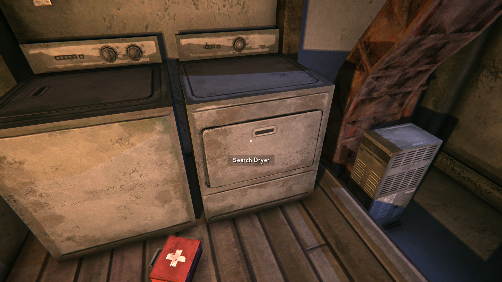
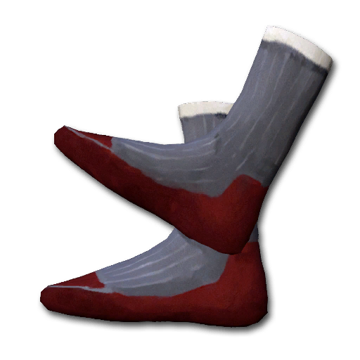

# Dryer

**Dryer**

| Property | Details |
| --- | --- |
|  |  / *Dryer.jpg* |
| Release | TBD |
| Update | [0.00](./The%20Long%20Dark%20%E2%80%94%20Changelog.md#0.00) |
| Story item | No |
| **Container** |  |
| Capacity | 30.0 kg(66 lbs) |
| **Advanced data** |  |
| Object key | GAMEPLAY\_Dryer |

A **Dryer** is a stationary interactable object in [The Long Dark](./The%20Long%20Dark.md). They are found in the basements of abandoned homes, and are always accompanied by a [Washer](./Washer.md). They are both located in the basements of [Pleasant Valley Farmstead](./Pleasant%20Valley%20Farmstead.md), [Skeeter's Ridge](./Skeeter%27s%20Ridge.md), and [Abandoned Harris Home](./Basement%20%28Crumbling%20Highway%29.md). They sometimes have clothes on top of them, but will always contain [Clothing](./Clothing.md) as loot.

## Loot

|  | Item | Rarity |
| --- | --- | --- |
|  / *Sports\_Socks\_icon.png* | [Sports Socks](./Sports%20Socks.md) | 14.47% |
|  / *Wool\_Socks\_icon.png* | [Wool Socks](./Wool%20Socks.md) | 14.47% |
|  / *T-Shirt\_icon.png* | [T-Shirt](./T-Shirt.md) | 13.16% |
|  / *Thermal\_Underwear\_icon.png* | [Thermal Underwear](./Thermal%20Underwear.md) | 6.58% |
|  / *Dress\_Shirt\_icon.png* | [Dress Shirt](./Dress%20Shirt.md) | 6.58% |
|  / *Hoodie\_icon.png* | [Hoodie](./Hoodie.md) | 6.58% |
|  / *Cargo\_Pants\_icon.png* | [Cargo Pants](./Cargo%20Pants.md) | 3.29% |
|  / *Thick\_Wool\_Sweater\_icon.png* | [Thick Wool Sweater](./Thick%20Wool%20Sweater.md) | 3.29% |
|  / *Sweatshirt\_icon.png* | [Sweatshirt](./Sweatshirt.md) | 3.29% |
|  / *Thin\_Wool\_Sweater\_icon.png* | [Thin Wool Sweater](./Thin%20Wool%20Sweater.md) | 3.29% |
|  / *Jeans\_icon.png* | [Jeans](./Jeans.md) | 3.29% |
|  / *Plaid\_Shirt\_icon.png* | [Plaid Shirt](./Plaid%20Shirt.md) | 3.29% |
|  / *Wool\_Longjohns\_icon.png* | [Wool Longjohns](./Wool%20Longjohns.md) | 3.29% |
|  / *Work\_Pants\_icon.png* | [Work Pants](./Work%20Pants.md) | 3.29% |
|  / *Climbing\_Socks\_icon.png* | [Climbing Socks](./Climbing%20Socks.md) | 3.29% |
|  / *Wool\_Shirt\_icon.png* | [Wool Shirt](./Wool%20Shirt.md) | 3.29% |
|  / *Work\_Pants\_icon.png* | [Work Pants](./Work%20Pants.md) | 3.29% |
|  / *Combat\_Pants\_icon.png* | [Combat Pants](./Combat%20Pants.md) | 1.97% |

**Lua execution error in Module:Navbox function navbox**
