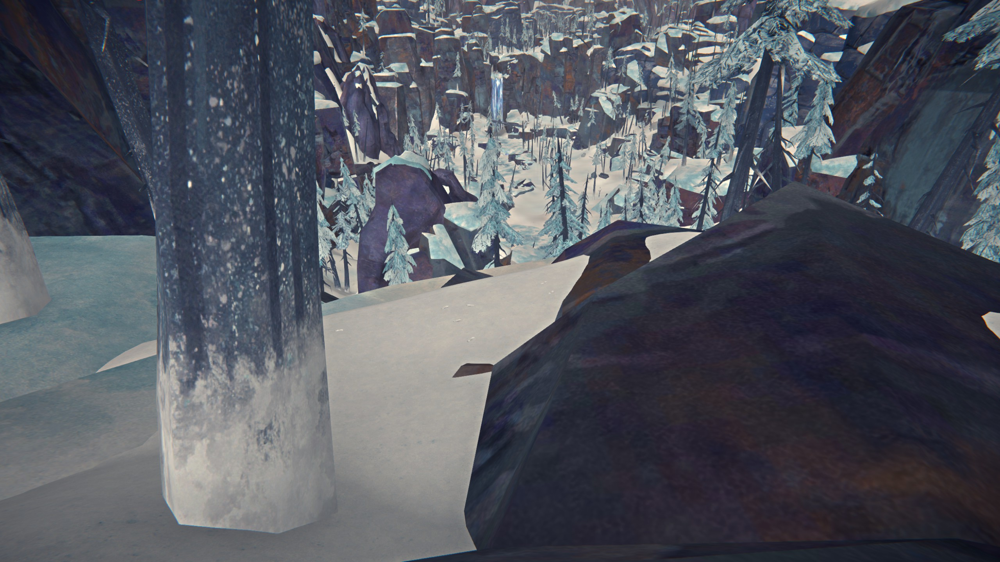
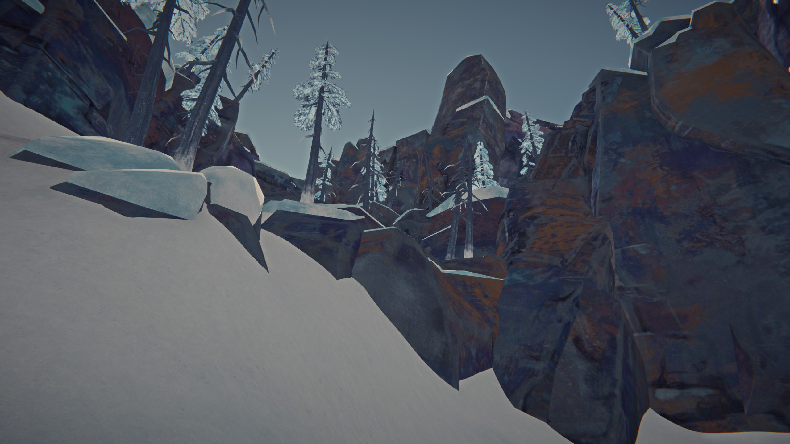

# Dubious Overlook

**Categories:** Locations, Locations in Zone of Contamination, Outdoor locations · **Source:** [Fandom](https://thelongdark.fandom.com/wiki/Dubious_Overlook)

**Dubious Overlook**

| Property | Details |
| --- | --- |
|  | [Dubious Overlook](../assets/Dubious_Overlook.jpg) |
| **Location** |  |
|  | [Dubious Overlook Location](../assets/Dubious_Overlook_Location.png) |
| Region | [Zone of Contamination](./Zone%20of%20Contamination.md) |
| Location | Near [Welkin's Window](./Welkin%27s%20Window.md) |
| Description | A cliff overlooking the southern section of the map |
| **General** |  |
|  | Has no shelter |

**Dubious Overlook** is a location in the [Zone of Contamination](./Zone%20of%20Contamination.md).

## Overview

The exact location is just down the hill from [Welkin's Window](./Welkin%27s%20Window.md), and is a patch of snow surrounded by some rocks overlooking a cliff side. It cannot be easily seen from the Cave, so just walk down the snow covered hillside until you see a cliff to the left.

It gives a view of the unpolluted southern valley, as well as [Enduring Waterfall](./Enduring%20Waterfall.md).

## Gallery

