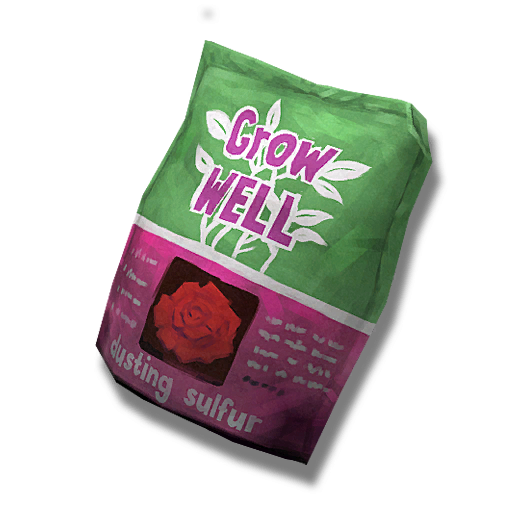

# Dusting Sulfur

**Contents**

- [Overview](#Overview)
- [Spawn points](#Spawn_points)
- [Products](#Products)
- [Trivia](#Trivia)

<table class="infobox">
<caption>Dusting Sulfur</caption>
<colgroup>
<col style="width: 50%" />
<col style="width: 50%" />
</colgroup>
<tbody>
<tr>
<td colspan="2"><figure>

<figcaption>Dusting_Sulfur_icon.png</figcaption>
</figure></td>
</tr>
<tr>
<td colspan="2" class="section">
<strong>General</strong>
</td>
</tr>
<tr>
<td>
Item Type
</td>
<td>
Material|-
</td>
</tr>
<tr>
<td>
Renewable
</td>
<td>
Yes (very rare <a href="./Beachcombing.md" class="wikilink" title="Beachcombing">Beachcombing</a>)
</td>
</tr>
<tr>
<td colspan="2" class="section">
<strong>Statistics</strong>
</td>
</tr>
<tr>
<td>
Weight
</td>
<td>
0.10 kg(0.22 lbs)
</td>
</tr>
</tbody>
</table>

<table>
<colgroup>
<col style="width: 33%" />
<col style="width: 33%" />
<col style="width: 33%" />
</colgroup>
<tbody>
<tr>
<td style="vertical-align: top; font-size: 3em; color: #5d5980; padding-right: 10px">
“
</td>
<td>
A chemical compound sometimes used as a pesticide. Could be useful when crafting Ammunition.

&#10;

In-game description

</td>
<td style="vertical-align: bottom; font-size: 3em; color: #5d5980; padding-left: 10px">
”
</td>
</tr>
</tbody>
</table>

**Dusting Sulfur** is a crafting material in *The Long Dark*.

## Overview

Dusting Sulfur is used to craft <a href="./Can%20of%20Gunpowder.md" class="wikilink" title="Can of Gunpowder">Can of Gunpowder</a>, a resource for <a href="./Gunsmithing.md" class="wikilink" title="Gunsmithing">Gunsmithing</a>. This may only be done at the <a href="./Ammunition%20Work%20Bench.md" class="wikilink" title="Ammunition Workbench">Ammunition Workbench</a> in <a href="./Bleak%20Inlet.md" class="wikilink" title="Bleak Inlet">Bleak Inlet</a> or at <a href="./Blackrock%20Prison.md" class="wikilink" title="Blackrock Prison">Blackrock Prison</a>. Bags of dusting sulfur can be found in many former industrial and agricultural sites on <a href="./Great%20Bear%20Island.md" class="wikilink" title="Great Bear Island">Great Bear Island</a>.

0.10 kg of gunpowder may also be used as an accelerant for <a href="./Fire%20Starting.md" class="wikilink" title="starting fires">starting fires</a>. This gives dusting sulfur a use on <a href="./Interloper.md" class="wikilink" title="Interloper">Interloper</a> difficulty despite firearms not being present.

## Spawn points

Some observed spawn points include:

**<a href="./Broken%20Railroad.md" class="wikilink" title="Broken Railroad">Broken Railroad</a>**

- <a href="./Maintenance%20Yard.md" class="wikilink" title="Maintenance Yard">Maintenance Yard</a> (Maintenance Shed)

**<a href="./Coastal%20Highway.md" class="wikilink" title="Coastal Highway">Coastal Highway</a>**

- <a href="./Quonset%20Garage.md" class="wikilink" title="Quonset Garage">Quonset Garage</a>
- <a href="./Rabbit%20Grove.md" class="wikilink" title="Cabin (Rabbit Grove)">Cabin (Rabbit Grove)</a>

**<a href="./Mountain%20Town.md" class="wikilink" title="Mountain Town">Mountain Town</a>**

- <a href="./Paradise%20Meadows%20Farm.md" class="wikilink" title="Paradise Meadows Farm">Paradise Meadows Farm</a>
- Orca Gas Station

<a href="./Mystery%20Lake%20%28disambiguation%29.md" class="wikilink" title="Mystery Lake">Mystery Lake</a>

- In the right Trailer from the <a href="./Carter%20Hydro%20Dam.md" class="wikilink" title="Carter Hydro Dam">Carter Hydro Dam</a>, under toppled over metal shelves.
- <a href="./Trapper%27s%20Homestead.md" class="wikilink" title="Trapper&#39;s Cabin">Trapper's Cabin</a>

**<a href="./Pleasant%20Valley.md" class="wikilink" title="Pleasant Valley">Pleasant Valley</a>**

- <a href="./Pleasant%20Valley%20Farmstead.md" class="wikilink" title="Pleasant Valley Farmstead">Pleasant Valley Farmstead</a> Basement and Barn
- <a href="./Pleasant%20Valley%20Outbuildings.md" class="wikilink" title="Pleasant Valley Outbuildings">Pleasant Valley Outbuildings</a> Barn
- <a href="./Prepper%20Cache.md" class="wikilink" title="Prepper cache">Prepper cache</a> (Clothing)

**<a href="./Bleak%20Inlet.md" class="wikilink" title="Bleak Inlet">Bleak Inlet</a>**

- <a href="./Last%20Resort%20Cannery.md" class="wikilink" title="Last Resort Cannery">Last Resort Cannery</a> Warehouse (near the trailer, upper floor)
- <a href="./Last%20Resort%20Cannery.md" class="wikilink" title="Last Resort Cannery">Last Resort Cannery</a> Workshop
- <a href="./Echo%20One%20Radio%20Tower.md" class="wikilink" title="Echo One Radio Tower">Echo One Radio Tower</a> Outside door
- Car in the east on a bridge
- <a href="./Fallen%20Lighthouse.md" class="wikilink" title="Fallen Lighthouse">Fallen Lighthouse</a>

**<a href="./Blackrock.md" class="wikilink" title="Blackrock">Blackrock</a>**

- <a href="./Blackrock%20Prison.md" class="wikilink" title="Blackrock Prison">Blackrock Prison</a>
  - Inside the Wardens office
  - Inside the guardtower
  - Second room of the infirmary

## Products

## Trivia

- Dusting Sulfur is branded as the product "Grow Well", with dusting sulfur as an active ingredient. It is likely meant to be an insecticide/fungicide/Disease repellant used in gardens and landscaping.
- The Errant Pilgrim update introduced <a href="./Gunsmithing.md" class="wikilink" title="Gunsmithing">Gunsmithing</a>.

**Lua execution error in Module:Navbox function navbox**

