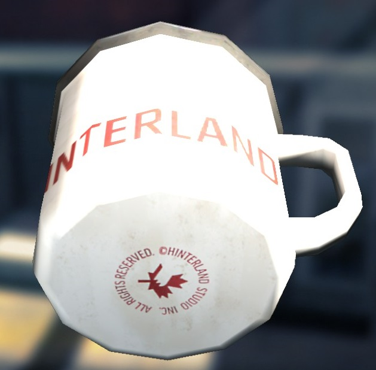
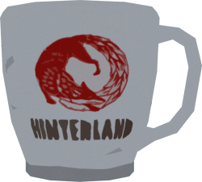
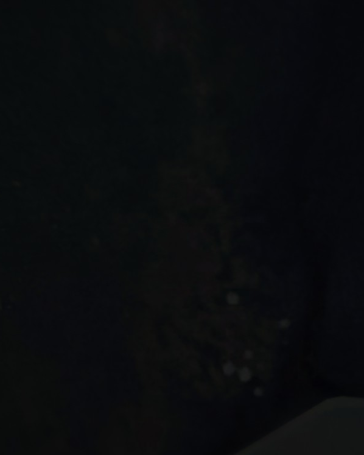
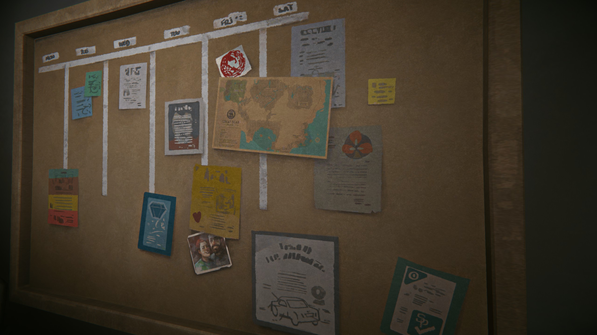
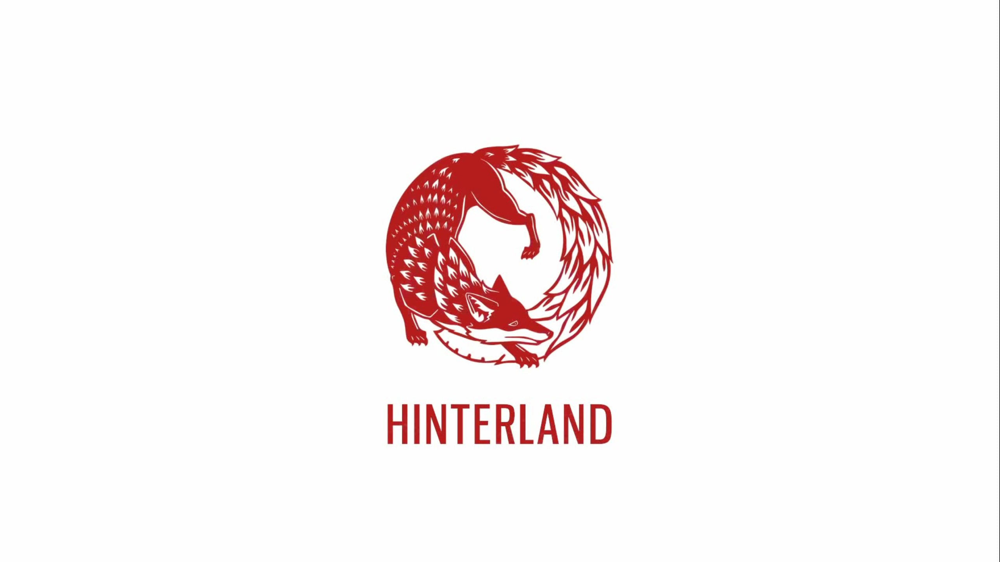
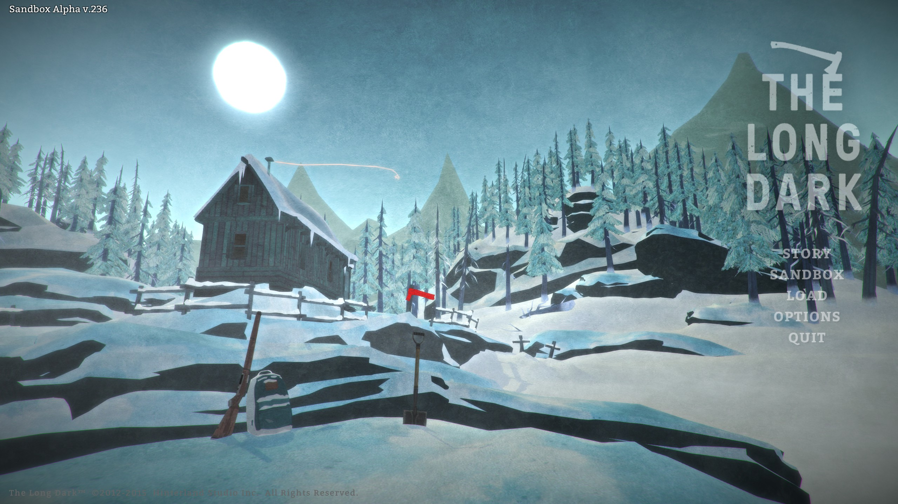
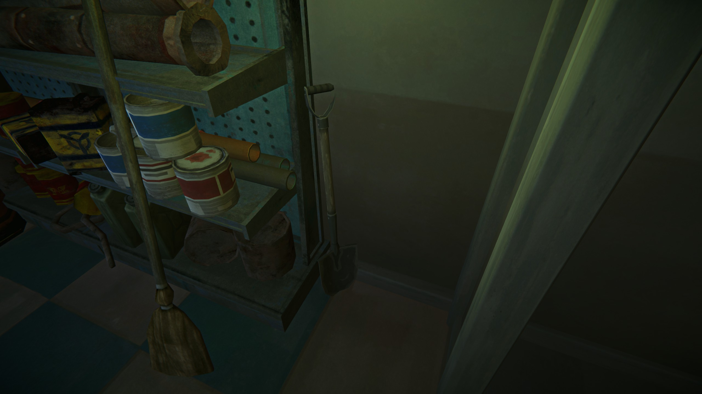

# Easter Eggs

**Source:** [Fandom](https://thelongdark.fandom.com/wiki/Easter_Eggs)

**Contents**

- [General Secrets](#general-secrets)
- [Hidden Items](#hidden-items)
- [Hidden Locations](#hidden-locations)
- [Beachcombing](#beachcombing)
- [Easter Eggs](#easter-eggs)
- [Real World People](#real-world-people)
- [Films](#films)
- [Radio](#radio)
- [Named Locations](#named-locations)
- [Great Bear Island](#great-bear-island)
- [Items](#items)
- [Rock Art](#rock-art)
- [Hank's Hatch](#hanks-hatch)
- [References to Previous Game Builds](#references-to-previous-game-builds)

**Easter Eggs** are hidden messages, images, or features typically placed in software to reference other forms of media. They may also be well placed hidden secrets found in the game. Below is a list of secrets, obscure knowledge, and Easter Eggs in _[The Long Dark](./The%20Long%20Dark.md)_.

## General Secrets

### Hidden Items

- _The Long Dark_ features a large number of hidden loot items both indoors and outside. Such items are usually small (e.g. [firestrikers](./Firestriker.md), [matches](./Wood%20Matches.md), [ammunition](./Revolver%20Ammunition.md)) and atop shelves, desks, between/underneath furniture, or otherwise in difficult to find locations. CROUCHING ("Control" by default) can be helpful or required in finding such hidden items. Most notably a [Magnifying Lens](./Magnifying%20Lens.md) hidden inside the [Camp Office](./Camp%20Office.md) (Mystery Lake), and a hidden stash of supplies inside [Hibernia Processing](./Hibernia%20Processing.md) (Desolation Point) which requires crouching up and inside a pipe.
- [Safes](./Safe.md): Safes are heavy metal storage containers which are initially locked. They contain some of the highest loot tables in _The Long Dark_, being able to contain rare items such as [Can of Gunpowder](./Can%20of%20Gunpowder.md), [Mukluks](./Mukluks.md) and [Gauntlets](./Gauntlets.md). Safes have static locations ([Old Spence Family Homestead](./Old%20Spence%20Family%20Homestead.md) (Forlorn Muskeg), [Trapper's Homestead](./Trapper%27s%20Homestead.md) (Mystery Lake), [Carter Hydro Dam &amp; Environs](./Carter%20Hydro%20Dam.md) (upper) (Mystery Lake) and are opened by rotating their dial left until a "click" is heard, then right until a second click, and then left again until the third click.
- [Hidden Caches](./Hidden%20Cache.md): these small, orange-lidded containers are filled with high level loot on all difficulties and are concealed in remote and inhospitable regions, particularly in [Hushed River Valley](./Hushed%20River%20Valley.md).

### Hidden Locations

- [Secret Mountain Path](./Secret%20Mountain%20Path.md) - this Bleak Inlet area contains a small amount of loot and acts as a shortcut between the eastern and western halves of the region. It is initially walled off by Scrub Bushes from the eastern side, which cannot be traversed until they are harvested by a [Hatchet](./Hatchet.md).
- Access to [Bleak Inlet](./Bleak%20Inlet.md)'s [Cannery Pier Workshop](./Cannery%20Pier.md) is initially blocked by a shut electrically powered door. Access requires reading a note (does not need to be picked up, but item has no weight) inside [Echo One Radio Tower](./Echo%20One%20Radio%20Tower.md), Bleak Inlet. Once the access code has been read, the door may be unlocked by entering [The Last Resort Cannery](./Last%20Resort%20Cannery.md) (braving harsh cold, wind, and [Timberwolf packs](./Timberwolf.md)), ascending a Mountaineering Rope inside a structure, and navigating a [parkour](https://en.wikipedia.org/wiki/Parkour) route around the upper level of the compound. This leads to the Workshop entrance, where the electronic door may be unlocked at night during an active [Aurora](./Aurora.md), granting access to [Gunsmithing](./Gunsmithing.md) and the [Milling Machine](./Milling%20Machine.md).
- [Cinder Hills Coal Mine](./Cinder%20Hills%20Coal%20Mine.md), [Coastal Highway](./Coastal%20Highway.md) - the middle level of the mine is a series of interconnected tunnels with rich loot on all Game Modes, but also [electrified hazards](./Burns.md). It can only be accessed via entering the Lower Level (Coastal Highway) and using the elevator while it is powered during an active [Aurora](./Aurora.md).
- [Misty Falls Picnic Area](./Misty%20Falls%20Picnic%20Area.md), [Pleasant Valley](./Pleasant%20Valley.md) - an unnamed cave filled with glowing flora may be found along the mountain beside the picnic area, which features a unique interior layout, as well as potentially frozen corpses and loot.

### Beachcombing

- [Beachcombing](./Beachcombing.md) is an obscure game mechanic which causes select items to randomly spawn in coastal regions ([Coastal Highway](./Coastal%20Highway.md), [Desolation Point](./Desolation%20Point.md), [Crumbling Highway](./Crumbling%20Highway.md), and [Bleak Inlet](./Bleak%20Inlet.md)). These items may be found near where the ocean meets the ice, typically in or near areas of dangerous Weak Ice. This allows many otherwise non-renewable resources to theoretically become sustainable (e.g. [Cloth](./Cloth.md), [Cured Leather](./Cured%20Leather.md), Saplings). Note: not all items may be found via Beachcombing, and item(s) present at a Beachcombing location prevent future spawns, requiring their removal before a item may spawn.

## Easter Eggs

### Real World People

- If a survivor's hydration is low, they will mention "That guy who drank his own pee doesn't sound so crazy right now" referencing [Bear Grylls](https://en.wikipedia.org/wiki/Bear_Grylls) [drinking his own urine](https://www.google.com/search?q=bear+grylls+pee&rlz=1C1GCEA_enUS1043US1043&oq=bear+grylls+pee&gs_lcrp=EgZjaHJvbWUyBggAEEUYOdIBCDMzMTFqMGo0qAIAsAIA&sourceid=chrome&ie=UTF-8#fpstate=ive&vld=cid:654e5bb1,vid:axVPg5EtvKs,st:0).
- In [Episode 2: Luminance Fugue](./Episode%202%20-%20Luminance%20Fugue.md), after [Will Mackenzie's](./Will%20Mackenzie.md) 3rd encounter with the [Old Bear](./Old%20Bear.md) after acquiring the [Bear Spear](./Bear%20Spear.md), the bear will back off, with Will remarking "not so tough now that I'm all Grizzly Adams?" referencing [John Adams](https://en.wikipedia.org/wiki/John_%22Grizzly%22_Adams).
- The director's name of _The Long Dark_, Raphael Von Lierop, can be seen briefly on a computer monitor in [Episode 3: Crossroads Elegy](./Episode%203%20-%20Crossroads%20Elegy.md) during the flashback with Astrid.

### Films

The entire mission [What One Man Can Do](./What%20One%20Man%20Can%20Do.md) with the [Old Bear](./Old%20Bear.md) hunting Mackenzie (a crashed bush pilot) is a reference to the film [The Edge](https://en.wikipedia.org/wiki/The_Edge_%281997_film%29).

### Radio

- During an [Aurora](./Aurora.md), if you click on a [Radio](./Radio.md), either in a [Car](./Car.md), [Truck](./Truck.md), or on a table, classical music will play. The music that plays has been identified to be Glenn Gould playing Bach on piano.

### Named Locations

A number of locations are named after [Hinterland's](./Hinterland%20Studio%20Inc..md) developers.

- [Desolation Point](./Desolation%20Point.md) - [Matt's Truck](./Matt%27s%20Truck.md)
- [Desolation Point](./Desolation%20Point.md) - [Katie's Secluded Corner](./Katie%27s%20Secluded%20Corner.md)
- [Mystery Lake](./Mystery%20Lake%20%28region%29.md) - [Alan's Cave](./Alan%27s%20Cave.md)
- [Mystery Lake](./Mystery%20Lake%20%28region%29.md) - [Dave's Quiet Clearing](./Dave%27s%20Quiet%20Clearing.md)
- [Mystery Lake](./Mystery%20Lake%20%28region%29.md) - [Max's Last Stand](./Max%27s%20Last%20Stand.md)
- [Timberwolf Mountain](./Timberwolf%20Mountain.md) - [Eric's Falls](./Eric%27s%20Falls.md)
- Most of the names on the [Prison Transport Manifest](./Prison%20Transport%20Manifest.md) are named after Hinterland developers

### Great Bear Island

- Great Bear Island itself is directly inspired by [Vancouver Island](https://en.wikipedia.org/wiki/Vancouver_Island).
- Mystery Lake is a reference to the mystery lake school division in North Manitoba Canada where the developers did a career day video call with local middle school students in 2013 to promote video game development in Canada.
- The [Concentrator](./Concentrator.md) is based off of the [Britannia Mine Museum](https://en.m.wikipedia.org/wiki/Britannia_Mine_Museum) in Vancouver, British Columbia, Canada.
  - The [Haul Truck](./Haul%20Truck.md) is most likely based off the one in front of the museum.

### Items

- [Stacy's Grape Soda](./Stacy%27s%20Grape%20Soda.md) - is named after "Stacyplays" (aka Stacy Hinojosa) a YouTuber who ran a "let's play" series during The Long Dark's alpha/beta (2014-2016). It is slightly rarer than other types: Orange Soda, and Summit Soda.
- Brand References - many in-game items are references to real-world brands in name and/or appearance such as [Orange Soda](./Orange%20Soda.md) (Fanta), [Summit Soda](./Summit%20Soda.md) (Mountain Dew/Sprite), Beef Jerky ([Jack Link's](./Beef%20Jerky.md)), and [Firestriker](./Firestriker.md) (Aurora Fire Starter 440C). The Flashlight appears to be loosely based on a 1920s vintage Ever-Ready flashlight, however uses a LED bulb as opposed to the Ever-Ready's fluorescent bulb.
- Weapons in game are typically based off of real world items.
  - The [Revolver](./Revolver.md) in-game most closely resembles a [Smith &amp; Wesson Model 27](https://guns.fandom.com/wiki/Smith_%26_Wesson_Model_27) or [28](https://guns.fandom.com/wiki/Smith_%26_Wesson_Model_28) (leaning more towards the former), which both use .357 Magnum ammunition; however, in-game Revolver Ammunition appears to be .32 S&amp;W Long or .38 Special.
    - A cut image of a [.44 Magnum Bullet](../assets/Revolver_44_Mag_Bullet_icon.png) can be found in the game files, suggesting that the Revolver could also be a [Smith &amp; Wesson Model 29](https://guns.fandom.com/wiki/Smith_%26_Wesson_Model_29).
  - The [Hunting Rifle](./Hunting%20Rifle.md) is inspired by the Lee-Enfield bolt action rifle, which was Britain's standard issue rifle until the 1960s and was used by the Canadian Rangers until 2015.
  - The [Distress Pistol](./Distress%20Pistol.md) closely resembles the real-life [Orion flare gun](https://en.wikipedia.org/wiki/Flare_gun).
- [First Aid Kit](./First%20Aid%20Kit.md) - these wall-mounted containers filled with medical supplies are a reference to the [Swedish folk duo of the same name](https://en.wikipedia.org/wiki/First_Aid_Kit_%28band%29#2012%E2%80%932013), who composed and performed the song "[Lion's Roar](https://youtu.be/gekHV9DIjHc)", used in _The Long Dark's_ intro for Wintermute (Story Mode).
- [Cups of Coffee](./Cup%20of%20Coffee.md) - every coffee cup has the Hinterland Studios logo on the front of the cup. This is the most blatant and easiest to find Easter Egg in the game.
- The description of the [Hoodie](./Hoodie.md) might be a reference to the Hinterland Developers.
- Photographs on walls and nightstands inside of houses in [Coastal House](./Coastal%20House.md), [Milton House](./Milton%20House.md), and [Crossroads House](./Crossroads%20House.md) in [Coastal Highway](./Coastal%20Highway.md), [Mountain Town](./Mountain%20Town.md), and [Pleasant Valley](./Pleasant%20Valley.md) respectively are pictures of [Hinterland](./Hinterland%20Studio%20Inc..md) developers, their friends or family; including "Stacyplays" (aka Stacy Hinojosa) a YouTuber who ran a "let's play" series during _The Long Dark's_ alpha/beta (2014-2016). Each picture has been digitally downgraded to fit in the the game's graphical aesthetic style.
- The item description of the [Spelunker's Lantern](./Spelunker%27s%20Lantern.md): "A light for deep, dark places, when other lights go out." is a direct reference to the [Phial of Galadriel](https://tolkiengateway.net/wiki/Phial_of_Galadriel) from Lord of The Rings: "It will shine still brighter when night is about you. May it be a light to you in dark places, when all other lights go out."
  - The [Achievement](./The%20Long%20Dark%20%E2%80%94%20Achievements.md), [Too Greedily, too Deep](./Too%20Greedily%2C%20too%20Deep.md) is yet another reference to Lord of the Rings:
    - **Saruman: "**Moria... You fear to go into those mines. The dwarves delved too greedily and too deep. You know what they awoke in the darkness of Khazad-dum... shadow and flame."
  - The Achievement [Something Wicked](./Something%20Wicked.md) is a reference to a quote from one of the three witches in Shakespeare's [Macbeth](https://nosweatshakespeare.com/quotes/famous/something-wicked-this-way-comes/):
    - **Second Witch**: "By the pricking of my thumbs, Something wicked this way comes."

_Cup of Coffee Icon with the Hinterland Logo_

_The bottom of the cup_

_Old design with old logo_

### Rock Art

A number of rocks contain faint images of cavemen, monsters or graffiti, typically in an abstract art form or extremely low resolution. These rocks are found in all regions, but are most common in [Pleasant Valley](./Pleasant%20Valley.md) near the entrance to [Winding River](./Winding%20River.md), as well as [Bleak Inlet](./Bleak%20Inlet.md).

_Cave Art (Desolation Point), a monster or animal_

### Hank's Hatch

The side mission [Hank's Hatch](./Hank%27s%20Hatch.md) contains many references to [Firewatch](https://en.wikipedia.org/wiki/Firewatch). "Hank" is a nod to the protagonist "Henry" from the game. Hank (a common nickname for Henry) shares many similarities with his counterpart, including taking a job working in a fire tower in a nature park to be away from other people. In his journal, Hank complains about "the chatty lady" on the radio, a reference to Delilah, Henry's supervisor in Firewatch who communicates with him by radio throughout the game and also occasionally refers to him as "Hank". Hank's Journal refers to him finding a "weird old bunker," also a reference to the plot of Firewatch.

### References to Previous Game Builds

During the mission [Memories](./Memories.md), several callbacks to previous builds of the game can be found in the [Jackrabbit Hangar](./Jackrabbit%20Hangar.md):

- An old map of [Great Bear Island](./Great%20Bear%20Island.md) can be seen on the time table board behind Mackenzie when first starting the mission. This map was the first official map of the Island that was never put in the game.
  - The old version of the [Hinterland Studio Inc.](./Hinterland%20Studio%20Inc..md) logo can also be seen on the wall.
- The shovel found on the old builds of the game's title screen can be found next to the bathroom.

_The office board in Memories_

_The first ever released map_

_The old Hinterland Logo_

_The shovel in the pre alpha main menu_

_The shovel near the bathroom_
