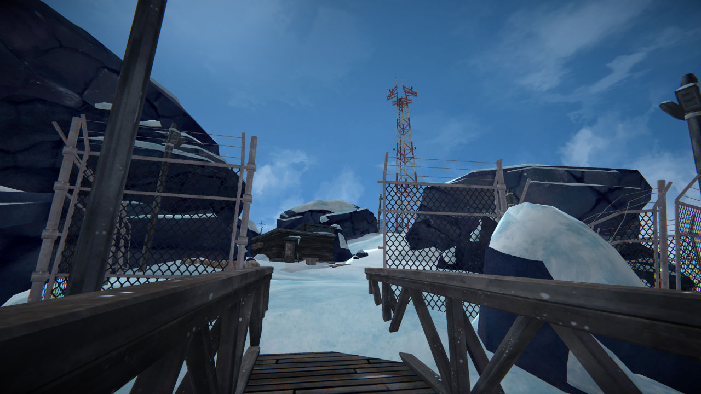
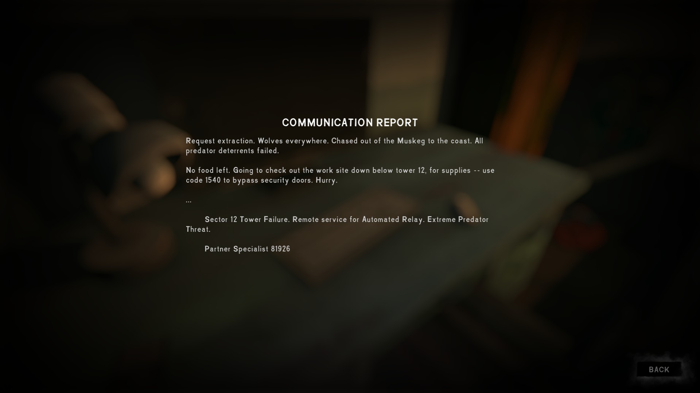
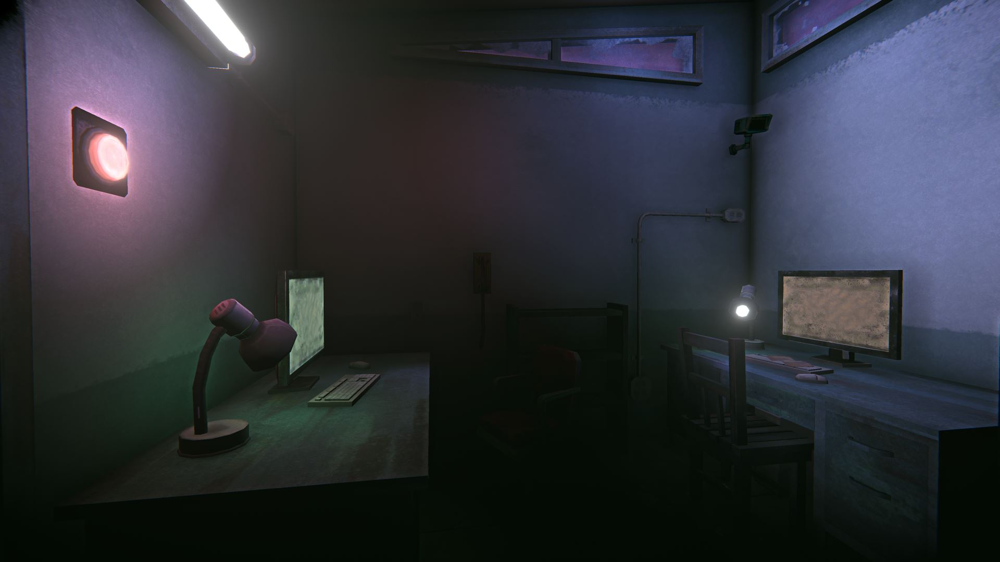
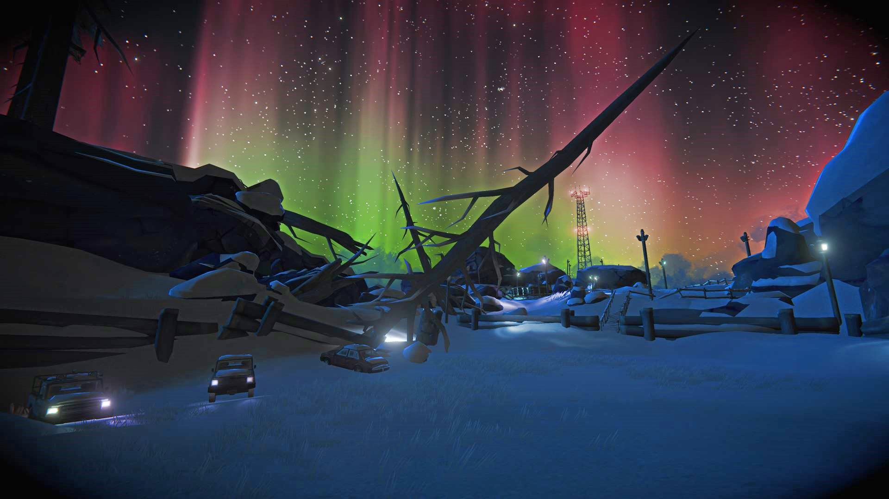

# Echo One Radio Tower

**Categories:** Indoor locations, Industrial locations, Locations, Locations in Bleak Inlet, Military/Sporting locations · **Source:** [Fandom](https://thelongdark.fandom.com/wiki/Echo_One_Radio_Tower)

**Contents**

- [Overview](#overview)
- [Safehouse](#safehouse)
- [Access](#access)
- [Code](#code)

**Echo One Radio Tower**

| Property | Details |
| --- | --- |
| | [Screen fb3efe93 48fa 4cfb 9acc e75dadcb821b hi](../assets/Screen_fb3efe93-48fa-4cfb-9acc-e75dadcb821b_hi.jpg) |
| **Location** | |
| | [Echo One Radio Tower Location](../assets/Echo_One_Radio_Tower_Location.png) |
| Region | [Bleak Inlet](./Bleak%20Inlet.md) |
| Location | The southmost point of the Bleak Inlet plateau, south of the [Pensive Lookout](./Pensive%20Lookout.md). |
| Description | A radio hut and tower |
| **General** | |
| Type | IndustrialMilitary/Sporting |
| Firebox | |
| [Bed icon](../assets/Bed_icon.png) | |
| | Has an interior |

Echo One is a radio hut and tower positioned on the southmost point of the [Bleak Inlet](./Bleak%20Inlet.md) plateau. Inside the hut on a desk, the player can find a note that provides the code to the electronic lock on the pier warehouse door to the [Workshop](./Workshop.md) at the [Last Resort Cannery](./Last%20Resort%20Cannery.md).

## Overview

The radio hut is positioned on the southern tip of the plateau, overlooking the entire region. Inside the hut, the player can find decent amounts of loot, some good storage, and the essential keycode to unlock the door to the [Milling Machine](./Milling%20Machine.md) and [Ammunition Work Bench](./Ammunition%20Work%20Bench.md). Some firewood can be found around the site, as well as a few harvestable wooden objects. Inside the player can escape from the cold and hostile wildlife.

## Safehouse

The radio hut has some qualities that make it a potential safe house, but its position ultimately makes it inadequate.

Although it is safe from predators and has a fair bit of storage, the only way to travel between the upper and lower part of the region is by a climbing rope area at [Pensive Lookout](./Pensive%20Lookout.md), and the player has to supply and deploy their own rope (assuming there is not one hanging on the outer wall of the lookout), making the lookout a better choice if the player desires to live on the plateau at all. Likewise, traveling to other regions from the plateau requires the player climb a rope to move beyond the connecting transition area. It also doesn't have a firebox or workbench.

## Access

The station is visible from all around the map on a clear day, but the path to reach the site is not immediately obvious. While most of the region can be accessed through Forlorn Muskeg, the station and the rest of the plateau can only be reached by climbing down into The Ravine basin, then continuing along the frozen waterway.

Depending on the player's goals, it may be more efficient to enter via this path the first time visiting the region. Though it requires up to two climbing ropes, it allows the player to unlock the workshop, without backtracking and making repeated trips.

## Code

As mentioned in the [Cannery Memo](./Cannery%20Memo.md) written by a worker for the cannery, they have 'rigged something up in the old cannery workshop,' and mentions, 'don't forget to get the code from the old radio station.' The code can be found in the form of [Communication Report](./Communication%20Report.md), which can be found resting on the keyboard of the computer on one of the desks.

Players who make it to the pier will find that a heavy metal door and electronic keypad block their path. The keypad can only be used during the [aurora](./Aurora.md), and without retrieving the paper from the radio hut, the keypad will remain locked.

_A view of the [cannery](./Last%20Resort%20Cannery.md) and [Long Bridge](./Long%20Bridge.md)._

