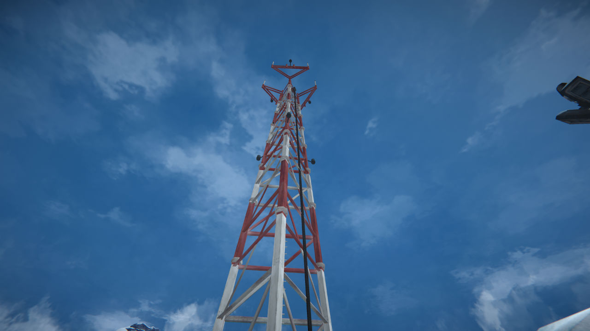
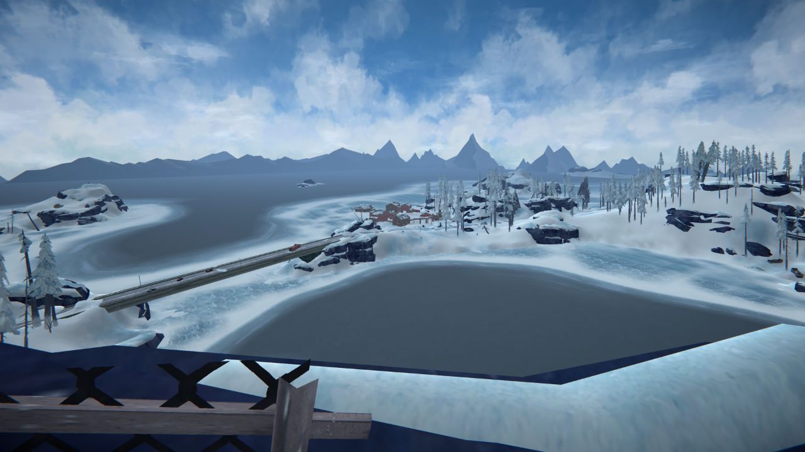
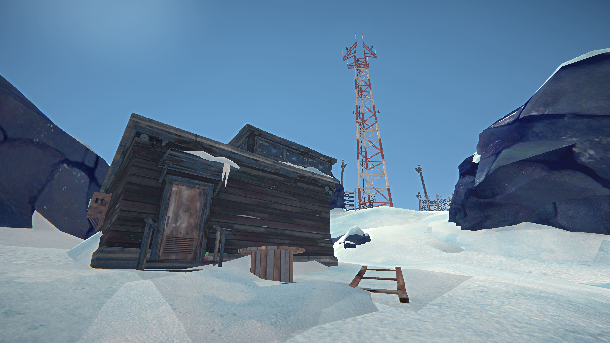
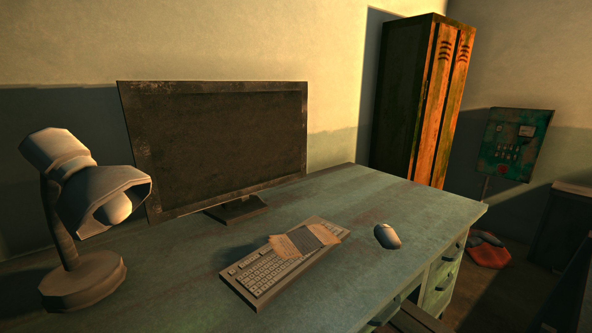
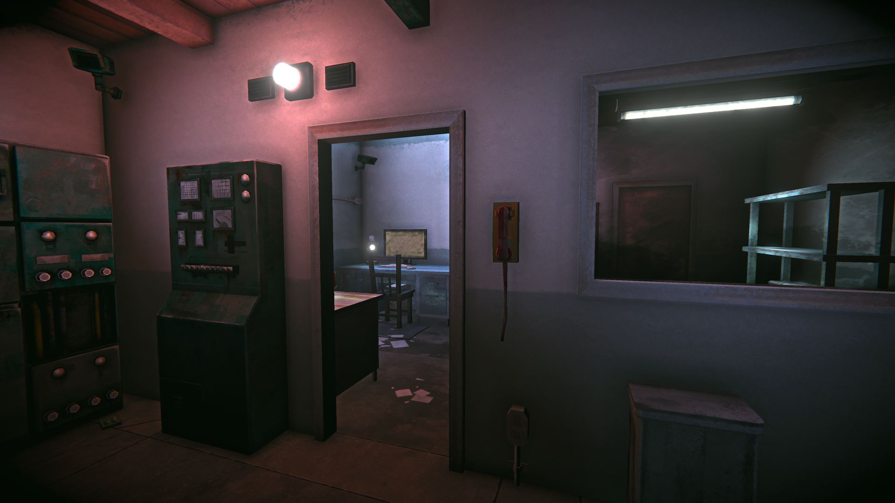
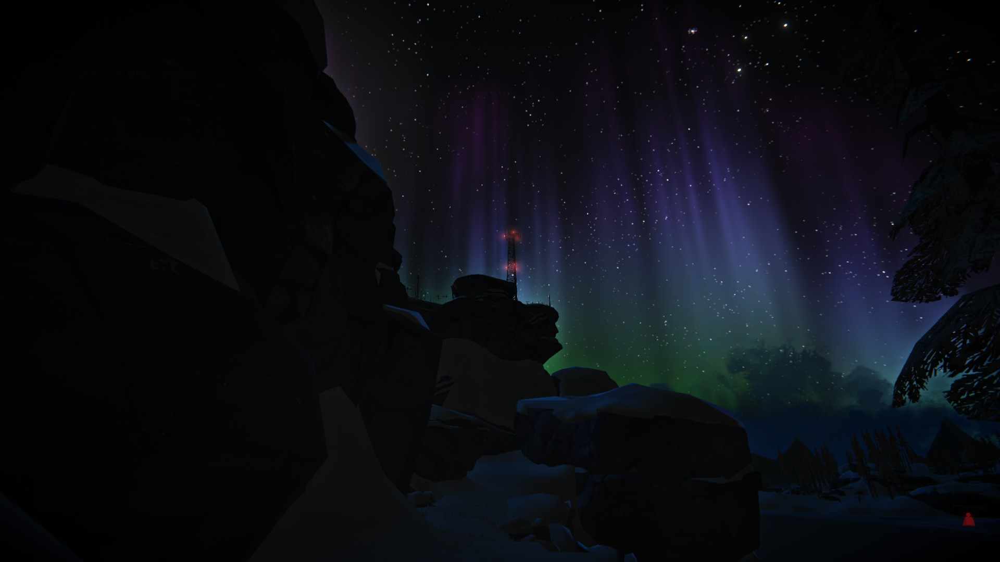
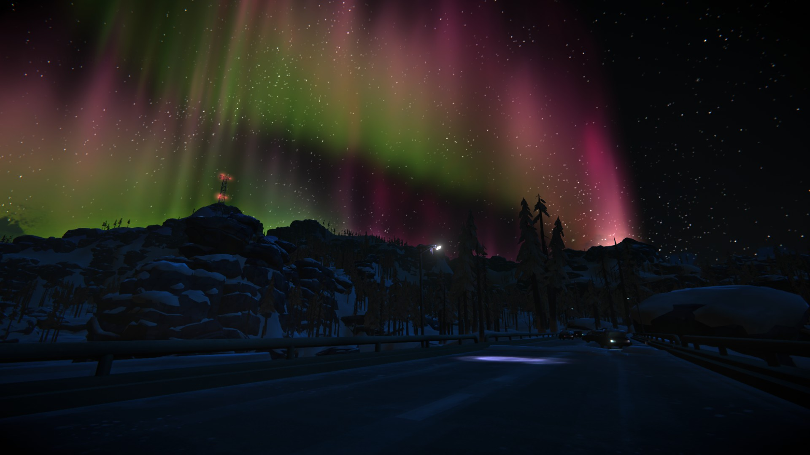

# Echo One Radio Tower

**Categories:** Indoor locations, Industrial locations, Locations, Locations in Bleak Inlet, Military/Sporting locations · **Source:** [Fandom](https://thelongdark.fandom.com/wiki/Echo_One_Radio_Tower)

**Contents**

- [Overview](#overview)
- [Safehouse](#safehouse)
- [Access](#access)
- [Code](#code)

**Echo One Radio Tower**

_Screen\_fb3efe93-48fa-4cfb-9acc-e75dadcb821b\_hi.jpg_

**Location**

_Echo\_One\_Radio\_Tower\_Location.png_

**Region:** [Bleak Inlet](./Bleak%20Inlet.md)\|-

**Description:** A radio hut and tower

**General**

**Type:** IndustrialMilitary/Sporting\|-

_bed\_icon.png_

_The radio mast_

_A view of the [cannery](./Last%20Resort%20Cannery.md) and [Long Bridge](./Long%20Bridge.md)._

_The hut and mast from the bridge_

_Radio control hut_

_Communication report and pc (no buffer memories)_

_Communication Report_

_View_

_Aurora_

_Aurora (No buffer memory in PC)_

_Aurora_

_Aurora lit radio mast. View from Secret mountain path_

_Aurora nights radio_
