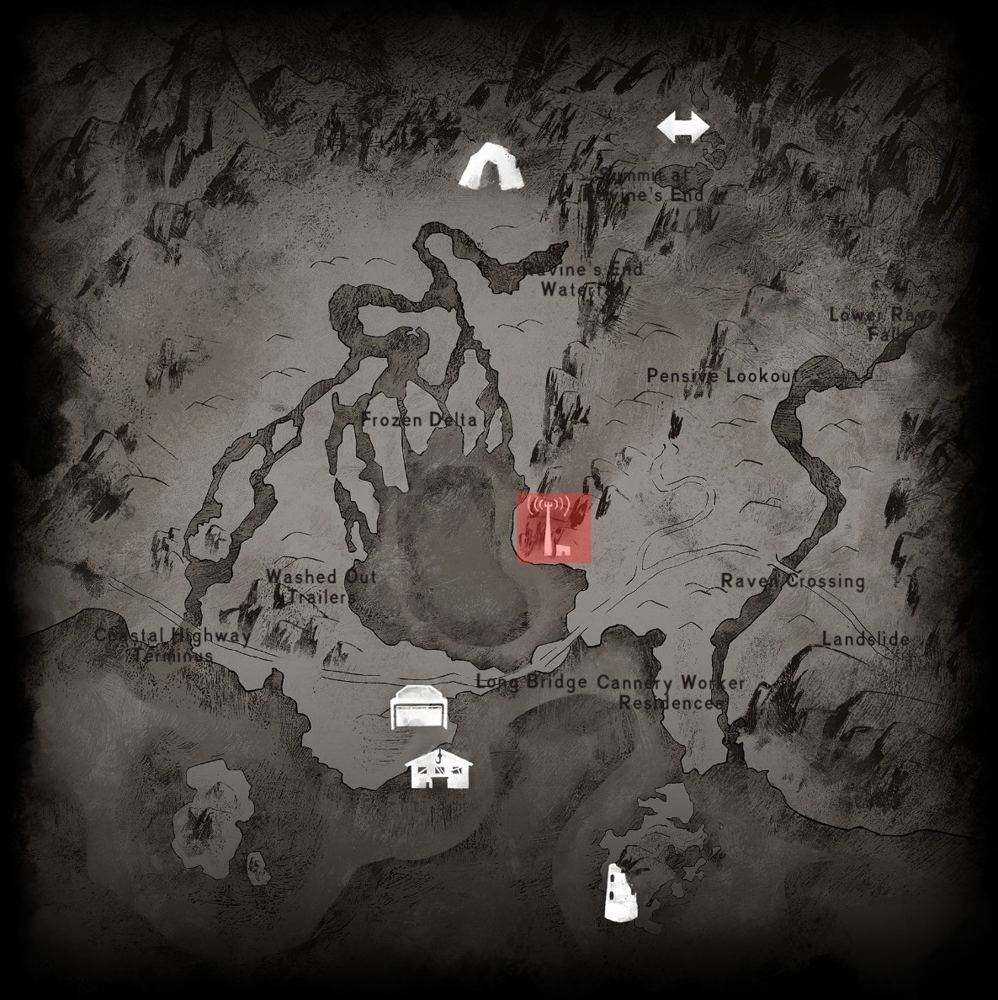

# Echo One Radio Tower

**Categories:** Indoor locations, Industrial locations, Locations, Locations in Bleak Inlet, Military/Sporting locations · **Source:** [Fandom](https://thelongdark.fandom.com/wiki/Echo_One_Radio_Tower)

**Contents**

- [Overview](#overview)
- [Safehouse](#safehouse)
- [Access](#access)
- [Code](#code)

**Echo One Radio Tower**

_Screen\_fb3efe93-48fa-4cfb-9acc-e75dadcb821b\_hi.jpg_

**Location**

_Echo\_One\_Radio\_Tower\_Location.png_

**Region:** [Bleak Inlet](./Bleak%20Inlet.md)

**Description:** A radio hut and tower

**General**

**Type:** IndustrialMilitary/Sporting

_bed\_icon.png_
