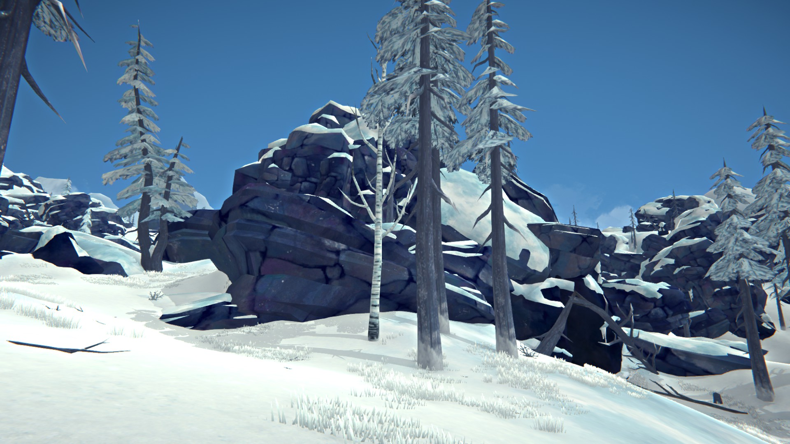
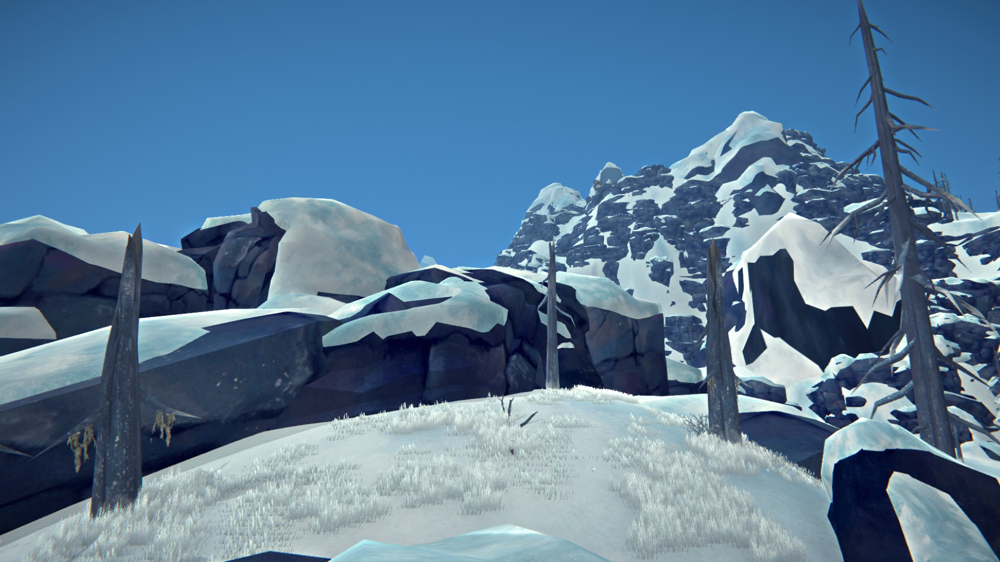
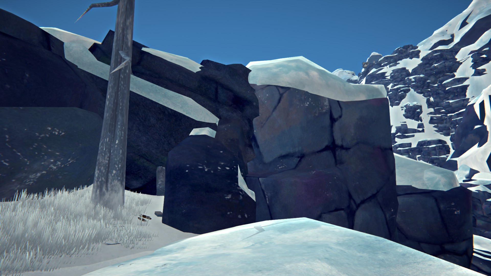
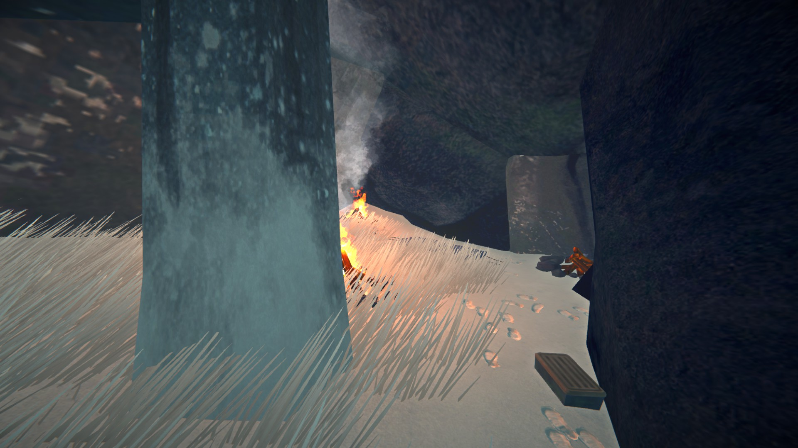
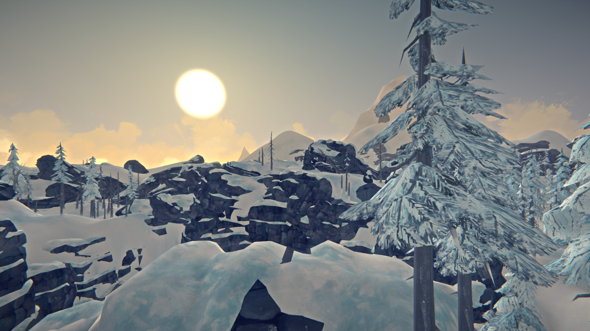

# Echo Peak East

**Categories:** Locations, Locations in Timberwolf Mountain, Outdoor locations · **Source:** [Fandom](https://thelongdark.fandom.com/wiki/Echo_Peak_East)

**Echo Peak East**

| Property | Details |
| --- | --- |
|  | [Echo peak east](../assets/Echo_peak_east.jpg) |
| **Location** |  |
|  | [Echo Peak East Location](../assets/Echo_Peak_East_Location.png) |
| Region | [Timberwolf Mountain](./Timberwolf%20Mountain.md) |
| Location | Above [Echo Ravine](./Echo%20Ravine.md) |
| **General** |  |
| Type | Outdoors |
|  | Has no shelter |

**Echo Peak East** is a location (for some reason West of) [Echo Peak West](./Echo%20Peak%20West.md) on [Timberwolf Mountain](./Timberwolf%20Mountain.md).

## Overview

The peak lies near its western counterpart. At the top of the peak is some [Old Man's Beard Lichen](./Old%20Man%27s%20Beard%20Lichen.md), and a nice view of the [Echo Ravine](./Echo%20Ravine.md). At the bottom of the peak is a [bear](./Bear.md) cave.

The plastic container in the shallow cave at the top may contain a polaroid.

## Gallery

_A view of [Timberwolf Mountain](./Timberwolf%20Mountain.md) with Echo Peak East in the foreground, as seen from [Echo Peak West](./Echo%20Peak%20West.md)._

