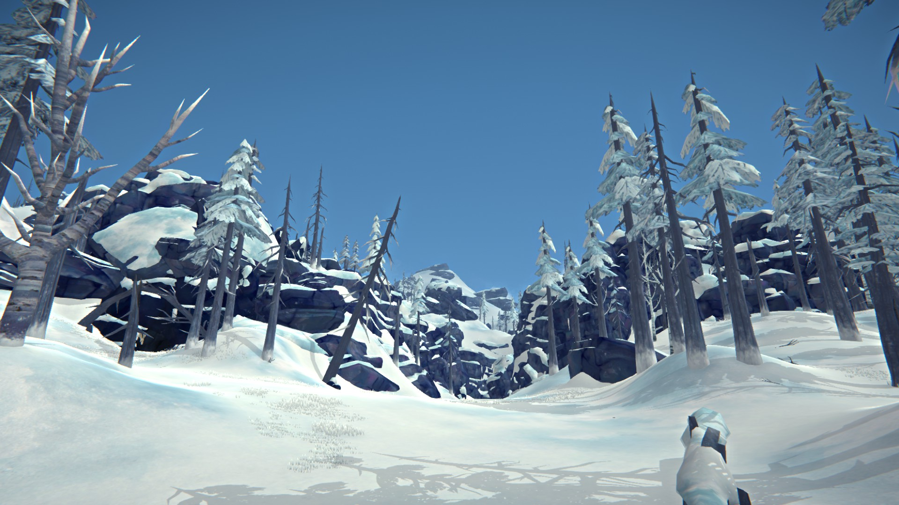
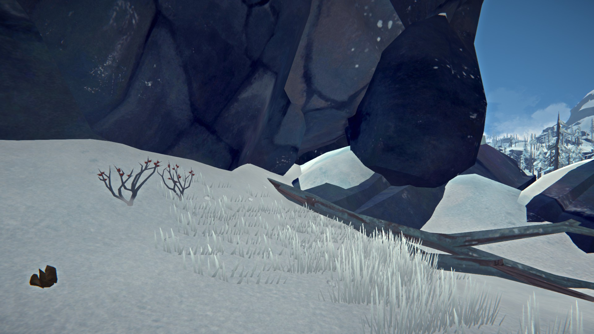
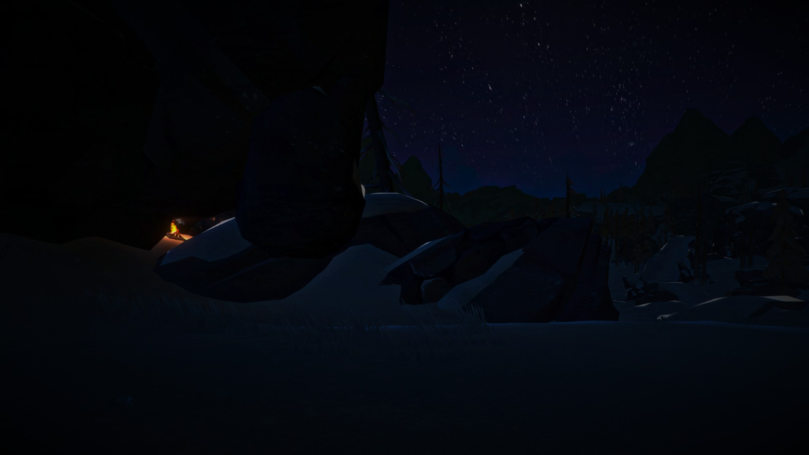

# Echo Peak West

**Categories:** Locations, Locations in Timberwolf Mountain, Outdoor locations · **Source:** [Fandom](https://thelongdark.fandom.com/wiki/Echo_Peak_West)

**Echo Peak West**

| Property | Details |
| --- | --- |
|  | [Echo Peak West](../assets/Echo_Peak_West.jpg) |
| **Location** |  |
|  | [Echo Peak West Location](../assets/Echo_Peak_West_Location.png) |
| Region | [Timberwolf Mountain](./Timberwolf%20Mountain.md)\|- |
| Type | Outdoors\|- |

## Overview

Echo Peak West is located several hundred meters above [Echo Ravine](./Echo%20Ravine.md) and near the [Wing](./Wing.md).

Several [Rose Hip](./Rose%20Hip.md) bushes can be found and sometimes a [frozen Corpse](./Frozen%20Corpse.md). There is a small alcove which provides adequate wind protection, but no bonus warmth. On occasion, a [Revolver](./Revolver.md) may spawn next to the corpse.

## Gallery

![Whole of EchoPeakWest (A view from the [Wing].)](../assets/Echo_Peak_West_03.jpg)

_[Timberwolf Mountain](./Timberwolf%20Mountain.md) with [Echo Peak East](./Echo%20Peak%20East.md) in the foreground, as seen from Echo Peak West_
