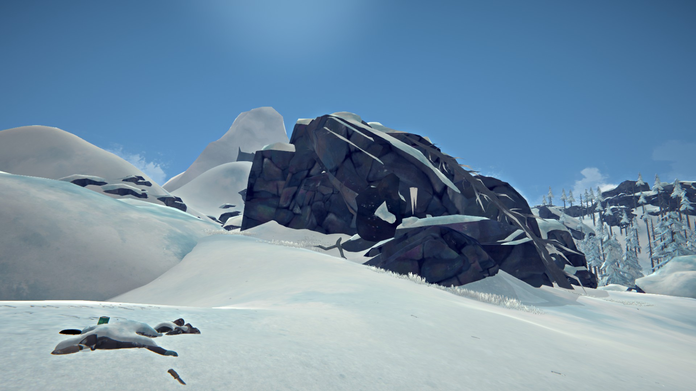
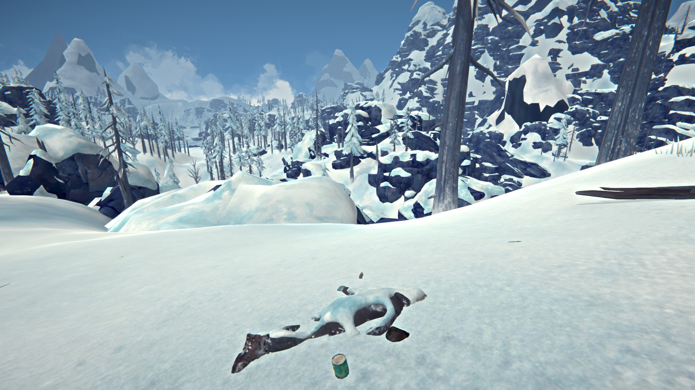
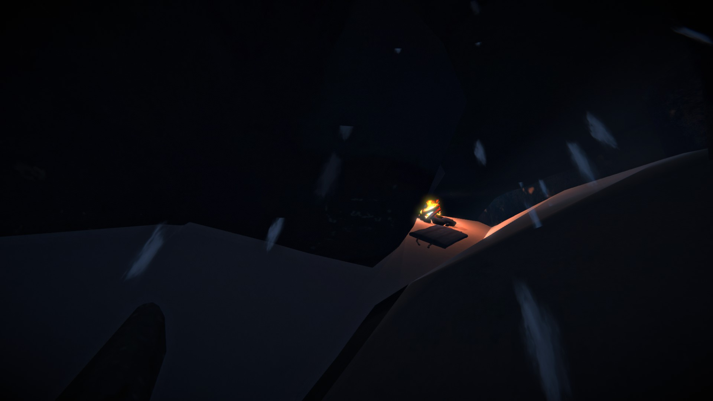
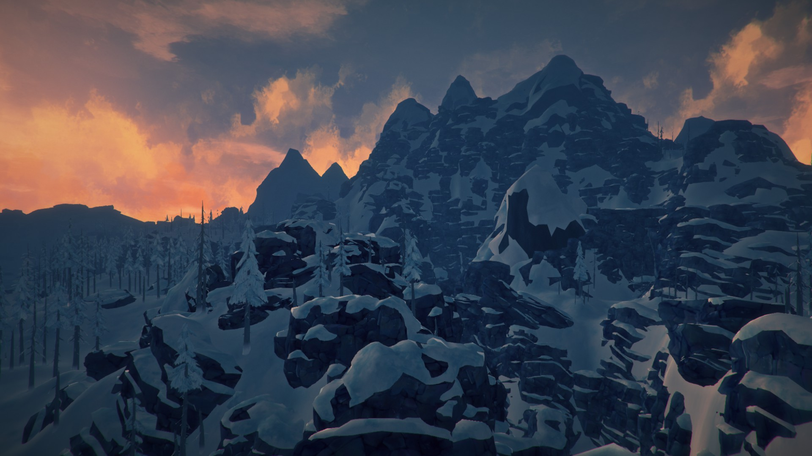

# Echo Peak West

**Categories:** Locations, Locations in Timberwolf Mountain, Outdoor locations · **Source:** [Fandom](https://thelongdark.fandom.com/wiki/Echo_Peak_West)

**Echo Peak West**

_echo\_peak\_west.jpg_

**Location**

_Echo\_Peak\_West\_Location.png_

**Region:** [Timberwolf Mountain](./Timberwolf%20Mountain.md)

**Type:** Outdoors

## Overview

Echo Peak West is located several hundred meters above [Echo Ravine](./Echo%20Ravine.md) and near the [Wing](./Wing.md).

Several [Rose Hip](./Rose%20Hip.md) bushes can be found and sometimes a [frozen Corpse](./Frozen%20Corpse.md). There is a small alcove which provides adequate wind protection, but no bonus warmth. On occasion, a [Revolver](./Revolver.md) may spawn next to the corpse.

## Gallery

_Top of Echo Peak West_

_Path from the lake to the Echo Ravine. The left side is EchoPeakEast and the right side is EchoPeakWest._

_Shallow cave at the top._

![Whole of EchoPeakWest (A view from the \[Wing\].)](../assets/Echo_Peak_West_03.jpg)

_Whole of EchoPeakWest (A view from the \[Wing\].)_

_View of Echo Peak East from Echo Peak West_

_Echo\_Peak\_West.jpg_

_A nighttime view of the peak, with the small alcove in the background_

_Echo\_Peak\_West\_02c.jpg_

_[Timberwolf Mountain](./Timberwolf%20Mountain.md) with [Echo Peak East](./Echo%20Peak%20East.md) in the foreground, as seen from Echo Peak West_
