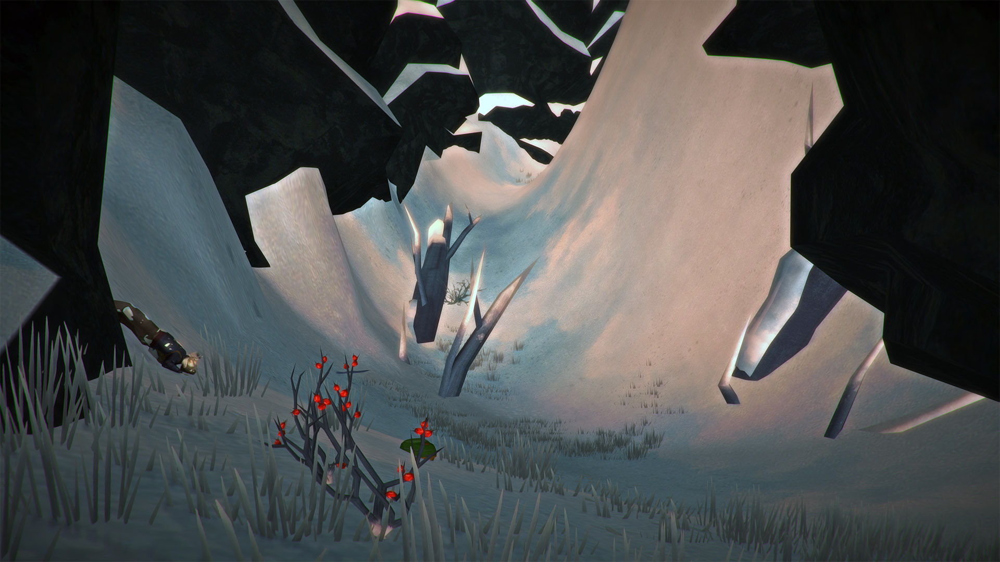
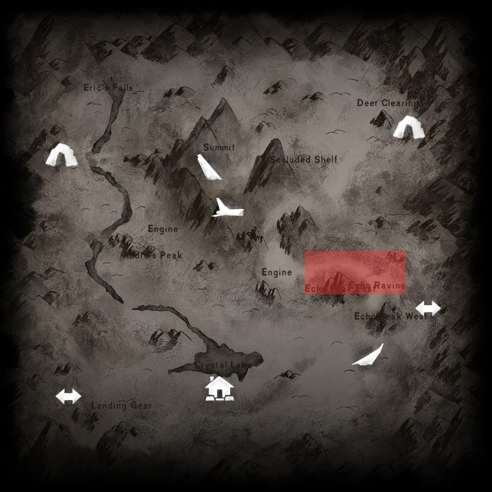

# Echo Ravine

**Echo Ravine**

| Property | Details |
| --- | --- |
|  |  / *Echo\_Ravine.jpg* |
| **Location** |  |
|  |  / *Echo\_Ravine\_Location.png* |
| Region | [Timberwolf Mountain](./Timberwolf%20Mountain.md)\|- |
| **General** |  |
| Type | Outdoors\|- |
