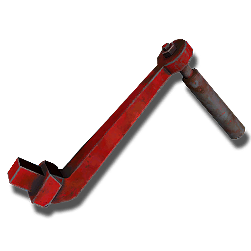

# Elevator Crank

<table class="infobox">
<caption>Elevator Crank</caption>
<colgroup>
<col style="width: 50%" />
<col style="width: 50%" />
</colgroup>
<tbody>
<tr>
<td colspan="2"><figure>

<figcaption>Elevator_Crank_icon.png</figcaption>
</figure></td>
</tr>
<tr>
<td>
Release
</td>
<td>
<a href="./The%20Long%20Dark%20%E2%80%94%20Changelog.md#1.95" class="wikilink" title="6 October 2021">6 October 2021</a>
</td>
</tr>
<tr>
<td>
Wintermute
</td>
<td>
<a href="./Episode%204%20-%20Fury%2C%20Then%20Silence.md" class="wikilink" title="Episode 4">Episode 4</a> - <a href="./The%20Detonators.md" class="wikilink" title="The Detonators">The Detonators</a>
</td>
</tr>
<tr>
<td colspan="2" class="section">
<strong>Properties</strong>
</td>
</tr>
<tr>
<td>
Item type
</td>
<td>
<a href="./Collectibles.md" class="wikilink" title="Collectibles">Collectibles</a>|-
</td>
</tr>
<tr>
<td>
Stackable
</td>
<td>
No
</td>
</tr>
<tr>
<td>
Examine
</td>
<td>
An attachment for manually raising and lowering the mine elevator.
</td>
</tr>
<tr>
<td colspan="2" class="section">
<strong>Values</strong>
</td>
</tr>
<tr>
<td>
Weight
</td>
<td>
0.00 / 1.00 kg (0 lbs)
</td>
</tr>
<tr>
<td colspan="2" class="section">
<strong>Actions</strong>
</td>
</tr>
<tr>
<td>
Backpack
</td>
<td>
Examine
</td>
</tr>
<tr>
<td>
On ground
</td>
<td>
Take It, Leave It
</td>
</tr>
<tr>
<td colspan="2" class="section">
<strong>Advanced data</strong>
</td>
</tr>
<tr>
<td>
Item key
</td>
<td>
STORY_ElevatorCrank
</td>
</tr>
</tbody>
</table>

**Elevator Crank** is a <a href="./Collectibles.md" class="wikilink" title="Collectible">Collectible</a> item found in <a href="./Episode%204%20-%20Fury%2C%20Then%20Silence.md" class="wikilink" title="Episode 4: Fury, Then Silence">Episode 4: Fury, Then Silence</a> of <a href="./Wintermute.md" class="wikilink" title="Wintermute">Wintermute</a> during the mission <a href="./The%20Detonators.md" class="wikilink" title="The Detonators">The Detonators</a>. During the course of the mission, <a href="./Will%20Mackenzie.md" class="wikilink" title="Will Mackenzie">Will Mackenzie</a> journeys to the <a href="./Last%20Prospect.md" class="wikilink" title="Last Prospect">Last Prospect</a> mine and uses the Elevator Crank to access the lower levels of the mine in pursuit of the <a href="./Detonators.md" class="wikilink" title="Detonators">Detonators</a>.

## Survival Mode

|  |  |  |
|----|----|----|
| “ | Crank used to move an elevator | ” |

An Elevator Crank can also be found in Survival Mode near the elevator of the <a href="./Last%20Prospect.md" class="wikilink" title="Last Prospect">Last Prospect</a> mine in the <a href="./Blackrock.md" class="wikilink" title="Blackrock">Blackrock</a> region.

It is now classified as a Tool, the description is different from Episode 4's, and it now weighs 1.00 Kg.

It is used for traversing the Abandoned Last Prospect Mine to fully explore it's interior, much like in Wintermute.

## Update history

- UPDATE **7 December 2021 (<a href="./The%20Long%20Dark%20%E2%80%94%20Changelog.md#1.98" class="wikilink" title="Update">Update</a>):**
  - Added to Survival Mode.
- UPDATE **6 October 2021 (<a href="./The%20Long%20Dark%20%E2%80%94%20Changelog.md#1.95" class="wikilink" title="Update">Update</a>):**
  - Added to game.

**Lua execution error in Module:Navbox function navboxLua execution error in Module:Navbox function navbox**

<a href="ru:%D0%A0%D1%8B%D1%87%D0%B0%D0%B3_%D0%BF%D0%BE%D0%B4%D1%8A%D0%B5%D0%BC%D0%BD%D0%B8%D0%BA%D0%B0" class="wikilink" title="ru:Рычаг подъемника">ru:Рычаг подъемника</a>

