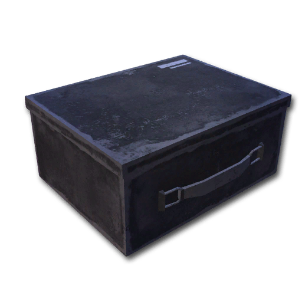

# Emergency Food

**Categories:** Story items, Tools, Wintermute · **Source:** [Fandom](https://thelongdark.fandom.com/wiki/Emergency_Food)

_2120907963\_TLD-Wintermute-v2.png.de8a285930f6a8f5ad9cf5878754cf5b.png_

**Wintermute-Exclusive content.** / This content only appears in [Wintermute](./Wintermute.md).

_Emergency\_Food\_icon.png_

**General**

**Item Type:** Tool\|-

**Weight:** 5.00 kg(11 lbs)

> “**Hardy stuff in an emergency, but not a fancy meal.**”
>
> — In-game Description

> “**Water, energy bars, purification tablets. Breakfast of champions.**”
>
> — Mackenzie's Description
