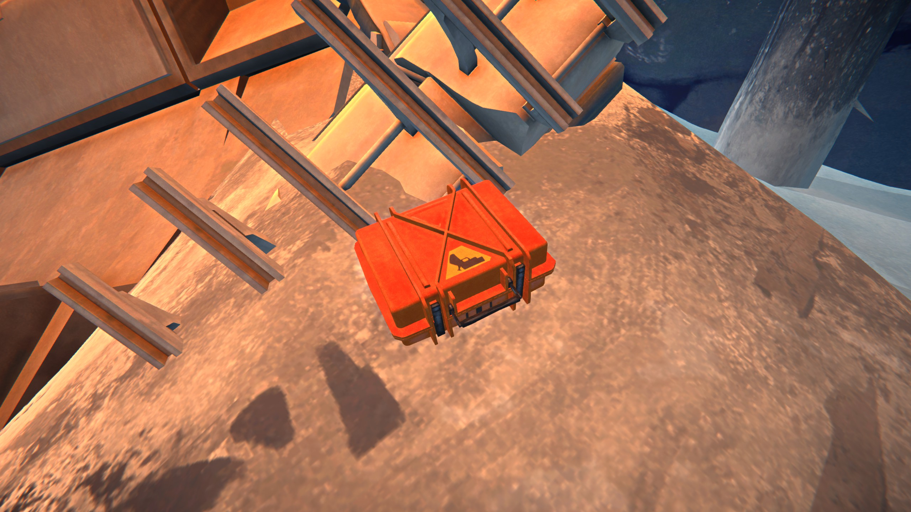
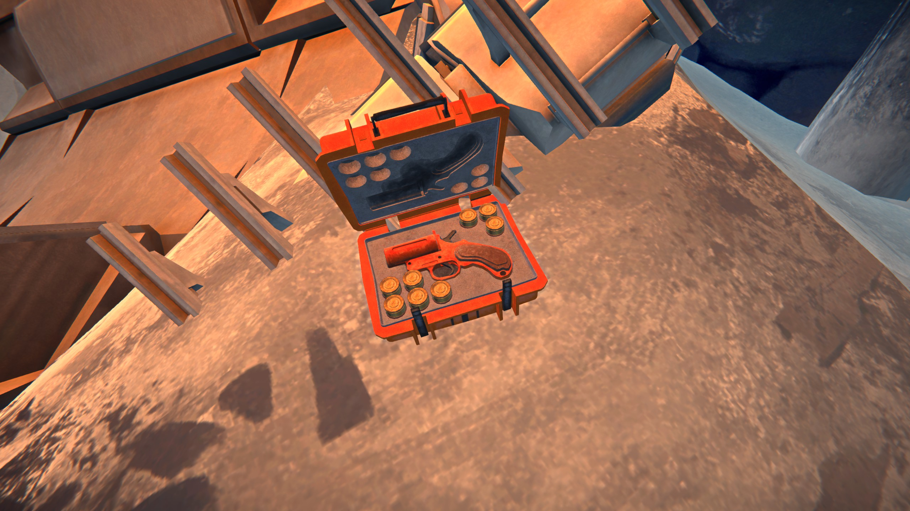

# Emergency Kit

**Categories:** Interactable Objects, Story items · **Source:** [Fandom](https://thelongdark.fandom.com/wiki/Emergency_Kit)

**Contents**

- [Overview](#overview)
- [Survival Mode Locations](#survival-mode-locations)
- [Ash Canyon](#ash-canyon)
- [Bleak Inlet](#bleak-inlet)
- [Coastal Highway](#coastal-highway)
- [Keeper's Pass North](#keeper-s-pass-north)
- [Mountain Town](#mountain-town)
- [Mystery Lake (region)](#mystery-lake-region)
- [Pleasant Valley](#pleasant-valley)
- [Timberwolf Mountain](#timberwolf-mountain)
- [Zone of Contamination](#zone-of-contamination)
- [Prepper Cache](#prepper-cache)
- [Wintermute Locations](#wintermute-locations)
- [Episode 1: Do Not Go Gentle](#episode-1-do-not-go-gentle)
- [Episode 2: Luminance Fugue](#episode-2-luminance-fugue)
- [Episode 3: Crossroads Elegy](#episode-3-crossroads-elegy)
- [Episode 4: Fury, Then Silence](#episode-4-fury-then-silence)

**Emergency Kit**

**General**

Item Type

Item

Wintermute

Yes

_For the Distress Pistol Kit in Wintermute, see [Distress Pistol Kit](./Distress%20Pistol%20Kit.md)._

An **Emergency Kit** is a stationary object found occasionally in the game world. It is an interactable storage device, containing a [Distress Pistol](./Distress%20Pistol.md) and [Flare Shells](./Flare%20Shell.md).

## Overview

On lower difficulties, this kit can contain a maximum of:

- 1 [Distress Pistol](./Distress%20Pistol.md)
- 8 [Flare Shell](./Flare%20Shell.md)

On higher difficulties (such as [Stalker](./Stalker.md)), the kit is often partially stocked or almost entirely empty, either containing just Flare Shells or just the Distress Pistol.

While this kit cannot be carried like the [Distress Pistol Kit](./Distress%20Pistol%20Kit.md), Flare Shells/a Pistol can be placed inside for storage.

## Survival Mode Locations

Some of these locations do not spawn a kit on [Interloper](./Interloper.md) or [Misery](./Misery.md).

### [Ash Canyon](./Ash%20Canyon.md)

- On the hidden cliff south of [Angler's Den](./Angler%27s%20Den.md) (must be reached via a one way drop near [High Meadow](./High%20Meadow.md) and [Climber's Cave](./Climber%27s%20Cave.md)) (N/A on Interloper)

### [Bleak Inlet](./Bleak%20Inlet.md)

- [Pensive Lookout](./Pensive%20Lookout.md) (N/A on Interloper)
- [Last Resort Cannery](./Last%20Resort%20Cannery.md) kitchen near the trawler (found on all difficulties)

### [Coastal Highway](./Coastal%20Highway.md)

- [Abandoned Lookout](./Abandoned%20Lookout.md) (N/A on Interloper)
- [Fishing Camp](./Fishing%20Camp.md), western most [Fishing Hut](./Fishing%20Hut.md) (N/A on Interloper)

### [Keeper's Pass North](./Keeper%27s%20Pass%20North.md)

- Below [Builder's Bridge](./Builder%27s%20Bridge.md). Take the rope climb down to the river and it is in a small cave. (found on all difficulties)

### [Mountain Town](./Mountain%20Town.md)

- [Mackenzie's Crashed Plane](./Mackenzie%27s%20Crashed%20Plane.md) (N/A on Interloper)
- In the [Warm Cave](./Warm%20Cave.md) in between rope climbs between the Transition Cave leading to Mystery Lake and the rope climb leading to [Milton Park](./Milton%20Park.md). (N/A on Interloper)

### [Mystery Lake (region)](./Mystery%20Lake%20%28region%29.md)

- [Forestry Lookout](./Forestry%20Lookout.md) (N/A on Interloper)

### [Pleasant Valley](./Pleasant%20Valley.md)

- [Signal Hill](./Signal%20Hill.md) (N/A on Interloper)
- [Pleasant Valley Farmstead](./Pleasant%20Valley%20Farmstead.md) Basement (N/A on Interloper)
- [Crash Site (Pleasant Valley)](./Crash%20Site%20%28Pleasant%20Valley%29.md) near tail section of the destroyed plane (N/A on Interloper)
- [Pleasant Valley Outbuildings](./Pleasant%20Valley%20Outbuildings.md), big barn next to [Work Bench](./Work%20Bench.md) (found on all difficulties)

### [Timberwolf Mountain](./Timberwolf%20Mountain.md)

- Back of the [Tail Section](./Tail%20Section.md) (found on all difficulties)

### [Zone of Contamination](./Zone%20of%20Contamination.md)

- In the scaffold room of [Forgotten Exploration](./Forgotten%20Exploration.md)

### [Prepper Cache](./Prepper%20Cache.md)

- Can spawn in the Stockpile Prepper Cache (N/A on Interloper)

## Wintermute Locations

### [Episode 1: Do Not Go Gentle](./Episode%201%20-%20Do%20Not%20Go%20Gentle.md)

- Only spawns if the player added the [Distress Pistol Kit](./Distress%20Pistol%20Kit.md) to the plane before leaving in [Memories](./Memories.md). Will be found at [Mackenzie's Crashed Plane](./Mackenzie%27s%20Crashed%20Plane.md) near the plane wing ramp. Will always spawn 1 Distress Pistol and 4 Flare Shells.

### [Episode 2: Luminance Fugue](./Episode%202%20-%20Luminance%20Fugue.md)

- In the bathroom of [Carter Hydro Dam](./Carter%20Hydro%20Dam.md)

### [Episode 3: Crossroads Elegy](./Episode%203%20-%20Crossroads%20Elegy.md)

- [Crash Site (Pleasant Valley)](./Crash%20Site%20%28Pleasant%20Valley%29.md), behind the middle section of the destroyed plane during [Fallen Star](./Fallen%20Star.md)
- [Community Hall](./Community%20Hall.md) entrance during [Coming Storm](./Coming%20Storm.md)
- [Pleasant Valley Outbuildings](./Pleasant%20Valley%20Outbuildings.md), big barn next to [Work Bench](./Work%20Bench.md)

### [Episode 4: Fury, Then Silence](./Episode%204%20-%20Fury%2C%20Then%20Silence.md)

- N/A
