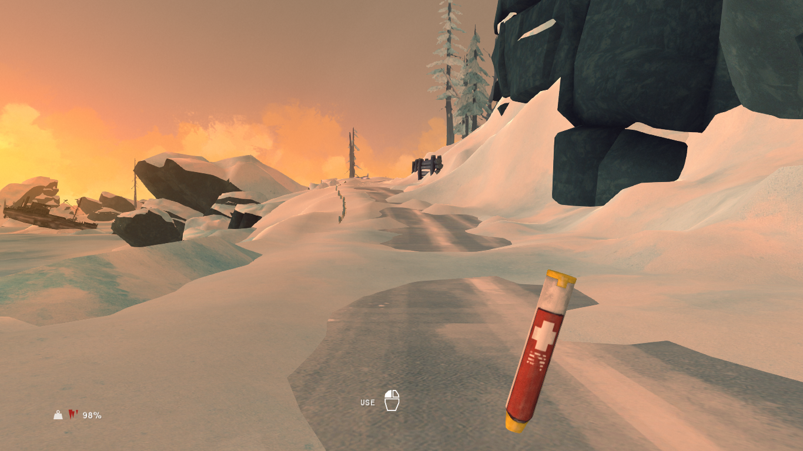

# Emergency Stim

**Contents**

- [Overview](#Overview)
- [Uses](#Uses)
- [Spawn Locations](#Spawn_Locations)
- [Guaranteed](#Guaranteed)
- [Possible Spawns](#Possible_Spawns)
- [Gallery](#Gallery)
- [Trivia](#Trivia)
- [Update history](#Update_history)

<table class="infobox">
<caption>Emergency Stim</caption>
<colgroup>
<col style="width: 50%" />
<col style="width: 50%" />
</colgroup>
<tbody>
<tr>
<td colspan="2"><figure>

<figcaption>Emergency_Stim_icon.png</figcaption>
</figure></td>
</tr>
<tr>
<td>
Release
</td>
<td>
<a href="./The%20Long%20Dark%20%E2%80%94%20Changelog.md#0.321" class="wikilink" title="21 April 2016">21 April 2016</a>
</td>
</tr>
<tr>
<td>
Wintermute
</td>
<td>
No
</td>
</tr>
<tr>
<td>
Renewable
</td>
<td>
Yes ( <a href="./Trader.md" class="wikilink" title="Trader">Trader</a> and rare <a href="./Beachcombing.md" class="wikilink" title="Beachcombing">Beachcombing</a>) No (<a href="./Interloper.md" class="wikilink" title="Interloper">Interloper</a>)
</td>
</tr>
<tr>
<td colspan="2" class="section">
<strong>Properties</strong>
</td>
</tr>
<tr>
<td>
Item type
</td>
<td>
<a href="./First%20Aid.md" class="wikilink" title="First Aid">First Aid</a>|-
</td>
</tr>
<tr>
<td>
Stackable
</td>
<td>
No
</td>
</tr>
<tr>
<td>
Examine
</td>
<td>
Emergency steroid injection. Will provide a short-burst of energy. Then you'll collapse from exhaustion. Use as last resort!
</td>
</tr>
<tr>
<td colspan="2" class="section">
<strong>Values</strong>
</td>
</tr>
<tr>
<td>
Weight
</td>
<td>
0.10 kg (0.22 lbs)
</td>
</tr>
</tbody>
</table>

**Emergency Stim** is a <a href="./First%20Aid.md" class="wikilink" title="First Aid">First Aid</a> item in *The Long Dark*. Upon use, it will restore some of the survivor's <a href="./Condition.md" class="wikilink" title="Condition">Condition</a> and grant them unlimited energy for sprinting and rope climbing for one minute.

## Overview

Emergency Stims are rare, powerful, and single-use only. When used, the Emergency Stim will:

- Instantly restore 15% Condition.
- Fully restore <a href="./Fatigue.md" class="wikilink" title="Fatigue">Fatigue</a> for 60 real-time seconds.
- Grant unlimited <a href="./Stamina.md" class="wikilink" title="Stamina">Stamina</a> (e.g. for Sprinting/Robe Climbing) for 60 seconds.
- Allow Sprinting, even if the survivor has <a href="./Afflictions.md" class="wikilink" title="Afflictions">Afflictions</a> which would normally prevent it (see below).
- Allow climbing up/down deployed <a href="./Mountaineering%20Rope.md" class="wikilink" title="Mountaineering Ropes">Mountaineering Ropes</a>, even if the survivor has <a href="./Afflictions.md" class="wikilink" title="Afflictions">Afflictions</a> which would normally prevent it (see below).
- Inflict <a href="./Afflictions.md" class="wikilink" title="Exhausted">Exhausted</a> after 60 seconds (drops the survivor's <a href="./Fatigue.md" class="wikilink" title="Fatigue">Fatigue</a> to 0%).

Note: Afflictions such as <a href="./Broken%20Ribs.md" class="wikilink" title="Broken Ribs">Broken Ribs</a> (which prevents climbing) and <a href="./Sprained%20Ankle.md" class="wikilink" title="Sprained Ankles">Sprained Ankles</a> (which prevents sprinting) are ignored while under the effects of the Emergency Stim; however, the survivor cannot use climbing ropes if <a href="./Encumbrance.md" class="wikilink" title="encumbered">encumbered</a>, nor sprint if they are carrying 10 kg (22 lbs) or more over their maximum carry weight, even while under the effects of an emergency stim.

## Uses

- Instantly restoring 15% condition.
- Sprinting long distances regardless of injuries.
- Outrunning <a href="./Wildlife.md" class="wikilink" title="wildlife">wildlife</a>.
- Climbing ropes faster, regardless of injuries or Fatigue.
- Draining <a href="./Fatigue.md" class="wikilink" title="Fatigue">Fatigue</a> to 0% can be useful to more quickly recover from afflictions that require sleep, such as <a href="./Food%20Poisoning.md" class="wikilink" title="Food Poisoning">Food Poisoning</a>.

## Spawn Locations

Emergency Stims may be found rarely in most regions (8-10 across an entire world on <a href="./Survival%20Mode.md" class="wikilink" title="Interloper">Interloper</a>) in high-tier loot areas, <a href="./First%20Aid%20Kit.md" class="wikilink" title="First Aid Kits">First Aid Kits</a>, beside <a href="./Frozen%20Corpse.md" class="wikilink" title="Frozen Corpses">Frozen Corpses</a>, or hidden beneath/around furniture. They can also be acquired by trading with the <a href="./Trader.md" class="wikilink" title="Trader">Trader</a>, but are only unlocked after reaching 400 <a href="./Trader.md#Trust" class="wikilink" title="Trust">Trust</a>, and not on <a href="./Interloper.md" class="wikilink" title="Interloper">Interloper</a> or <a href="./Misery.md" class="wikilink" title="Misery">Misery</a>.

### Guaranteed

- On the trek to the rope anchor above the <a href="./Gold%20Mine.md" class="wikilink" title="Gold Mine">Gold Mine</a> entrance in <a href="./Ash%20Canyon.md" class="wikilink" title="Ash Canyon">Ash Canyon</a>, one will spawn along the rock walls on the left side if approaching from <a href="./Wolf%27s%20Jaw%20Overlook.md" class="wikilink" title="Wolf&#39;s Jaw Overlook">Wolf's Jaw Overlook</a> (removed on Interloper).
- Inside of the barn at the <a href="./Pleasant%20Valley%20Outbuildings.md" class="wikilink" title="Outbuildings">Outbuildings</a> in <a href="./Pleasant%20Valley.md" class="wikilink" title="Pleasant Valley">Pleasant Valley</a>.
- Second floor of <a href="./Lonely%20Lighthouse.md" class="wikilink" title="Lonely Lighthouse">Lonely Lighthouse</a> in <a href="./Desolation%20Point.md" class="wikilink" title="Desolation Point">Desolation Point</a>.
- Multiple spawns in <a href="./Broken%20Railroad.md" class="wikilink" title="Broken Railroad">Broken Railroad</a>
  - Bottom of the ravine underneath the <a href="./Broken%20Bridge%20%28Broken%20Railroad%20location%29.md" class="wikilink" title="Broken Bridge">Broken Bridge</a>.
  - Inside the <a href="./Hunting%20Lodge.md" class="wikilink" title="Hunting Lodge">Hunting Lodge</a>.
- <a href="./Mackenzie%27s%20Crashed%20Plane.md" class="wikilink" title="Mackenzie&#39;s Crashed Plane">Mackenzie's Crashed Plane</a> in <a href="./Mountain%20Town.md" class="wikilink" title="Mountain Town">Mountain Town</a>. (ver. 2.52 currently bugged under snow and only accessible using campfire trick)
- The <a href="./Summit.md" class="wikilink" title="summit">summit</a> of <a href="./Timberwolf%20Mountain.md" class="wikilink" title="Timberwolf Mountain">Timberwolf Mountain</a>.
- <a href="./Cinder%20Hills%20Coal%20Mine.md" class="wikilink" title="Cinder Hills Coal Mine">Cinder Hills Coal Mine</a> between <a href="./Coastal%20Highway.md" class="wikilink" title="Coastal Highway">Coastal Highway</a> and <a href="./Pleasant%20Valley.md" class="wikilink" title="Pleasant Valley">Pleasant Valley</a>.
- The train cart at the bottom of <a href="./The%20Ravine.md" class="wikilink" title="The Ravine">The Ravine</a>.
- <a href="./Marsh%20Ridge.md" class="wikilink" title="Marsh Ridge">Marsh Ridge</a> cave in <a href="./Forlorn%20Muskeg.md" class="wikilink" title="Forlorn Muskeg">Forlorn Muskeg</a>.

### Possible Spawns

- Inside the <a href="./Old%20Substation.md" class="wikilink" title="Old Substation">Old Substation</a> either on the ground or on the desk
- In a wooden crate in the <a href="./Maintenance%20Yard.md" class="wikilink" title="Maintenance Yard">Maintenance Yard</a>.
- A hunting blind in <a href="./Mystery%20Lake%20%28region%29.md" class="wikilink" title="Mystery Lake">Mystery Lake</a>.
- Below a workbench next to the entrance of <a href="./Carter%20Hydro%20Dam.md" class="wikilink" title="Carter Hydro Dam">Carter Hydro Dam</a>.
- Inside Cellblock C of <a href="./Blackrock%20Prison.md" class="wikilink" title="Blackrock Prison">Blackrock Prison</a> inside the room with red chairs, beneath the table the chairs are around

## Gallery

<table class="gallery">
<colgroup>
<col style="width: 33%" />
<col style="width: 33%" />
<col style="width: 33%" />
</colgroup>
<tbody>
<tr>
<td><figure>
[Missing image: Emergency_stim_equipped.jpg]
<figcaption>An emergency stim when equipped</figcaption>
</figure></td>
<td><figure>

<figcaption>An emergency stim when equipped (old version)</figcaption>
</figure></td>
<td><figure>
[Missing image: Tld-int-rav-stim.jpg]
<figcaption>Stim location inside the train wagon in lower section of Ravine, on Interloper/ Misery difficulty. One of the few guaranteed outdoor stims available.</figcaption>
</figure></td>
</tr>
</tbody>
</table>

## Trivia

- Emergency Stims in The Long Dark are "autoinjectors", a real-world medical device: usually a single use, disposable, spring-loaded syringe injector used to quickly self-administer a specific drug.
- The Long Dark's animation for an emergency stim is realistic: appearing to depict the autoinjector being pressed to the survivor's thigh.
- Given their gameplay effects and description, emergency stims in The Long Dark are likely loaded with hydrocortisone.
- While under the effects of a Emergency Stim, the player is able to fully sprint in any direction, including backwards.

## Update history

- UPDATE **21 April 2016 (<a href="./The%20Long%20Dark%20%E2%80%94%20Early%20Access%20Changelog.md#0.321" class="wikilink" title="Update">Update</a>):**
  - Added to game.

**Lua execution error in Module:Navbox function navbox** <a href="ru:%D0%A8%D0%BF%D1%80%D0%B8%D1%86_%D0%BF%D0%B5%D1%80%D0%B2%D0%BE%D0%B9_%D0%BF%D0%BE%D0%BC%D0%BE%D1%89%D0%B8" class="wikilink" title="ru:Шприц первой помощи">ru:Шприц первой помощи</a>

