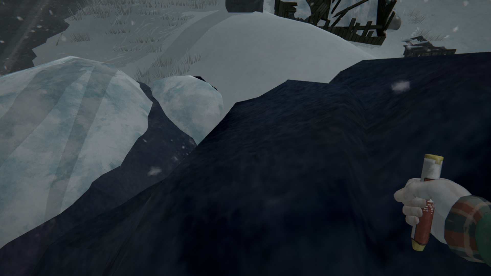
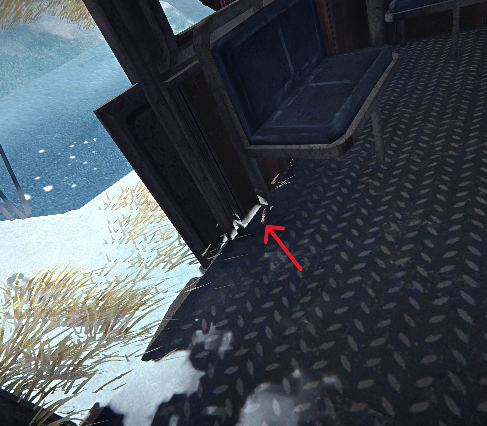

# Emergency Stim

**Categories:** First Aid, Pages with update history · **Source:** [Fandom](https://thelongdark.fandom.com/wiki/Emergency_Stim)

**Contents**

- [Overview](#overview)
- [Uses](#uses)
- [Spawn Locations](#spawn-locations)
- [Guaranteed](#guaranteed)
- [Possible Spawns](#possible-spawns)
- [Gallery](#gallery)
- [Trivia](#trivia)
- [Update history](#update-history)

**Emergency Stim**

**Release:** [21 April 2016](./The%20Long%20Dark%20%E2%80%94%20Changelog.md#0.321)

**Wintermute:** No

**Renewable:** Yes ( [Trader](./Trader.md) and rare [Beachcombing](./Beachcombing.md)) No ([Interloper](./Interloper.md))

**Properties**

**Item type:** [First Aid](./First%20Aid.md)

**Stackable:** No

**Examine:** Emergency steroid injection. Will provide a short-burst of energy. Then you'll collapse from exhaustion. Use as last resort!

**Values**

**Weight:** 0.10 kg (0.22 lbs)

**Emergency Stim** is a [First Aid](./First%20Aid.md) item in _The Long Dark_. Upon use, it will restore some of the survivor's [Condition](./Condition.md) and grant them unlimited energy for sprinting and rope climbing for one minute.

## Overview

Emergency Stims are rare, powerful, and single-use only. When used, the Emergency Stim will:

- Instantly restore 15% Condition.
- Fully restore [Fatigue](./Fatigue.md) for 60 real-time seconds.
- Grant unlimited [Stamina](./Stamina.md) (e.g. for Sprinting/Robe Climbing) for 60 seconds.
- Allow Sprinting, even if the survivor has [Afflictions](./Afflictions.md) which would normally prevent it (see below).
- Allow climbing up/down deployed [Mountaineering Ropes](./Mountaineering%20Rope.md), even if the survivor has [Afflictions](./Afflictions.md) which would normally prevent it (see below).
- Inflict [Exhausted](./Afflictions.md) after 60 seconds (drops the survivor's [Fatigue](./Fatigue.md) to 0%).

Note: Afflictions such as [Broken Ribs](./Broken%20Ribs.md) (which prevents climbing) and [Sprained Ankles](./Sprained%20Ankle.md) (which prevents sprinting) are ignored while under the effects of the Emergency Stim; however, the survivor cannot use climbing ropes if [encumbered](./Encumbrance.md), nor sprint if they are carrying 10 kg (22 lbs) or more over their maximum carry weight, even while under the effects of an emergency stim.

## Uses

- Instantly restoring 15% condition.
- Sprinting long distances regardless of injuries.
- Outrunning [wildlife](./Wildlife.md).
- Climbing ropes faster, regardless of injuries or Fatigue.
- Draining [Fatigue](./Fatigue.md) to 0% can be useful to more quickly recover from afflictions that require sleep, such as [Food Poisoning](./Food%20Poisoning.md).

## Spawn Locations

Emergency Stims may be found rarely in most regions (8-10 across an entire world on [Interloper](./Survival%20Mode.md)) in high-tier loot areas, [First Aid Kits](./First%20Aid%20Kit.md), beside [Frozen Corpses](./Frozen%20Corpse.md), or hidden beneath/around furniture. They can also be acquired by trading with the [Trader](./Trader.md), but are only unlocked after reaching 400 [Trust](./Trader.md#Trust), and not on [Interloper](./Interloper.md) or [Misery](./Misery.md).

### Guaranteed

- On the trek to the rope anchor above the [Gold Mine](./Gold%20Mine.md) entrance in [Ash Canyon](./Ash%20Canyon.md), one will spawn along the rock walls on the left side if approaching from [Wolf's Jaw Overlook](./Wolf%27s%20Jaw%20Overlook.md) (removed on Interloper).
- Inside of the barn at the [Outbuildings](./Pleasant%20Valley%20Outbuildings.md) in [Pleasant Valley](./Pleasant%20Valley.md).
- Second floor of [Lonely Lighthouse](./Lonely%20Lighthouse.md) in [Desolation Point](./Desolation%20Point.md).
- Multiple spawns in [Broken Railroad](./Broken%20Railroad.md)
  - Bottom of the ravine underneath the [Broken Bridge](./Broken%20Bridge%20%28Broken%20Railroad%20location%29.md).
  - Inside the [Hunting Lodge](./Hunting%20Lodge.md).
- [Mackenzie's Crashed Plane](./Mackenzie%27s%20Crashed%20Plane.md) in [Mountain Town](./Mountain%20Town.md). (ver. 2.52 currently bugged under snow and only accessible using campfire trick)
- The [summit](./Summit.md) of [Timberwolf Mountain](./Timberwolf%20Mountain.md).
- [Cinder Hills Coal Mine](./Cinder%20Hills%20Coal%20Mine.md) between [Coastal Highway](./Coastal%20Highway.md) and [Pleasant Valley](./Pleasant%20Valley.md).
- The train cart at the bottom of [The Ravine](./The%20Ravine.md).
- [Marsh Ridge](./Marsh%20Ridge.md) cave in [Forlorn Muskeg](./Forlorn%20Muskeg.md).

### Possible Spawns

- Inside the [Old Substation](./Old%20Substation.md) either on the ground or on the desk
- In a wooden crate in the [Maintenance Yard](./Maintenance%20Yard.md).
- A hunting blind in [Mystery Lake](./Mystery%20Lake%20%28region%29.md).
- Below a workbench next to the entrance of [Carter Hydro Dam](./Carter%20Hydro%20Dam.md).
- Inside Cellblock C of [Blackrock Prison](./Blackrock%20Prison.md) inside the room with red chairs, beneath the table the chairs are around

## Gallery

## Trivia

- Emergency Stims in The Long Dark are "autoinjectors", a real-world medical device: usually a single use, disposable, spring-loaded syringe injector used to quickly self-administer a specific drug.
- The Long Dark's animation for an emergency stim is realistic: appearing to depict the autoinjector being pressed to the survivor's thigh.
- Given their gameplay effects and description, emergency stims in The Long Dark are likely loaded with hydrocortisone.
- While under the effects of a Emergency Stim, the player is able to fully sprint in any direction, including backwards.

## Update history

- UPDATE **21 April 2016 ([Update](./The%20Long%20Dark%20%E2%80%94%20Early%20Access%20Changelog.md#0.321)):**
  - Added to game.
