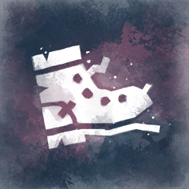

# Ends of the Earth

**Ends of the Earth**

| Property | Details |
| --- | --- |
|  |  / *Ends\_of\_the\_Earth\_icon.png* |
| Description | Travel from Desolation Point to Sundered Pass (single game). |

**Ends of the Earth** is an [achievement](./The%20Long%20Dark%20%E2%80%94%20Achievements.md) in *[The Long Dark](./The%20Long%20Dark.md)*.

## Guide

This achievement is easiest to unlock when playing on [Pilgrim](./Pilgrim.md). The player must walk from [Desolation Point](./Desolation%20Point.md) to [Sundered Pass](./Sundered%20Pass.md) in a single [Survival Mode](./Survival%20Mode.md) game. It does not matter if the player starts in either region or not, merely visiting both of these regions in one game will unlock the achievement.

## Trivia

This achievement is a pun referencing how the player has to walk from one edge of [Great Bear Island](./Great%20Bear%20Island.md) to the other, which are the two ends of the game world.**Lua execution error in Module:Navbox function navbox**
