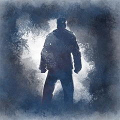

# Enemy For Life

<table class="infobox">
<caption>Enemy For Life</caption>
<colgroup>
<col style="width: 50%" />
<col style="width: 50%" />
</colgroup>
<tbody>
<tr>
<td colspan="2"><figure>

<figcaption>Enemy_For_Life_icon.png</figcaption>
</figure></td>
</tr>
<tr>
<td>
Description
</td>
<td>
Turn the tables on Mathis.
</td>
</tr>
</tbody>
</table>

**Enemy For Life** is a <a href="./Wintermute.md" class="wikilink" title="Wintermute">Wintermute</a> <a href="./The%20Long%20Dark%20%E2%80%94%20Achievements.md" class="wikilink" title="achievement">achievement</a> in <a href="./Episode%204%20-%20Fury%2C%20Then%20Silence.md" class="wikilink" title="Episode 4: Fury, then Silence">Episode 4: Fury, then Silence</a> of *<a href="./The%20Long%20Dark.md" class="wikilink" title="The Long Dark">The Long Dark</a>*.

## Guide

This is an unmissable story achievement achieved after completing the mission <a href="./The%20Detonators.md" class="wikilink" title="The Detonators">The Detonators</a>. After the <a href="./Blackrock%20Prison.md" class="wikilink" title="Blackrock Prison">Blackrock Prison</a> explodes, walk out of your jail cell and down the hallway. A cutscene will play with an enraged <a href="./Mathis.md" class="wikilink" title="Mathis">Mathis</a>, and the achievement will unlock.

## Game History

- UPDATE **6 October 2021 (<a href="./The%20Long%20Dark%20%E2%80%94%20Changelog.md#1.95" class="wikilink" title="Update">Update</a>):**
  - Added to game.

**Lua execution error in Module:Navbox function navbox**

