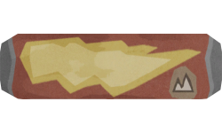

# Energy Bar

**Categories:** Food And Drink, Pages with update history · **Source:** [Fandom](https://thelongdark.fandom.com/wiki/Energy_Bar)

**Contents**

- [Overview](#overview)
- [Trivia](#trivia)
- [Gallery](#gallery)
- [Update history](#update-history)

**Energy Bar**

| Property | Details |
| --- | --- |
|  | [Energy Bar icon](../assets/Energy_Bar_icon.png) |
| Release | [22 September 2014](./The%20Long%20Dark%20%E2%80%94%20Early%20Access%20Changelog.md#0.117) |
| Wintermute | No |
| Renewable | Yes (rare [Beachcombing](./Beachcombing.md)) |
| **Properties** |  |
| Item type | [Food And Drink](./Food%20And%20Drink.md) |
| Equipable | No |
| Stackable | No |
| Examine | Energy in a bar. Chocolate, nuts, healthy stuff. |
| **Values** |  |
| Calories | 500 kcal |
| Hydration | 0% |
| [Vitamin C](./Scurvy.md) | Minor (4%) |
| Weight | 0.10 kg (0.22 lbs) |
| **Advanced data** |  |
| Item key | GAMEPLAY\_EnergyBar |

**Energy Bar** is a packaged [food](./Food%20And%20Drink.md) item in _[The Long Dark](./The%20Long%20Dark.md)_.

## Overview

Consuming an Energy bar provides up to 500 calories, and does not [dehydrate](./Thirst.md). It weighs a mere 0.10 kg, and has high energy density of 5,000 calories-per-kilogram (second only to [Salty Crackers](./Salty%20Crackers.md)). Like other packaged food and drink, the Energy Bar can be found anywhere uncommonly, most often inside of houses, shops, [Vehicles](./Vehicle.md), and on [frozen corpses](./Frozen%20Corpse.md). It is also the only food item that can be found in a [First Aid Kit](./First%20Aid%20Kit.md).

Because of its small weight, energy efficiency, and not causing dehydration (unlike the Salty Crackers), it is a valuable food source for traveling.

Energy Bars [decay](./Decay.md) very slowly, especially when outdoors.

## Trivia

- Energy Bars do not spawn on Interloper mode.
- The Energy Bar is packaged as a product called "_Zap Energy Bar"_.
- The ingredients on the back list: "Dates, Almonds, Flax Seeds, Coca Nibs, Honey, Salt, Natural Flavours."
- The energy bar bears the logo of the in-game company "ZAP." The same logo can be found on the [car battery](./Car%20Battery.md).

## Gallery

## Update history

- UPDATE **22 September 2014 ([Update](./The%20Long%20Dark%20%E2%80%94%20Early%20Access%20Changelog.md#0.117)):**
  - Added to game.
