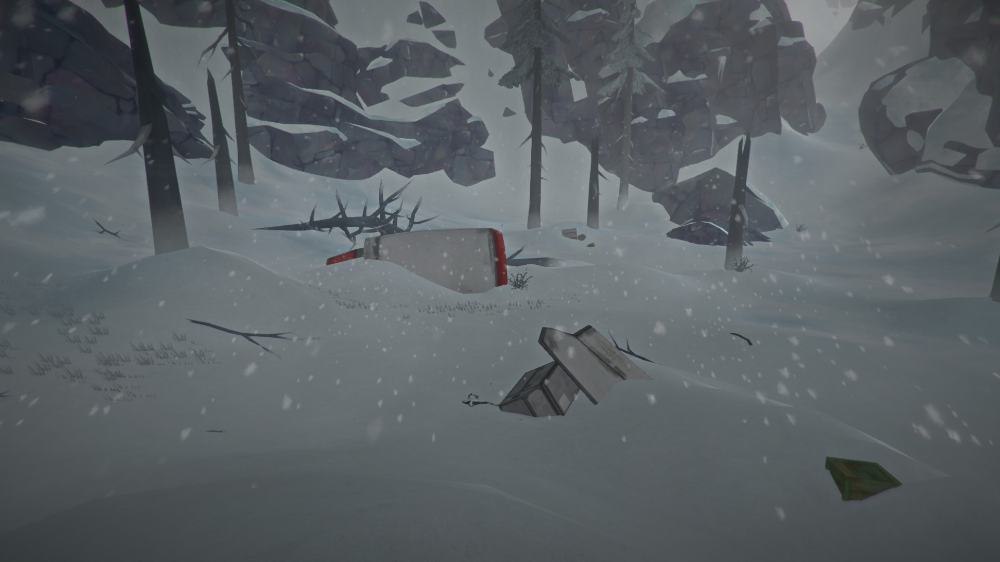
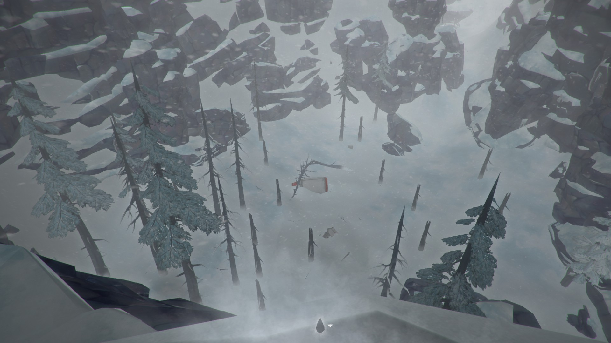

# Engine \(East\)

**Categories:** Locations, Locations in Timberwolf Mountain, Outdoor locations · **Source:** [Fandom](https://thelongdark.fandom.com/wiki/Engine_%28East%29)

**Engine (East)**

| Property | Details |
| --- | --- |
|  | [Engine Timberwolf Mountain location](../assets/Engine_-_Timberwolf_Mountain_location.jpg) |
| **Location** |  |
|  | [Engine (East) Location](../assets/Engine_%28East%29_Location.png) |
| Region | [Timberwolf Mountain](./Timberwolf%20Mountain.md) |
| Location | [Tail Section](./Tail%20Section.md) and [Chasm Cave](./Chasm%20Cave.md) |
| Description | An engine from the crashed aircraft with several [Cargo Containers](./Cargo%20Container.md) nearby |
| **General** |  |
| Type | Outdoors |
|  | Has no shelter |

**Engine (East)** is a Plane Engine found between [Chasm Cave](./Chasm%20Cave.md) and [Cave (Timberwolf Mountain location 2)](./Cave%20%28Timberwolf%20Mountain%20location%202%29.md) that crashed below [Timberwolf Mountain](./Timberwolf%20Mountain.md). A second [Engine can be found to the West](./Engine%20%28West%29.md).

## Overview

Two [Cargo Containers](./Cargo%20Container.md), as well as crates and cardboard boxes, can be found scattered about the area.

1-2 [wolves](./Wolf.md) may also patrol the area.

The containers contain the following:

1) Container between Engine and [Cave (Timberwolf Mountain location 2)](./Cave%20%28Timberwolf%20Mountain%20location%202%29.md)

- Upper door contains [coffee](./Tin%20of%20Coffee.md) and [tea](./Herbal%20Tea.md)
  - In Interloper contains 0-1 [Hoodie](./Hoodie.md), 0-1 [Dress Shirt](./Dress%20Shirt.md), 0-1 [Thin Wool Sweater](./Thin%20Wool%20Sweater.md) and 0-1 [Sweatshirt](./Sweatshirt.md)
- Lower door contains [energy bars](./Energy%20Bar.md), [Ketchup Chips](./Ketchup%20Chips.md) and [salty crackers](./Salty%20Crackers.md)
  - On Interloper contains 0-1 [Jeans](./Jeans.md), 1-2 [Leather Shoes](./Leather%20Shoes.md), 1 [Sport Socks](./Sports%20Socks.md) and 1 pair of [Wool Socks](./Wool%20Socks.md)

2) Container between Engine and [Chasm Cave](./Chasm%20Cave.md) (doesn't spawn in Interloper)

- Upper door contains [Dress Shirt](./Dress%20Shirt.md), [Hoodie](./Hoodie.md), [Plaid Shirt](./Plaid%20Shirt.md), [Sweatshirt](./Sweatshirt.md), [Thick Wool Sweater](./Thick%20Wool%20Sweater.md) and [thin wool sweaters](./Thin%20Wool%20Sweater.md)
- Lower door contains [wood matches](./Wood%20Matches.md) and [accelerant](./Accelerant.md)

The crates and the cardboard boxes don't contain anything but can be broken down for materials.

### Gallery

_A view of the engine from [Echo Peak East](./Echo%20Peak%20East.md)_
