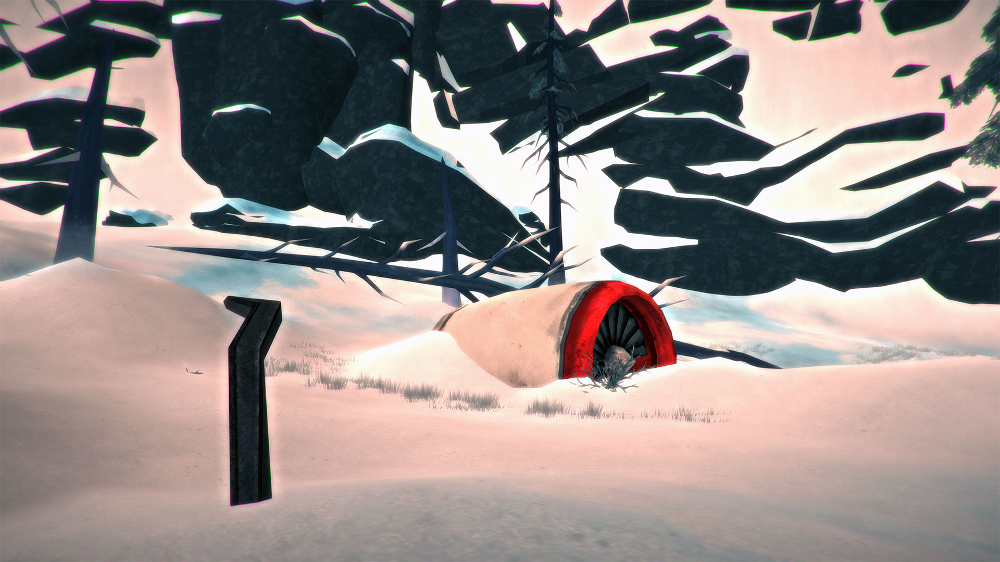

# Engine \(East\)

**Categories:** Locations, Locations in Timberwolf Mountain, Outdoor locations · **Source:** [Fandom](https://thelongdark.fandom.com/wiki/Engine_%28East%29)

**Engine (East)**

_Engine\_-\_Timberwolf\_Mountain\_location.jpg_

**Location**

_Engine\_(East)\_Location.png_

**Region:** [Timberwolf Mountain](./Timberwolf%20Mountain.md)\|-

**Description:** An engine from the crashed aircraft with several [Cargo Containers](./Cargo%20Container.md) nearby

**General**

**Type:** Outdoors\|-
