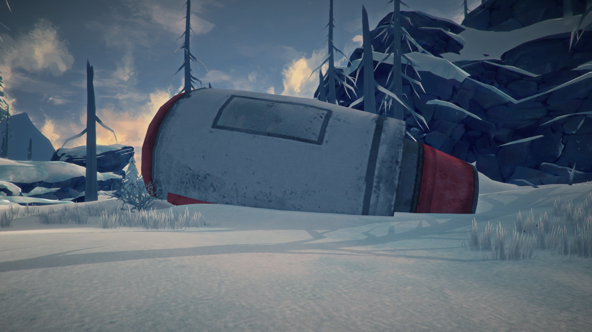
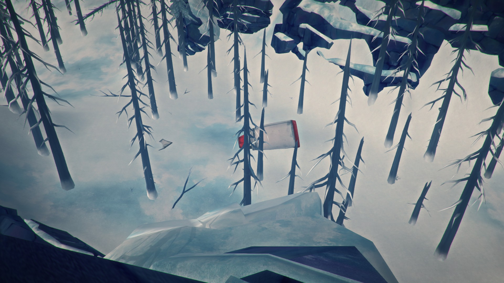

# Engine \(West\)

**Categories:** Locations, Locations in Timberwolf Mountain, Outdoor locations · **Source:** [Fandom](https://thelongdark.fandom.com/wiki/Engine_%28West%29)

**Engine (West)**

[Engine](../assets/Engine.jpg)

**Location**

[Engine (West) Location](../assets/Engine_%28West%29_Location.png)

**Region:** [Timberwolf Mountain](./Timberwolf%20Mountain.md)

**General**

**Type:** Outdoors

## Overview

[Wild animals](./Wildlife.md) such as [wolves](./Wolf.md) may patrol the area. There are ~30 [cat tails](./Cat%20Tail.md), [maple saplings](./Green%20Maple%20Sapling.md), and up to 4 [birch saplings](./Green%20Birch%20Sapling.md) by the river, as well as a one [Cargo Container](./Cargo%20Container.md), there are also several [reishi mushrooms](./Reishi%20Mushroom.md) on the left side of the top waterfall, right next to the cave entrance leading to [Blackrock](./Blackrock.md). Up to 3 Burdock saplings can be found around the engine (\*confirmed in Interloper).

Container near waterfall north of [cave](./Cave%20%28Timberwolf%20Mountain%20location%201%29.md) C exit

- Upper door contains: [energy bars](./Energy%20Bar.md), [Ketchup Chips](./Ketchup%20Chips.md) and [salty crackers](./Salty%20Crackers.md).
- Lower door contains: [Fleece Mittens](./Fleece%20Mittens.md), [Old Fashioned Parka](./Old%20Fashioned%20Parka.md), [Simple Parka](./Simple%20Parka.md), [sports vests](./Sport%20Vest.md), [wool ear wraps](./Wool%20Ear%20Wrap.md) and [Wool Toque](./Wool%20Toque.md)

### Gallery

_A view of the engine from [Andre's Peak](./Andre%27s%20Peak.md)_
