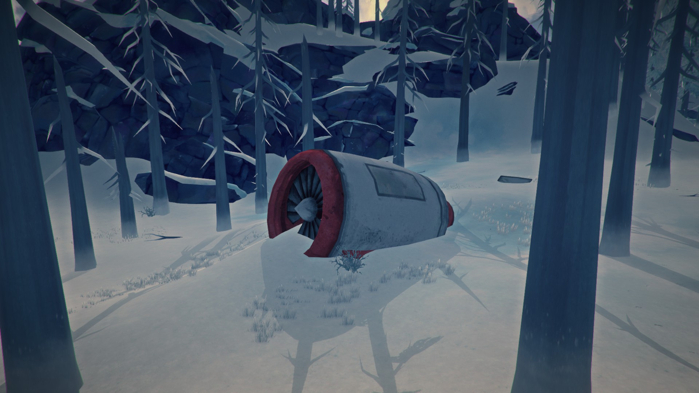

# Engine \(West\)

**Engine (West)**

| Property | Details |
| --- | --- |
|  |  / *Engine.jpg* |
| **Location** |  |
|  |  / *Engine\_(West)\_Location.png* |
| Region | [Timberwolf Mountain](./Timberwolf%20Mountain.md)\|- |
| **General** |  |
| Type | Outdoors\|- |
