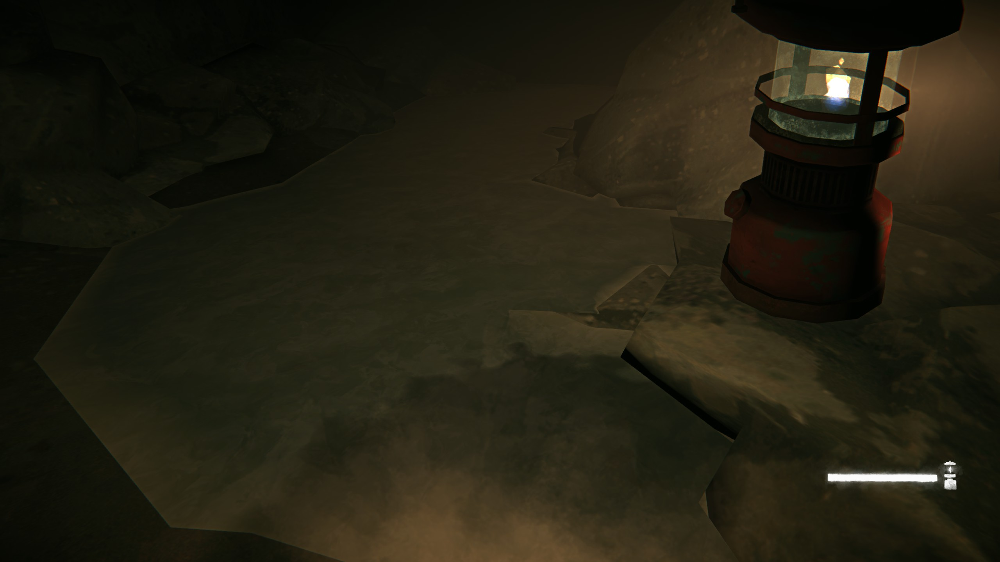
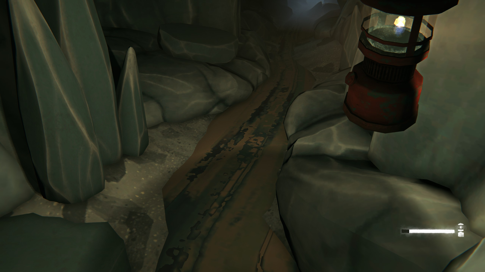
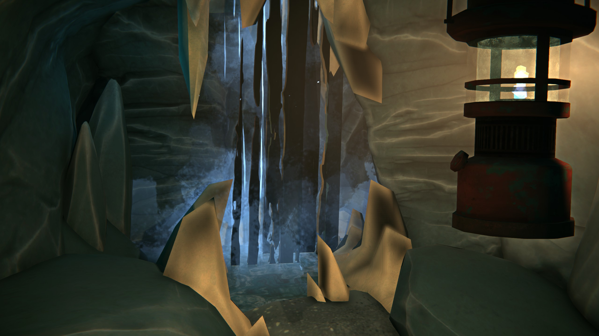
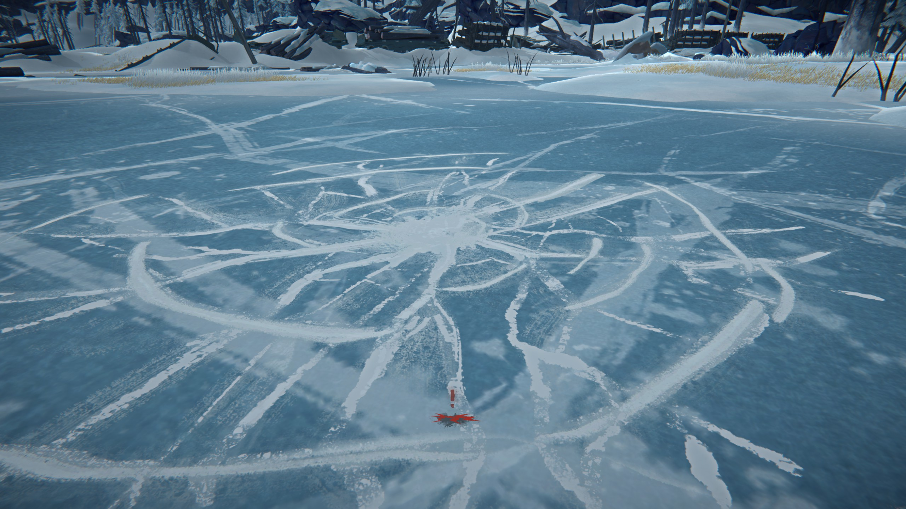

# Environmental Hazard

**Contents**

- [Cold Water Puddles/Streams](#cold-water-puddlesstreams)
- [Survivor Quotes](#survivor-quotes)
- [Waterfalls](#waterfalls)
- [Energized Wires](#energized-wires)
- [Electrified Water](#electrified-water)
- [Weak Ice](#weak-ice)
- [Toxic Airborne Gases](#toxic-airborne-gases)
- [Instant Kill Barriers](#instant-kill-barriers)
- [Chemical Hazards](#chemical-hazards)

**Environmental Hazards** are dangerous obstacles occasionally encountered while playing *The Long Dark.* While many are minor, some can be life threatening and will cause [Afflictions](./Afflictions.md) if not approached and handled with caution and respect.

## Cold Water Puddles/Streams

*An example of ankle deep, cold standing water*Occasionally, puddles of cold, ankle deep standing water or flowing water can be found inside caves and serve as a floor hazard for the player. Walking through or standing in a puddle/flowing stream will drench the player's footwear, slowly making the Socks and Shoes Clothing slots wet and partially lowering the player's [Warmth](./Warmth.md). Wet clothing can be avoided by simply unequipping the player's footwear clothing and passing through the puddle, but this will not stop the player from taking Warmth damage.

These puddles/streams can be found in:

- [Last Prospect](./Last%20Prospect.md) Mine
- [Gold Mine](./Gold%20Mine.md)
- Cave north of [Long Falls](./Long%20Falls.md)
- Various ice caves in [Hushed River Valley](./Hushed%20River%20Valley.md)
- Transition cave between [Blackrock](./Blackrock.md) and [Timberwolf Mountain](./Timberwolf%20Mountain.md)
- [Cinder Hills Coal Mine](./Cinder%20Hills%20Coal%20Mine.md) (middle level)
- Level 1 of the [Langston Mine](./Langston%20Mine.md)
- [Forgotten Exploration](./Forgotten%20Exploration.md)

| Column 1 |
| --- |
|  / *An example of flowing ankle deep water* |

### Survivor Quotes

Walking through a puddle will also generate a unique audio response from the survivor not found anywhere else in the game.

- "COLD! COLD!"
- "Gotta warm up my feet"
- "COLD WATER! HAH!"
- "Dammit! Up to my ankles..."
- "Feet are drenched"
- "Ugh water. Freezing"
- "Guh, my feet!"
- "Freezing water, everywhere"
- "So cold!"
- "Agh, soaked!"

## Waterfalls

*An example of an unavoidable waterfall in an Ice Cave* Waterfalls can occasionally be found inside [Ice Caves](./Ice%20Cave.md), and serve as an unavoidable hazard. Simply standing near one will slowly wet the player's clothing. Passing through one will full drench all of the player's outermost Clothing layers to 100% wetness and will automatically lower the player's Warmth to 0. Warming up afterwards becomes a priority if choosing to pass through such a hazard fully clothed, as your wet Clothing will immediately begin freezing over. If one must pass through a waterfall, simply remove all Clothing and walk through, then re-equip all clothing to start warming up again.

Any light source currently active and held will be extinguished when passing through a waterfall. This includes Matches, Flares, and [Torches](./Torch.md), and, oddly enough, active [Storm Lanterns](./Storm%20Lantern.md). Lit Flares and Torches will of course go out if thrown through a waterfall. Active [Flashlights](./Flashlight.md) are not affected by waterfalls.

Keep in mind that most waterfalls also have streams of cold water flowing on the ground on one side, so the player's feet can get wet before approaching/after passing through a waterfall.

- Inside various Ice Caves in [Hushed River Valley](./Hushed%20River%20Valley.md)
- Cave north of [Long Falls](./Long%20Falls.md) in [Ash Canyon](./Ash%20Canyon.md)
- [Reclusive Falls](./Reclusive%20Falls.md) and [Hushed River Valley](./Hushed%20River%20Valley.md) is a waterfall covering an Ice Cave
- [Misty Falls Cave](./Misty%20Falls%20Cave.md) in [Pleasant Valley](./Pleasant%20Valley.md)

## Energized Wires

Live, energized wires are a serious environmental hazard located inside or near many industrial buildings across the Island. They are identified by their exposed insulation and rapid sparking during an [Aurora](./Aurora.md). They are normally safe to walk across during the day, and are not affected by [Glimmer Fog](./Glimmer%20Fog.md) despite its tendency to power up electronic equipment.

Touching a live wire will give the [Burns](./Burns.md) Affliction and cause rapid [Condition](./Condition.md) loss. Great care should be given when walking or even sleeping on downed wires during dusk or the night, as an Aurora can activate and kill a survivor exposed to live wires rather quickly.

## Electrified Water

*Electrified water can kill in seconds* Some bodies can serve as a serious electrical hazard during an [Aurora](./Aurora.md), due to the amount of electrical current passing through. Standing in these bodies of water will cause rapid [Burns](./Burns.md) and [Condition](./Condition.md) damage, and will outright kill the player in seconds if the player doesn't leave.

Such bodies of water can be found in:

- [Cinder Hills Coal Mine](./Cinder%20Hills%20Coal%20Mine.md) (middle level)

## Weak Ice

*An example of cracked Weak Ice and a warning symbol* [Weak Ice](./Weak%20Ice.md) is the most commonly encountered water hazard found in *The Long Dark* and can be found in all coastal regions and certain fresh bodies of water. Stepping on thin ice will be accompanied by the audible sound of ice cracking and the ice at the player's feet visibly cracking, as well as a red Exclamation Point Symbol appearing in the middle of the screen. It is advised to immediately turn around until the Exclamation Point Symbol disappears, informing the player that they are on stable ice again.

Being exposed exposed the extreme cold water causes: 10% [Condition](./Condition.md) damage on any mode other than Pilgrim, makes all Clothing 100% wet, and induces [Hypothermia](./Hypothermia.md). Wet clothes are a serious hazard not only from continued Condition loss due to [Freezing](./Needs.md), but also from the risk of the clothing freezing over and inducing [Frostbite](./Frostbite.md).

[Crampons](./Crampons.md) and [Improvised Crampons](./Improvised%20Crampons.md) can provide the player with a little extra time on Thin Ice with the [Sure Footing](./Sure%20Footing.md) feat (6 seconds instead of 5 seconds).

## Toxic Airborne Gases

While very rare, some abandoned mineshaft tunnels contain clouds of toxic underground gases that accumulate in one spot due to the poor ventilation. Passing through these clouds will immediately give a [Suffocation](./Suffocation.md) Risk as the survivor begins coughing from the dirty air. Failure to quickly pass through these Hazards will result in an instant death after a set timer that appears on screen reaches zero.

So far, only 2 locations on Great Bear Island feature toxic gas clouds:

- The 3rd floor of the [Last Prospect](./Last%20Prospect.md) mine
- Various floors inside the [Langston Mine](./Langston%20Mine.md)

Toxic gases can be quickly sprinted through in most cases, even with the speed penalty that indoor spaces give to the player. Some toxic gas corridors inside the Langston Mine cannot be sprinted through easily without wearing a [Respirator](./Respirator.md) with fresh [Canisters](./Canister.md) however. One other factor to consider with the Langston is that many gaseous corridors have loot that is too dangerous to gather without wearing a Respirator.

## Instant Kill Barriers

While impossible to see with the naked eye until it is too late, some very rare locations in the game will instantly kill the player if they pass through them when attempting [Mountain Goating](./Mountain%20Goating.md). Most instant kill barrier locations are located outside the map boundaries of regions, but a few notable locations where death barriers are present include:

- All cliffsides surrounding the [Ravine Basin](./Ravine%20Basin.md) in [The Ravine](./The%20Ravine.md) should be treated with utmost caution, as they contain death barriers. Use the [Rope Climbing](./Rope%20Climbing.md) section to get down safely.
- [Broken Bridge (Broken Railroad location)](./Broken%20Bridge%20%28Broken%20Railroad%20location%29.md) on the other side leading to [Far Range Branch Line](./Far%20Range%20Branch%20Line.md), the base is an instant kill area.
- The nearby cliff near [Mackenzie's Crashed Plane](./Mackenzie%27s%20Crashed%20Plane.md) leading down to the ravine has a death barrier.

Other minor locations with instant kill barriers can be found in [this video by Bashrobe](https://www.youtube.com/watch?v=NIYBONWH24s).[1](https://www.youtube.com/watch?v=NIYBONWH24s)

## Chemical Hazards

 The [Zone of Contamination](./Zone%20of%20Contamination.md) contains several areas with spilled or dumped chemicals that will include the [Chemical Poisoning Risk](./Chemical%20Poisoning%20Risk.md). These [Chemical Hazard](./Chemical%20Hazard.md) zones act as dead zones for native Wildlife, and can rapidly destroy a player's footwear if not properly navigated. **Lua execution error in Module:Navbox function navbox**
