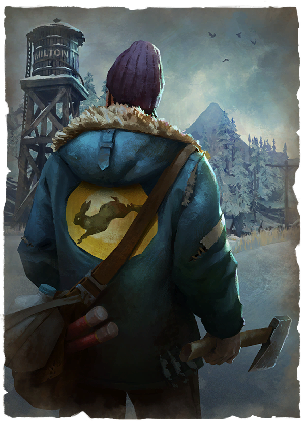
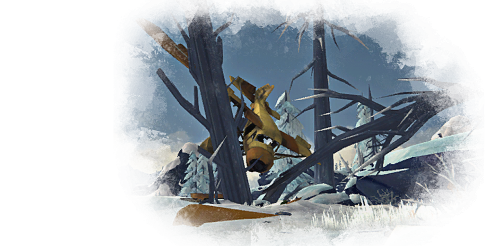
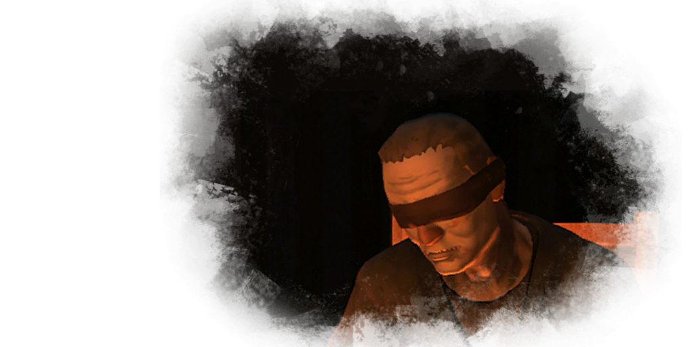
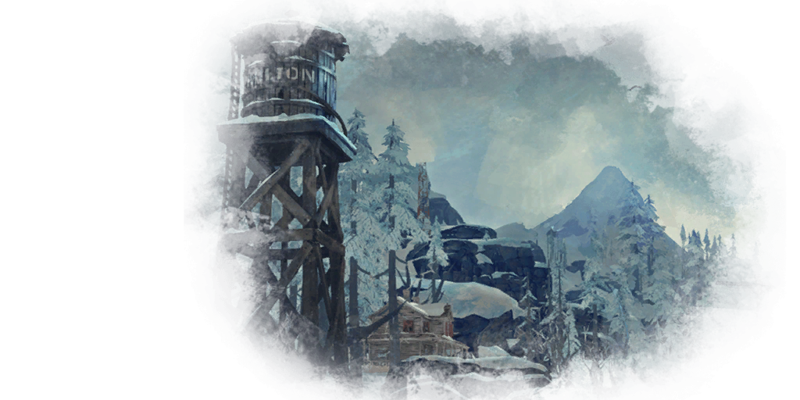
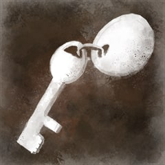
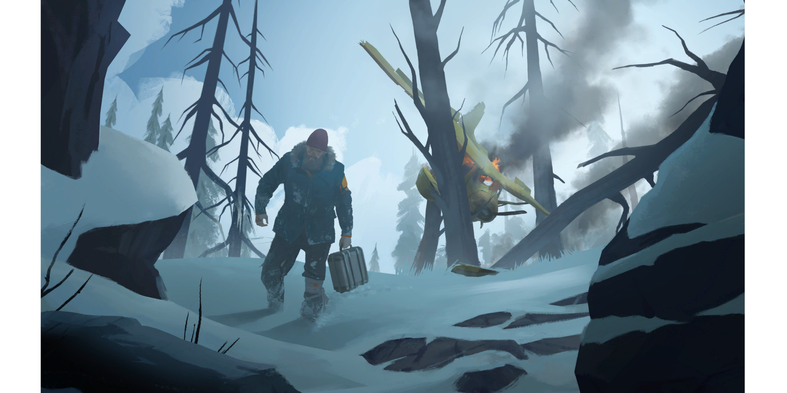

# Episode 1: Do Not Go Gentle

**Contents**

- [Overview](#Overview)
- [Main missions](#Main_missions)
- [Memories](#Memories)
- [The Crash](#The_Crash)
- [The Grey Mother](#The_Grey_Mother)
- [Paradise Lost](#Paradise_Lost)
- [Side Missions](#Side_Missions)
- [The Basics of Survival](#The_Basics_of_Survival)
- [Extra Supplies](#Extra_Supplies)
- [Milton Safety Deposit Box Keys](#Milton_Safety_Deposit_Box_Keys)
- [Milton Supply Caches](#Milton_Supply_Caches)
- [Highway Robbery](#Highway_Robbery)
- [One Last Thing](#One_Last_Thing)
- [Cast](#Cast)
- [Major Characters](#Major_Characters)
- [Minor Characters](#Minor_Characters)
- [Affliction Availability](#Affliction_Availability)
- [Positive Benefit](#Positive_Benefit)
- [Negative Affliction](#Negative_Affliction)
- [Craft-able Unlocks](#Craft-able_Unlocks)
- [Achievements](#Achievements)
- [Trivia](#Trivia)
- [Gallery](#Gallery)

**Template:spoiler**

*"Mackenzie and Dr. Greenwood are separated after their plane crashes deep in the Northern Canadian Wilderness. Struggling to survive, Mackenzie explores the small town of Milton, where he begins to understand the scope of this quiet apocalypse."*

***Do Not Go Gentle*** is the first episode in the <a href="./Wintermute.md" class="wikilink" title="Wintermute">Wintermute</a> story mode. It is followed by <a href="./Episode%202%20-%20Luminance%20Fugue.md" class="wikilink" title="Episode 2: Luminance Fugue">Episode 2: Luminance Fugue</a>.

## Overview

In this episode, <a href="./Will%20Mackenzie.md" class="wikilink" title="Will Mackenzie&#39;s">Will Mackenzie's</a> plane has crashed due to a <a href="./First%20Flare.md" class="wikilink" title="mysterious geomagnetic event">mysterious geomagnetic event</a>. He and fellow traveler <a href="./Astrid%20Greenwood.md" class="wikilink" title="Astrid Greenwood">Astrid Greenwood</a> are now separated and Mackenzie does his best to survive. His journey takes him to the small town of <a href="./Milton.md" class="wikilink" title="Milton">Milton</a>. Dr. Astrid Greenwood unexpectedly shows up at the workplace of bush pilot Will Mackenzie. She and Will have not seen each other in years, and their parting was not under ideal circumstances. She asks him to take her to a small village in the mountains. It is late in the evening and the weather is bad. She refuses to tell him why, and what the contents are in the metal locked briefcase she is carrying. When he protests, she becomes frustrated and starts to leave. He stops her and reluctantly agrees to take her.

During the trip, a <a href="./Aurora.md" class="wikilink" title="geomagnetic event">geomagnetic event</a> occurs, depriving the plane of power, sending the plane into a rocky ravine. Will finds himself alone, injured, in the dark in freezing temperatures, and with no sign of Astrid.

## Main missions

### Memories

<figure>

<figcaption>Memories.png</figcaption>
</figure>

  
*Main article: <a href="./Memories.md" class="wikilink" title="Memories">Memories</a>*

<!-- -->

  
"*Mackenzie hangs around the Jackrabbit Transport hangar, waiting for something to happen.*"

— In-game description

### The Crash

<figure>

<figcaption>The_Crash.png</figcaption>
</figure>

  
*Main article: <a href="./The%20Crash.md" class="wikilink" title="The Crash">The Crash</a>*

<!-- -->

  
"*Mackenzie fights to stay alive while searching for signs of Astrid. What happened to her?*"

— In-game description

### The Grey Mother

<figure>

<figcaption>The_Grey_Mother.png</figcaption>
</figure>

  
*Main article: <a href="./The%20Grey%20Mother.md" class="wikilink" title="The Grey Mother">The Grey Mother</a>*

<!-- -->

  
"*An old blind woman might be the last survivor in Milton. She might be the key to understanding what happened to Astrid.*"

— In-game description

### Paradise Lost

<figure>

<figcaption>Paradise_Lost.png</figcaption>
</figure>

  
*Main article: <a href="./Paradise%20Lost.md" class="wikilink" title="Paradise Lost">Paradise Lost</a>*

<!-- -->

  
"*It looks like Astrid made it out of Milton. Continue your search beyond the town's borders.*"

— In-game description

## Side Missions

<figure>

<figcaption>Missions_story_ep1_Side.png</figcaption>
</figure>

### The Basics of Survival

  
*Main article: <a href="./The%20Basics%20of%20Survival.md" class="wikilink" title="The Basics of Survival">The Basics of Survival</a>*

"*Enduring the Quiet Apocalypse will require survival skills. Find the collectibles that can teach you important survival lessons.*"

— In-game description

### Extra Supplies

  
*Main article: <a href="./Extra%20Supplies.md" class="wikilink" title="Extra Supplies">Extra Supplies</a>*

"*Grey Mother will need extra food and fuel if she is to survive alone for much longer.*"

— In-game description

### Milton Safety Deposit Box Keys

  
*Main article: <a href="./Milton%20Safety%20Deposit%20Box%20Keys.md" class="wikilink" title="Milton Safety Deposit Box Keys">Milton Safety Deposit Box Keys</a>*

"*Locate and use the keys that unlock various Safety Deposit boxes at the Milton Credit Union.*"

— In-game description

### Milton Supply Caches

  
*Main article: <a href="./Milton%20Supply%20Caches.md" class="wikilink" title="Milton Supply Caches">Milton Supply Caches</a>*

"*The Collapse taught Milton residents to be ready for the worst. Find the collectibles that point you to cache locations.*"

— In-game description

### Highway Robbery

  
*Main article: <a href="./Highway%20Robbery%20%28mission%29.md" class="wikilink" title="Highway Robbery (mission)">Highway Robbery (mission)</a>*

"*You found a note describing the possible location of emergency supplies near a bridge outside of Milton.*"

— In-game description

### One Last Thing

  
*Main article: <a href="./One%20Last%20Thing.md" class="wikilink" title="One Last Thing">One Last Thing</a>*

"*Grey Mother has one final request from you.*"

— In-game description

## Cast

### Major Characters

- <a href="./Will%20Mackenzie.md" class="wikilink" title="Will Mackenzie">Will Mackenzie</a> - (playable character) Mark Meer
- <a href="./Astrid%20Greenwood.md" class="wikilink" title="Astrid Greenwood">Astrid Greenwood</a> - Jennifer Hale
- <a href="./Grey%20Mother.md" class="wikilink" title="Grey Mother">Grey Mother</a> - Gwynyth Walsh
- <a href="./Methuselah.md" class="wikilink" title="Methuselah">Methuselah</a> - Richard Newman

### Minor Characters

- Maureen - (woman Will was on the phone with in <a href="./Jackrabbit%20Hangar.md" class="wikilink" title="Jackrabbit Remote Transport">Jackrabbit Remote Transport</a>) - Jackie Blackmore
- <a href="./Hobbs.md" class="wikilink" title="Hobbs">Hobbs</a> - Ben Cotton
- <a href="./Jeremiah.md" class="wikilink" title="Jeremiah">Jeremiah</a> (ending cameo) - David Hayter
- <a href="./Lilith%20Barker.md" class="wikilink" title="Lilith Barker">Lilith Barker</a>
- <a href="./Martin%20Barker.md" class="wikilink" title="Martin Barker">Martin Barker</a>

## Affliction Availability

### Positive Benefit

- <a href="./Well%20Fed.md" class="wikilink" title="Well Fed">Well Fed</a>/<a href="./Fatigue%20Reduced.md" class="wikilink" title="Fatigue Reduced">Fatigue Reduced</a>/<a href="./Restore%20Condition.md" class="wikilink" title="Restore Condition">Restore Condition</a>/<a href="./Improved%20Rest.md" class="wikilink" title="Improved Rest">Improved Rest</a>/<a href="./Energy%20Boost.md" class="wikilink" title="Energy Boost">Energy Boost</a>/<a href="./Warming%20Up.md" class="wikilink" title="Warming Up">Warming Up</a>

### Negative Affliction

- <a href="./Torn%20Clothing.md" class="wikilink" title="Torn Clothing">Torn Clothing</a>/<a href="./Minor%20Bruising.md" class="wikilink" title="Minor Bruising">Minor Bruising</a>/<a href="./Major%20Bruising.md" class="wikilink" title="Major Bruising">Major Bruising</a>/<a href="./Laceration.md" class="wikilink" title="Laceration">Laceration</a>
- <a href="./Blood%20Loss.md" class="wikilink" title="Blood Loss">Blood Loss</a>/<a href="./Infection.md" class="wikilink" title="Infection">Infection</a>/Infection Risk
- <a href="./Food%20Poisoning.md" class="wikilink" title="Food Poisoning">Food Poisoning</a>/<a href="./Headache.md" class="wikilink" title="Headache">Headache</a>/<a href="./Burns.md" class="wikilink" title="Burns">Burns</a>/<a href="./Dysentery.md" class="wikilink" title="Dysentery">Dysentery</a>
- <a href="./Intestinal%20Parasites.md" class="wikilink" title="Intestinal Parasites">Intestinal Parasites</a> (Hardened Survivor only)
- <a href="./Hypothermia.md" class="wikilink" title="Hypothermia">Hypothermia</a> / Hypothermia Risk / <a href="./Frostbite.md" class="wikilink" title="Frostbite">Frostbite</a> /Frostbite Risk
- <a href="./Sprained%20Ankle.md" class="wikilink" title="Sprained Ankle">Sprained Ankle</a> / <a href="./Sprained%20Wrist.md" class="wikilink" title="Sprained Wrist">Sprained Wrist</a> / Sprain Risk / <a href="./Pain.md" class="wikilink" title="Pain">Pain</a>

## Craft-able Unlocks

- <a href="./Rabbitskin%20Mitts.md" class="wikilink" title="Rabbitskin Mitts">Rabbitskin Mitts</a>
  - Unlocks when you acquire the <a href="./Field%20Dressing%20Your%20Kill%2C%20Vol.%20I.md" class="wikilink" title="Field Dressing Your Kill, Vol 1 Book">Field Dressing Your Kill, Vol 1 Book</a>.
- <a href="./Rabbitskin%20Hat.md" class="wikilink" title="Rabbitskin Hat">Rabbitskin Hat</a>
  - Unlocks when you acquire the <a href="./Field%20Dressing%20Your%20Kill%2C%20Vol.%20I.md" class="wikilink" title="Field Dressing Your Kill, Vol 1 Book">Field Dressing Your Kill, Vol 1 Book</a>.
- <a href="./Snare.md" class="wikilink" title="Snare">Snare</a>
  - Unlocks when you acquire the <a href="./Field%20Dressing%20Your%20Kill%2C%20Vol.%20I.md" class="wikilink" title="Field Dressing Your Kill, Vol 1 Book">Field Dressing Your Kill, Vol 1 Book</a>.
- <a href="./Bandage.md" class="wikilink" title="Bandage">Bandage</a>
  - Unlocks when you acquire the <a href="./A%20Sewing%20Primer.md" class="wikilink" title="Sewing Primer Book">Sewing Primer Book</a>.
- <a href="./Old%20Man%27s%20Beard%20Wound%20Dressing.md" class="wikilink" title="Old Man&#39;s Beard Wound Dressing">Old Man's Beard Wound Dressing</a>
  - Unlocks when you acquire the <a href="./Medicinal%20Plants%20of%20Great%20Bear.md" class="wikilink" title="Medicinal Plants of Great Bear Book">Medicinal Plants of Great Bear Book</a>.
- <a href="./Prepared%20Reishi%20Mushrooms.md" class="wikilink" title="Prepared Reishi Mushrooms">Prepared Reishi Mushrooms</a>
  - Unlocks when you acquire the <a href="./Medicinal%20Plants%20of%20Great%20Bear.md" class="wikilink" title="Medicinal Plants of Great Bear Book">Medicinal Plants of Great Bear Book</a>.
- <a href="./Prepared%20Rose%20Hips.md" class="wikilink" title="Prepared Rose Hips">Prepared Rose Hips</a>
  - Unlocks when you acquire the <a href="./Medicinal%20Plants%20of%20Great%20Bear.md" class="wikilink" title="Medicinal Plants of Great Bear Book">Medicinal Plants of Great Bear Book</a>.
- <a href="./Prepared%20Birch%20Bark.md" class="wikilink" title="Prepared Birch Bark">Prepared Birch Bark</a>
  - Unlocks when you acquire the <a href="./Medicinal%20Plants%20of%20Great%20Bear.md" class="wikilink" title="Medicinal Plants of Great Bear Book">Medicinal Plants of Great Bear Book</a>.
- <a href="./Tinder%20Plug.md" class="wikilink" title="Tinder Plug">Tinder Plug</a>
- <a href="./Torch.md" class="wikilink" title="Torch">Torch</a>

## Achievements

-  <a href="./Your%20Journey%20Begins.md" class="wikilink" title="Your Journey Begins">Your Journey Begins</a>
-  <a href="./Paradise%20Lost%20%28Achievement%29.md" class="wikilink" title="Paradise Lost (Achievement)">Paradise Lost (Achievement)</a>
-  <a href="./The%20Long%20Winter.md" class="wikilink" title="The Long Winter">The Long Winter</a>
-  <a href="./Losing%20a%20Child%20is%20Like....md" class="wikilink" title="Losing a Child is Like...">Losing a Child is Like...</a>
-  <a href="./Leaving%20the%20Old%20World%20Behind.md" class="wikilink" title="Leaving the Old World Behind">Leaving the Old World Behind</a>
-  <a href="./Too%20Big%20to%20Fail.md" class="wikilink" title="Too Big to Fail">Too Big to Fail</a>

## Trivia

- "[Do not go gentle into that good night](https://en.wikipedia.org/wiki/Do_not_go_gentle_into_that_good_night) " is the most famous poem of Welsh poet Dylan Thomas, referenced alongside The Long Dark in multiple works of popular culture. The phrase and the refrain occur throughout the poem and perfectly characterize the beginning of Episode 1:\
  *"Do not go gentle into that good night.*\
  *Rage, rage against the dying of the light."*
- The town of Milton and the mission “Paradise Lost” are allusions to 17th century English poet John Milton’s *[Paradise Lost](https://en.m.wikipedia.org/wiki/Paradise_Lost)*, an epic poem about the fall of man and the subsequent expulsion from paradise.

## Gallery

<table class="gallery">
<colgroup>
<col style="width: 100%" />
</colgroup>
<tbody>
<tr>
<td><figure>

<figcaption>The Episode 1 Menu Background</figcaption>
</figure></td>
</tr>
</tbody>
</table>

**Lua execution error in Module:Navbox function navbox** <a href="ru:%D0%A0%D0%B5%D0%B6%D0%B8%D0%BC_%D0%B8%D1%81%D1%82%D0%BE%D1%80%D0%B8%D0%B8:_%D1%8D%D0%BF%D0%B8%D0%B7%D0%BE%D0%B4_1" class="wikilink" title="ru:Режим истории: эпизод 1">ru:Режим истории: эпизод 1</a>

