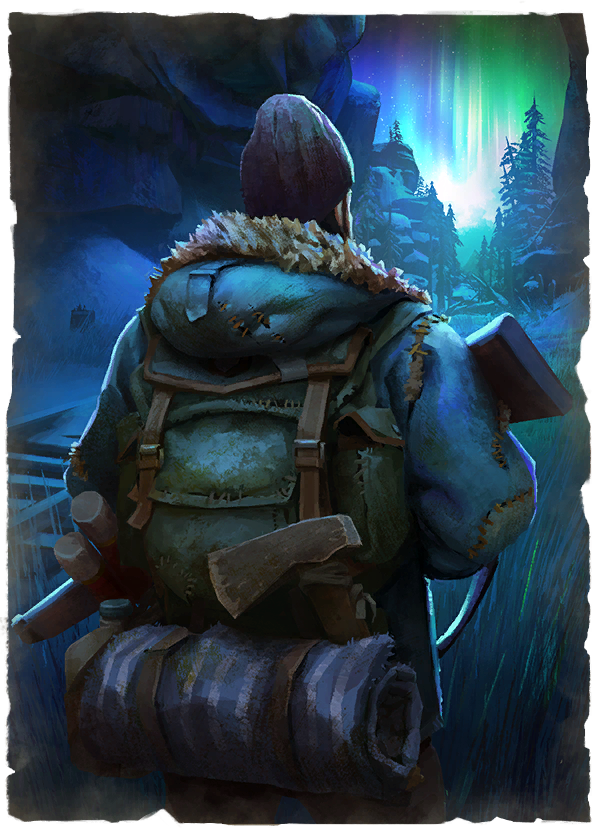
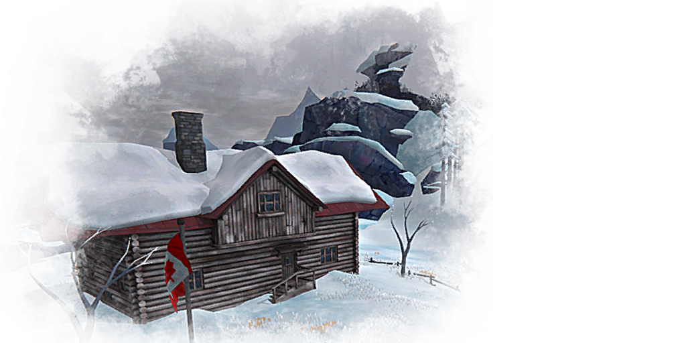
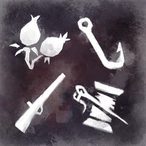

# Episode 2: Luminance Fugue

**Categories:** Episode 2, Episodes · **Source:** [Fandom](https://thelongdark.fandom.com/wiki/Episode_2%3A_Luminance_Fugue)

**Contents**

- [Overview](#overview)
- [Main missions](#main-missions)
- [The Wounded Trapper](#the-wounded-trapper)
- [The Best Defense](#the-best-defense)
- [Signal to Noise](#signal-to-noise)
- [What One Man Can Do](#what-one-man-can-do)
- [Renewed Hope](#renewed-hope)
- [Side Missions](#side-missions)
- [Forest Talker Supply Caches](#forest-talker-supply-caches)
- [Mystery Lake Supply Caches](#mystery-lake-supply-caches)
- [Aurora Hatch](#aurora-hatch)
- [Hank's Hatch](#hanks-hatch)
- [Lake Gunshots](#lake-gunshots)
- [Survival School](#survival-school)
- [Non-mission objective](#non-mission-objective)
- [Cast](#cast)
- [Major Characters](#major-characters)
- [Minor Characters](#minor-characters)
- [Affliction Availability](#affliction-availability)
- [Positive Benefit](#positive-benefit)
- [Negative Affliction](#negative-affliction)
- [Craft-able Unlocks](#craft-able-unlocks)
- [Player and Workbench Unlocks](#player-and-workbench-unlocks)
- [Forge Unlocks](#forge-unlocks)
- [Achievements](#achievements)
- [Gallery](#gallery)
- [Trivia](#trivia)

**Template:spoiler**

> “**Mackenzie's search for Astrid takes him deeper into the savage wilderness. A mysterious trapper may be the key to finding Astrid. But can he be trusted?**”

<!-- #Overview -->
​

<!-- #overview -->
## Overview

**_Luminance Fugue_** is the second episode in the [story](./Wintermute.md) of [The Long Dark](./The%20Long%20Dark.md). It is preceded by [Episode 1: Do Not Go Gentle](./Episode%201%20-%20Do%20Not%20Go%20Gentle.md) and is followed by [Episode 3: Crossroads Elegy](./Episode%203%20-%20Crossroads%20Elegy.md).

<!-- #the_wounded_trapper -->
​

<!-- #The_Wounded_Trapper -->
​

<!-- #The_wounded_trapper -->
​

<!-- #the-wounded-trapper -->
### The Wounded Trapper

_Main article: [The Wounded Trapper](./The%20Wounded%20Trapper.md)_

"_Mackenzie rescues an Old Trapper, whose knowledge of Great Bear Island, as well his shortwave radio, might be the key to finding Astrid._"

— In-game description

<!-- #the_best_defense -->
​

<!-- #The_Best_Defense -->
​

<!-- #The_best_defense -->
​

<!-- #the-best-defense -->
### The Best Defense

_Main article: [The Best Defense](./The%20Best%20Defense.md)_

"_A man-killing bear is on the prowl, risking Mackenzie's mission to find Astrid. But an old Voyageur legend might hold the answer to overcoming the massive predator._"

— In-game description

<!-- #signal_to_noise -->
​

<!-- #Signal_to_Noise -->
​

<!-- #Signal_to_noise -->
​

<!-- #Signal_To_Noise -->
​

<!-- #signal-to-noise -->
### Signal to Noise

_Main article: [Signal to Noise](./Signal%20to%20Noise.md)_

"_Jeremiah has a plan for how Mackenzie can reach Perseverance Mills, but carrying it out may put the pilot on a collision course with the Old Bear._"

— In-game description

<!-- #what_one_man_can_do -->
​

<!-- #What_One_Man_Can_Do -->
​

<!-- #What_one_man_can_do -->
​

<!-- #what-one-man-can-do -->
### What One Man Can Do

_Main article: [What One Man Can Do](./What%20One%20Man%20Can%20Do.md)_

"_The Old Bear has dragged Mackenzie to its lair. Will he put the legendary bear's story to an end?_"

— In-game description

<!-- #renewed_hope -->
​

<!-- #Renewed_Hope -->
​

<!-- #Renewed_hope -->
​

<!-- #renewed-hope -->
### **Renewed Hope**

_Main article: [Renewed Hope](./Renewed%20Hope.md)_

"_With the Old Bear no longer a risk, Jeremiah plots a course leading Mackenzie out of Mystery Lake with the means to contact Perseverance Mills, and one step closer to finding Astrid._"

— In-game description

<!-- #forest_talker_supply_caches -->
​

<!-- #Forest_Talker_Supply_Caches -->
​

<!-- #Forest_talker_supply_caches -->
​

<!-- #forest-talker-supply-caches -->
### Forest Talker Supply Caches

_Main article: [Forest Talker Supply Caches](./Forest%20Talker%20Supply%20Caches.md)_

"_The Forest Talkers, an eco-activist group, have left supply caches hidden in different regions around Great Bear Island. They could prove useful if found._"

— In-game description

<!-- #mystery_lake_supply_caches -->
​

<!-- #Mystery_Lake_Supply_Caches -->
​

<!-- #Mystery_lake_supply_caches -->
​

<!-- #mystery-lake-supply-caches -->
### Mystery Lake Supply Caches

_Main article: [Mystery Lake Supply Caches](./Mystery%20Lake%20Supply%20Caches.md)_

"_There are several supply caches hidden around Mystery Lake. Most are left by hunters or campers. Some are left by off-grid "preppers" waiting for the government to fall, or the end of the world, or some such nonsense._"

— In-game description

<!-- #aurora_hatch -->
​

<!-- #Aurora_Hatch -->
​

<!-- #Aurora_hatch -->
​

<!-- #aurora-hatch -->
### Aurora Hatch

_Main article: [Aurora Hatch](./Aurora%20Hatch.md)_

"_There's a hidden bunker in Forlorn Muskeg that can only be opened when the aurora is active._"

— In-game description

<!-- #hanks_hatch -->
​

<!-- #Hank's_Hatch -->
​

<!-- #hank's_hatch -->
​

<!-- #Hank's_hatch -->
​

<!-- #hanks-hatch -->
### Hank's Hatch

_Main article: [Hank's Hatch](./Hank%27s%20Hatch.md)_

"_Hank, a long-time prepper and denizen of Great Bear Island, has a secret supply cache. Find it and take what you need._"

— In-game description

<!-- #lake_gunshots -->
​

<!-- #Lake_Gunshots -->
​

<!-- #Lake_gunshots -->
​

<!-- #lake-gunshots -->
### Lake Gunshots

_Main article: [Lake Gunshots](./Lake%20Gunshots.md)_

"_You found a note with some details on possible Forest Talker activity around Mystery Lake._"

— In-game description

<!-- #survival_school -->
​

<!-- #Survival_School -->
​

<!-- #Survival_school -->
​

<!-- #survival-school -->
### Survival School

_Main article: [Survival School](./Survival%20School.md)_

"_Enduring the Quiet Apocalypse will require survival skills. Find the collectibles that teach you important survival lessons._"

— In-game description

<!-- #non_mission_objective -->
​

<!-- #Non-mission_objective -->
​

<!-- #non-mission_objective -->
​

<!-- #Non-mission_Objective -->
​

<!-- #non-mission-objective -->
## Non-mission objective

In addition to the side missions, the player can also find three keys to the locked lake cabins. The cabins contain various loot.

- Key to cabin #1 is found by the dead person at [High Blind](./High%20Blind.md) in [Forlorn Muskeg](./Forlorn%20Muskeg.md).
- Key to cabin #2 is found in the hunter's blind near [Alan's cave](./Alan%27s%20Cave.md) in [Mystery Lake](./Mystery%20Lake%20%28disambiguation%29.md).
- Key to cabin #3 is found within the [Camp Office](./Camp%20Office.md) in [Mystery Lake](./Mystery%20Lake%20%28disambiguation%29.md).

<!-- #major_characters -->
​

<!-- #Major_Characters -->
​

<!-- #Major_characters -->
​

<!-- #major-characters -->
### Major Characters

- [Will Mackenzie](./Will%20Mackenzie.md) - (playable character) Mark Meer
- [Jeremiah](./Jeremiah.md) - David Hayter
- [Methuselah](./Methuselah.md) - Richard Newman

<!-- #minor_characters -->
​

<!-- #Minor_Characters -->
​

<!-- #Minor_characters -->
​

<!-- #minor-characters -->
### Minor Characters

- [Mathis](./Mathis.md) - (ending cameo) Elias Toufexis (formerly voiced by Gord Marriott)
- [Atwood](./Atwood.md) (mentioned)
- Radio Voice - (man on the radio calling from Perseverance Mills) - Noel Johansen
- Forest Talker ([Lake Gunshots](./Lake%20Gunshots.md)) - Brian Drummond

<!-- #positive_benefit -->
​

<!-- #Positive_Benefit -->
​

<!-- #Positive_benefit -->
​

<!-- #positive-benefit -->
### Positive Benefit

- [Well Fed](./Well%20Fed.md)/[Fatigue Reduced](./Fatigue%20Reduced.md)/[Restore Condition](./Restore%20Condition.md)/[Improved Rest](./Improved%20Rest.md)/[Energy Boost](./Energy%20Boost.md)/[Warming Up](./Warming%20Up.md)

<!-- #negative_affliction -->
​

<!-- #Negative_Affliction -->
​

<!-- #Negative_affliction -->
​

<!-- #negative-affliction -->
### Negative Affliction

- [Torn Clothing](./Torn%20Clothing.md)/[Minor Bruising](./Minor%20Bruising.md)/[Major Bruising](./Major%20Bruising.md)/[Laceration](./Laceration.md)
- [Blood Loss](./Blood%20Loss.md)/[Infection](./Infection.md)/Infection Risk
- [Food Poisoning](./Food%20Poisoning.md)/[Headache](./Headache.md)/[Burns](./Burns.md)/[Dysentery](./Dysentery.md)
- [Intestinal Parasites](./Intestinal%20Parasites.md) (Hardened Survivor only)
- [Hypothermia](./Hypothermia.md) / Hypothermia Risk / [Frostbite](./Frostbite.md) /Frostbite Risk
- [Sprained Ankle](./Sprained%20Ankle.md) / [Sprained Wrist](./Sprained%20Wrist.md) / Sprain Risk / [Pain](./Pain.md)

<!-- #player_and_workbench_unlocks -->
​

<!-- #Player_and_Workbench_Unlocks -->
​

<!-- #Player_and_workbench_unlocks -->
​

<!-- #Player_And_Workbench_Unlocks -->
​

<!-- #player-and-workbench-unlocks -->
### Player and Workbench Unlocks

- [Rabbitskin Mitts](./Rabbitskin%20Mitts.md)
  - Unlocks during Episode 1.
- [Rabbitskin Hat](./Rabbitskin%20Hat.md)
  - Unlocks during Episode 1.
- [Deerskin Boots](./Deerskin%20Boots.md)
  - Unlocks when you acquire and complete the [Frontier Shooting Guide Book.](./Frontier%20Shooting%20Guide.md)
- [Deerskin Pants](./Deerskin%20Pants.md)
  - Unlocks when you acquire and complete the [Frontier Shooting Guide Book](./Frontier%20Shooting%20Guide.md).
- [Wolfskin Coat](./Wolfskin%20Coat.md)
  - Unlocks when you acquire and complete the [Advanced: Guns Guns Guns Book](./Advanced%20Guns%20Guns%20Guns!.md).
- [Line](./Line.md)
  - Unlocks when you acquire the [The Frozen Angler Book](./The%20Frozen%20Angler.md).
- [Hook](./Hook.md)
  - Unlocks when you acquire the [The Frozen Angler Book](./The%20Frozen%20Angler.md).
- [Fishing Tackle](./Fishing%20Tackle.md)
  - Unlocks when you acquire the [The Frozen Angler Book](./The%20Frozen%20Angler.md).
- [Snare](./Snare.md)
  - Unlocks during Episode 1.
- [Bandage](./Bandage.md)
  - Unlocks during Episode 1.
- [Old Man's Beard Wound Dressing](./Old%20Man%27s%20Beard%20Wound%20Dressing.md)
  - Unlocks during Episode 1.
- [Prepared Reishi Mushrooms](./Prepared%20Reishi%20Mushrooms.md)
  - Unlocks during Episode 1.
- [Prepared Rose Hips](./Prepared%20Rose%20Hips.md)
  - Unlocks during Episode 1.
- [Prepared Birch Bark](./Prepared%20Birch%20Bark.md)
  - Unlocks during Episode 1.
- [Tinder Plug](./Tinder%20Plug.md)
  - Unlocks during Episode 1.
- [Torch](./Torch.md)
  - Unlocks during Episode 1.

<!-- #forge_unlocks -->
​

<!-- #Forge_Unlocks -->
​

<!-- #Forge_unlocks -->
​

<!-- #forge-unlocks -->
### Forge Unlocks

- [Spear Head](./Spear%20Head.md)
- [Improvised Knife](./Improvised%20Knife.md)
  - After successfully crafting a Spear Head, then it will unlock this ability.
- [Improvised Hatchet](./Improvised%20Hatchet.md)
  - After successfully crafting a Spear Head, then it will unlock this ability.

<!-- #Achievements -->
​

<!-- #achievements -->
## Achievements

-  [The Old Trapper](./The%20Old%20Trapper.md)
-  [Lights in the Sky](./Lights%20in%20the%20Sky.md)
-  [Graduation Day](./Graduation%20Day.md)
-  [Freight-Train of Hate &amp; Hunger](./Freight-Train%20of%20Hate%20%26%20Hunger.md)
-  [You'll Be With Her Soon](./You%27ll%20Be%20With%20Her%20Soon.md)
-  [Sounds Like Some Kind of Indie Band](./Sounds%20Like%20Some%20Kind%20of%20Indie%20Band.md)
-  [Cache Mastery](./Cache%20Mastery.md)

<!-- #Gallery -->
​

<!-- #gallery -->
## Gallery

<!-- #Trivia -->
​

<!-- #trivia -->
## Trivia

- Of all the episodes of Wintermute, Episode 2 is the most similar to [Survival Mode](./Survival%20Mode.md).
  - It provides full open-world access to three regions and has almost all survival mechanics enabled, aside from [skills](./Skills.md).
