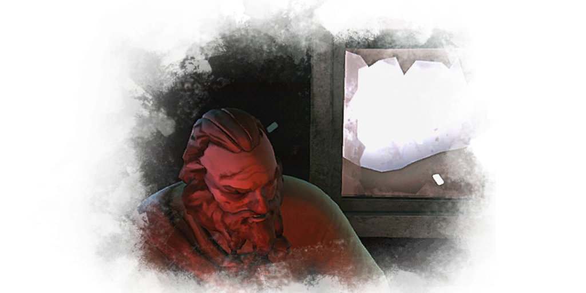
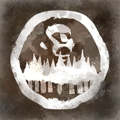

# Episode 2: Luminance Fugue

**Contents**

- [Overview](#Overview)
- [Main missions](#Main_missions)
- [The Wounded Trapper](#The_Wounded_Trapper)
- [The Best Defense](#The_Best_Defense)
- [Signal to Noise](#Signal_to_Noise)
- [What One Man Can Do](#What_One_Man_Can_Do)
- [Renewed Hope](#Renewed_Hope)
- [Side Missions](#Side_Missions)
- [Forest Talker Supply Caches](#Forest_Talker_Supply_Caches)
- [Mystery Lake Supply Caches](#Mystery_Lake_Supply_Caches)
- [Aurora Hatch](#Aurora_Hatch)
- [Hank's Hatch](#Hank%27s_Hatch)
- [Lake Gunshots](#Lake_Gunshots)
- [Survival School](#Survival_School)
- [Non-mission objective](#Non-mission_objective)
- [Cast](#Cast)
- [Major Characters](#Major_Characters)
- [Minor Characters](#Minor_Characters)
- [Affliction Availability](#Affliction_Availability)
- [Positive Benefit](#Positive_Benefit)
- [Negative Affliction](#Negative_Affliction)
- [Craft-able Unlocks](#Craft-able_Unlocks)
- [Player and Workbench Unlocks](#Player_and_Workbench_Unlocks)
- [Forge Unlocks](#Forge_Unlocks)
- [Achievements](#Achievements)
- [Gallery](#Gallery)
- [Trivia](#Trivia)

**Template:spoiler**

|  |  |  |
|----|----|----|
| “ | Mackenzie's search for Astrid takes him deeper into the savage wilderness. A mysterious trapper may be the key to finding Astrid. But can he be trusted? | ” |

## Overview

***Luminance Fugue*** is the second episode in the <a href="./Wintermute.md" class="wikilink" title="story">story</a> of <a href="./The%20Long%20Dark.md" class="wikilink" title="The Long Dark">The Long Dark</a>. It is preceded by <a href="./Episode%201%20-%20Do%20Not%20Go%20Gentle.md" class="wikilink" title="Episode 1: Do Not Go Gentle">Episode 1: Do Not Go Gentle</a> and is followed by <a href="./Episode%203%20-%20Crossroads%20Elegy.md" class="wikilink" title="Episode 3: Crossroads Elegy">Episode 3: Crossroads Elegy</a>.

## Main missions

### The Wounded Trapper

<figure>

<figcaption>Missions_story_ep2_The_Wounded_Trapper.png</figcaption>
</figure>

  
*Main article: <a href="./The%20Wounded%20Trapper.md" class="wikilink" title="The Wounded Trapper">The Wounded Trapper</a>*

"*Mackenzie rescues an Old Trapper, whose knowledge of Great Bear Island, as well his shortwave radio, might be the key to finding Astrid.*"

— In-game description

### The Best Defense

<figure>

<figcaption>Missions_story_ep2_The_Best_Defense.png</figcaption>
</figure>

  
*Main article: <a href="./The%20Best%20Defense.md" class="wikilink" title="The Best Defense">The Best Defense</a>*

"*A man-killing bear is on the prowl, risking Mackenzie's mission to find Astrid. But an old Voyageur legend might hold the answer to overcoming the massive predator.*"

— In-game description

### Signal to Noise

<figure>

<figcaption>Missions_story_ep2_Signal_to_Noise.png</figcaption>
</figure>

  
*Main article: <a href="./Signal%20to%20Noise.md" class="wikilink" title="Signal to Noise">Signal to Noise</a>*

"*Jeremiah has a plan for how Mackenzie can reach Perseverance Mills, but carrying it out may put the pilot on a collision course with the Old Bear.*"

— In-game description

### What One Man Can Do

<figure>

<figcaption>Missions_story_ep2_What_One_Man_Can_Do.png</figcaption>
</figure>

  
*Main article: <a href="./What%20One%20Man%20Can%20Do.md" class="wikilink" title="What One Man Can Do">What One Man Can Do</a>*

"*The Old Bear has dragged Mackenzie to its lair. Will he put the legendary bear's story to an end?*"

— In-game description

### Renewed Hope

<figure>

<figcaption>Missions_story_ep2_Renewed_Hope.png</figcaption>
</figure>

  
*Main article: <a href="./Renewed%20Hope.md" class="wikilink" title="Renewed Hope">Renewed Hope</a>*

"*With the Old Bear no longer a risk, Jeremiah plots a course leading Mackenzie out of Mystery Lake with the means to contact Perseverance Mills, and one step closer to finding Astrid.*"

— In-game description

## Side Missions

### Forest Talker Supply Caches

<figure>

<figcaption>Missions_story_ep2_Side.png</figcaption>
</figure>

  
*Main article: <a href="./Forest%20Talker%20Supply%20Caches.md" class="wikilink" title="Forest Talker Supply Caches">Forest Talker Supply Caches</a>*

"*The Forest Talkers, an eco-activist group, have left supply caches hidden in different regions around Great Bear Island. They could prove useful if found.*"

— In-game description

### Mystery Lake Supply Caches

  
*Main article: <a href="./Mystery%20Lake%20Supply%20Caches.md" class="wikilink" title="Mystery Lake Supply Caches">Mystery Lake Supply Caches</a>*

"*There are several supply caches hidden around Mystery Lake. Most are left by hunters or campers. Some are left by off-grid "preppers" waiting for the government to fall, or the end of the world, or some such nonsense.*"

— In-game description

### Aurora Hatch

  
*Main article: <a href="./Aurora%20Hatch.md" class="wikilink" title="Aurora Hatch">Aurora Hatch</a>*

"*There's a hidden bunker in Forlorn Muskeg that can only be opened when the aurora is active.*"

— In-game description

### Hank's Hatch

  
*Main article: <a href="./Hank%27s%20Hatch.md" class="wikilink" title="Hank&#39;s Hatch">Hank's Hatch</a>*

"*Hank, a long-time prepper and denizen of Great Bear Island, has a secret supply cache. Find it and take what you need.*"

— In-game description

### Lake Gunshots

  
*Main article: <a href="./Lake%20Gunshots.md" class="wikilink" title="Lake Gunshots">Lake Gunshots</a>*

"*You found a note with some details on possible Forest Talker activity around Mystery Lake.*"

— In-game description

### Survival School

  
*Main article: <a href="./Survival%20School.md" class="wikilink" title="Survival School">Survival School</a>*

"*Enduring the Quiet Apocalypse will require survival skills. Find the collectibles that teach you important survival lessons.*"

— In-game description

## Non-mission objective

In addition to the side missions, the player can also find three keys to the locked lake cabins. The cabins contain various loot.

- Key to cabin \#1 is found by the dead person at <a href="./High%20Blind.md" class="wikilink" title="High Blind">High Blind</a> in <a href="./Forlorn%20Muskeg.md" class="wikilink" title="Forlorn Muskeg">Forlorn Muskeg</a>.
- Key to cabin \#2 is found in the hunter's blind near <a href="./Alan%27s%20Cave.md" class="wikilink" title="Alan&#39;s cave">Alan's cave</a> in <a href="./Mystery%20Lake%20%28disambiguation%29.md" class="wikilink" title="Mystery Lake">Mystery Lake</a>.
- Key to cabin \#3 is found within the <a href="./Camp%20Office.md" class="wikilink" title="Camp Office">Camp Office</a> in <a href="./Mystery%20Lake%20%28disambiguation%29.md" class="wikilink" title="Mystery Lake">Mystery Lake</a>.

## Cast

### Major Characters

- <a href="./Will%20Mackenzie.md" class="wikilink" title="Will Mackenzie">Will Mackenzie</a> - (playable character) Mark Meer
- <a href="./Jeremiah.md" class="wikilink" title="Jeremiah">Jeremiah</a> - David Hayter
- <a href="./Methuselah.md" class="wikilink" title="Methuselah">Methuselah</a> - Richard Newman

### Minor Characters

- <a href="./Mathis.md" class="wikilink" title="Mathis">Mathis</a> - (ending cameo) Elias Toufexis (formerly voiced by Gord Marriott)
- <a href="./Atwood.md" class="wikilink" title="Atwood">Atwood</a> (mentioned)
- Radio Voice - (man on the radio calling from Perseverance Mills) - Noel Johansen
- Forest Talker (<a href="./Lake%20Gunshots.md" class="wikilink" title="Lake Gunshots">Lake Gunshots</a>) - Brian Drummond

## Affliction Availability

### Positive Benefit

- <a href="./Well%20Fed.md" class="wikilink" title="Well Fed">Well Fed</a>/<a href="./Fatigue%20Reduced.md" class="wikilink" title="Fatigue Reduced">Fatigue Reduced</a>/<a href="./Restore%20Condition.md" class="wikilink" title="Restore Condition">Restore Condition</a>/<a href="./Improved%20Rest.md" class="wikilink" title="Improved Rest">Improved Rest</a>/<a href="./Energy%20Boost.md" class="wikilink" title="Energy Boost">Energy Boost</a>/<a href="./Warming%20Up.md" class="wikilink" title="Warming Up">Warming Up</a>

### Negative Affliction

- <a href="./Torn%20Clothing.md" class="wikilink" title="Torn Clothing">Torn Clothing</a>/<a href="./Minor%20Bruising.md" class="wikilink" title="Minor Bruising">Minor Bruising</a>/<a href="./Major%20Bruising.md" class="wikilink" title="Major Bruising">Major Bruising</a>/<a href="./Laceration.md" class="wikilink" title="Laceration">Laceration</a>
- <a href="./Blood%20Loss.md" class="wikilink" title="Blood Loss">Blood Loss</a>/<a href="./Infection.md" class="wikilink" title="Infection">Infection</a>/Infection Risk
- <a href="./Food%20Poisoning.md" class="wikilink" title="Food Poisoning">Food Poisoning</a>/<a href="./Headache.md" class="wikilink" title="Headache">Headache</a>/<a href="./Burns.md" class="wikilink" title="Burns">Burns</a>/<a href="./Dysentery.md" class="wikilink" title="Dysentery">Dysentery</a>
- <a href="./Intestinal%20Parasites.md" class="wikilink" title="Intestinal Parasites">Intestinal Parasites</a> (Hardened Survivor only)
- <a href="./Hypothermia.md" class="wikilink" title="Hypothermia">Hypothermia</a> / Hypothermia Risk / <a href="./Frostbite.md" class="wikilink" title="Frostbite">Frostbite</a> /Frostbite Risk
- <a href="./Sprained%20Ankle.md" class="wikilink" title="Sprained Ankle">Sprained Ankle</a> / <a href="./Sprained%20Wrist.md" class="wikilink" title="Sprained Wrist">Sprained Wrist</a> / Sprain Risk / <a href="./Pain.md" class="wikilink" title="Pain">Pain</a>

## Craft-able Unlocks

### Player and Workbench Unlocks

- <a href="./Rabbitskin%20Mitts.md" class="wikilink" title="Rabbitskin Mitts">Rabbitskin Mitts</a>
  - Unlocks during Episode 1.
- <a href="./Rabbitskin%20Hat.md" class="wikilink" title="Rabbitskin Hat">Rabbitskin Hat</a>
  - Unlocks during Episode 1.
- <a href="./Deerskin%20Boots.md" class="wikilink" title="Deerskin Boots">Deerskin Boots</a>
  - Unlocks when you acquire and complete the <a href="./Frontier%20Shooting%20Guide.md" class="wikilink" title="Frontier Shooting Guide Book.">Frontier Shooting Guide Book.</a>
- <a href="./Deerskin%20Pants.md" class="wikilink" title="Deerskin Pants">Deerskin Pants</a>
  - Unlocks when you acquire and complete the <a href="./Frontier%20Shooting%20Guide.md" class="wikilink" title="Frontier Shooting Guide Book">Frontier Shooting Guide Book</a>.
- <a href="./Wolfskin%20Coat.md" class="wikilink" title="Wolfskin Coat">Wolfskin Coat</a>
  - Unlocks when you acquire and complete the <a href="./Advanced%20Guns%20Guns%20Guns!.md" class="wikilink" title="Advanced: Guns Guns Guns Book">Advanced: Guns Guns Guns Book</a>.
- <a href="./Line.md" class="wikilink" title="Line">Line</a>
  - Unlocks when you acquire the <a href="./The%20Frozen%20Angler.md" class="wikilink" title="The Frozen Angler Book">The Frozen Angler Book</a>.
- <a href="./Hook.md" class="wikilink" title="Hook">Hook</a>
  - Unlocks when you acquire the <a href="./The%20Frozen%20Angler.md" class="wikilink" title="The Frozen Angler Book">The Frozen Angler Book</a>.
- <a href="./Fishing%20Tackle.md" class="wikilink" title="Fishing Tackle">Fishing Tackle</a>
  - Unlocks when you acquire the <a href="./The%20Frozen%20Angler.md" class="wikilink" title="The Frozen Angler Book">The Frozen Angler Book</a>.
- <a href="./Snare.md" class="wikilink" title="Snare">Snare</a>
  - Unlocks during Episode 1.
- <a href="./Bandage.md" class="wikilink" title="Bandage">Bandage</a>
  - Unlocks during Episode 1.
- <a href="./Old%20Man%27s%20Beard%20Wound%20Dressing.md" class="wikilink" title="Old Man&#39;s Beard Wound Dressing">Old Man's Beard Wound Dressing</a>
  - Unlocks during Episode 1.
- <a href="./Prepared%20Reishi%20Mushrooms.md" class="wikilink" title="Prepared Reishi Mushrooms">Prepared Reishi Mushrooms</a>
  - Unlocks during Episode 1.
- <a href="./Prepared%20Rose%20Hips.md" class="wikilink" title="Prepared Rose Hips">Prepared Rose Hips</a>
  - Unlocks during Episode 1.
- <a href="./Prepared%20Birch%20Bark.md" class="wikilink" title="Prepared Birch Bark">Prepared Birch Bark</a>
  - Unlocks during Episode 1.
- <a href="./Tinder%20Plug.md" class="wikilink" title="Tinder Plug">Tinder Plug</a>
  - Unlocks during Episode 1.
- <a href="./Torch.md" class="wikilink" title="Torch">Torch</a>
  - Unlocks during Episode 1.

### Forge Unlocks

- <a href="./Spear%20Head.md" class="wikilink" title="Spear Head">Spear Head</a>
- <a href="./Improvised%20Knife.md" class="wikilink" title="Improvised Knife">Improvised Knife</a>
  - After successfully crafting a Spear Head, then it will unlock this ability.
- <a href="./Improvised%20Hatchet.md" class="wikilink" title="Improvised Hatchet">Improvised Hatchet</a>
  - After successfully crafting a Spear Head, then it will unlock this ability.

## Achievements

-  <a href="./The%20Old%20Trapper.md" class="wikilink" title="The Old Trapper">The Old Trapper</a>
-  <a href="./Lights%20in%20the%20Sky.md" class="wikilink" title="Lights in the Sky">Lights in the Sky</a>
-  <a href="./Graduation%20Day.md" class="wikilink" title="Graduation Day">Graduation Day</a>
-  <a href="./Freight-Train%20of%20Hate%20%26%20Hunger.md" class="wikilink" title="Freight-Train of Hate &amp; Hunger">Freight-Train of Hate &amp; Hunger</a>
-  <a href="./You%27ll%20Be%20With%20Her%20Soon.md" class="wikilink" title="You&#39;ll Be With Her Soon">You'll Be With Her Soon</a>
-  <a href="./Sounds%20Like%20Some%20Kind%20of%20Indie%20Band.md" class="wikilink" title="Sounds Like Some Kind of Indie Band">Sounds Like Some Kind of Indie Band</a>
-  <a href="./Cache%20Mastery.md" class="wikilink" title="Cache Mastery">Cache Mastery</a>

## Gallery

<table class="gallery">
<colgroup>
<col style="width: 100%" />
</colgroup>
<tbody>
<tr>
<td><figure>

<figcaption>The Episode 2 Menu Background</figcaption>
</figure></td>
</tr>
</tbody>
</table>

## Trivia

- Of all the episodes of Wintermute, Episode 2 is the most similar to <a href="./Survival%20Mode.md" class="wikilink" title="Survival Mode">Survival Mode</a>.
  - It provides full open-world access to three regions and has almost all survival mechanics enabled, aside from <a href="./Skills.md" class="wikilink" title="skills">skills</a>.

**Lua execution error in Module:Navbox function navbox** <a href="ru:%D0%A0%D0%B5%D0%B6%D0%B8%D0%BC_%D0%B8%D1%81%D1%82%D0%BE%D1%80%D0%B8%D0%B8:_%D1%8D%D0%BF%D0%B8%D0%B7%D0%BE%D0%B4_2" class="wikilink" title="ru:Режим истории: эпизод 2">ru:Режим истории: эпизод 2</a>

