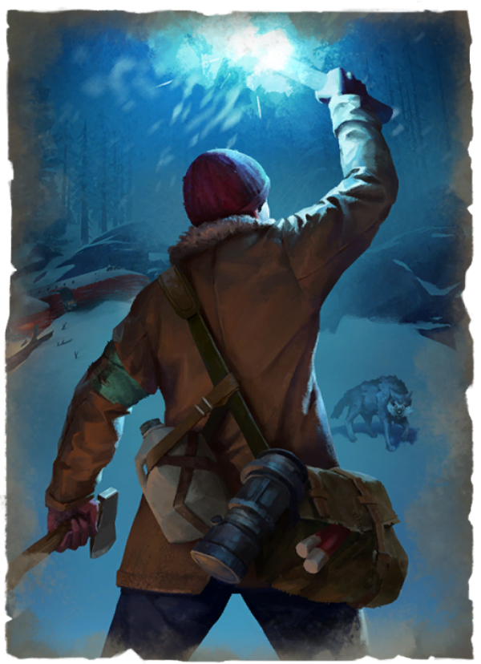
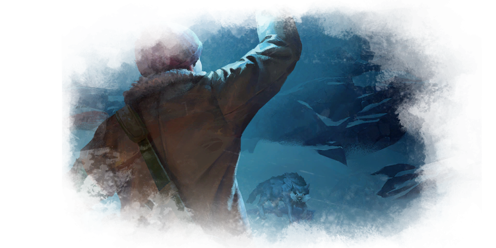
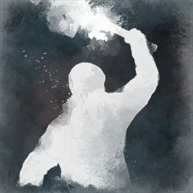
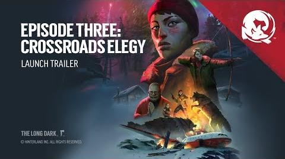

# Episode 3: Crossroads Elegy

**Categories:** Episode 3, Episodes · **Source:** [Fandom](https://thelongdark.fandom.com/wiki/Episode_3%3A_Crossroads_Elegy)

**Contents**

- [Overview](#overview)
- [Main Missions](#main-missions)
- [Trauma](#trauma)
- [Fallen Star](#fallen-star)
- [Coming Storm](#coming-storm)
- [Aftermath](#aftermath)
- [Side Missions](#side-missions)
- [Blackrock](#blackrock)
- [Forest Talkers](#forest-talkers)
- [Tall Tales](#tall-tales)
- [Molly's Gift](#mollys-gift)
- [Joplin's Bunker Raid](#joplins-bunker-raid)
- [Church Artifact](#church-artifact)
- [Cast](#cast)
- [Major Characters](#major-characters)
- [Minor Characters](#minor-characters)
- [Affliction Availability](#affliction-availability)
- [Positive Benefit](#positive-benefit)
- [Negative Affliction](#negative-affliction)
- [Craft-able Unlocks](#craft-able-unlocks)
- [Achievements](#achievements)
- [Gallery](#gallery)

**Template:spoiler**

_"In the aftermath of events in Milton, an enigmatic stranger rescues Dr. Astrid Greenwood from near-death. Facing the blizzards of Pleasant Valley, Astrid must bring all of her skills as a doctor to bear on the survivors she encounters. Will she find Mackenzie, and get closer to the mystery that's taking them to Perseverance Mills?"_

<!-- #Overview -->
​

<!-- #overview -->
## Overview

**_Crossroads Elegy_** is the third episode in the [story](./Wintermute.md) of [The Long Dark](./The%20Long%20Dark.md). It is preceded by [Episode 2: Luminance Fugue](./Episode%202%20-%20Luminance%20Fugue.md) and is followed by [Episode 4: Fury, then Silence](./Episode%204%20-%20Fury%2C%20Then%20Silence.md).

The episode takes place entirely within the [Pleasant Valley](./Pleasant%20Valley.md) region.

<!-- #Trauma -->
​

<!-- #trauma -->
### Trauma

_Main article: [Trauma](./Trauma.md)_

"_Molly rescued you from near death. As a local with deep knowledge of the Region, she might be key to surviving long enough to find a way to Perseverance Mills._"

— In-game description

<!-- #fallen_star -->
​

<!-- #Fallen_Star -->
​

<!-- #Fallen_star -->
​

<!-- #fallen-star -->
### Fallen Star

_Main article: [Fallen Star](./Fallen%20Star.md)_

"_Survivors of an airline crash in the mountains have found their way to the Community Hall in Thomson's Crossing. There might be others out there in need of help. Can you save them?_"

— In-game description

<!-- #coming_storm -->
​

<!-- #Coming_Storm -->
​

<!-- #Coming_storm -->
​

<!-- #coming-storm -->
### Coming Storm

_Main article: [Coming Storm](./Coming%20Storm.md)_

"_A whiteout blizzard is on the way. Find the three missing Survivors and collect enough supplies in the Hall kitchen to keep everyone alive until the storm passes._"

— In-game description

<!-- #Aftermath -->
​

<!-- #aftermath -->
### Aftermath

_Main article: [Aftermath](./Aftermath.md)_

"_You've brought healing and respite to the people at Thomson's Crossing. Your work at the Community Hall is complete. Do what you need to do before leaving Pleasant Valley._"

— In-game description

<!-- #Blackrock -->
​

<!-- #blackrock -->
### Blackrock

_Main article: [Blackrock (mission)](./Blackrock%20%28mission%29.md)_

"_Investigate the Black Rock Penitentiary guards and their abandoned road block._"

— In-game description

<!-- #forest_talkers -->
​

<!-- #Forest_Talkers -->
​

<!-- #Forest_talkers -->
​

<!-- #forest-talkers -->
### Forest Talkers

_Main article: [Forest Talkers (side mission)](./Forest%20Talkers%20%28side%20mission%29.md)_

"_The Forest Talkers seem to be wrapped up in the local politics and history of Pleasant Valley. Search for more information about their activity in the Region._"

— In-game description

<!-- #tall_tales -->
​

<!-- #Tall_Tales -->
​

<!-- #Tall_tales -->
​

<!-- #tall-tales -->
### Tall Tales

_Main article: [Tall Tales](./Tall%20Tales.md)_

"_Books describing odd or mysterious events in Pleasant Valley. Investigate to find out more about the life and character of people in the Region._"

— In-game description

<!-- #mollys_gift -->
​

<!-- #Molly's_Gift -->
​

<!-- #molly's_gift -->
​

<!-- #Molly's_gift -->
​

<!-- #mollys-gift -->
### Molly's Gift

_Main article: [Molly's Gift](./Molly%27s%20Gift.md)_

"_More help from Astrid's mysterious rescuer. As a local, Molly's help could be vital to surviving the harsh wilderness in Pleasant Valley._"

— In-game description

<!-- #joplins_bunker_raid -->
​

<!-- #Joplin's_Bunker_Raid -->
​

<!-- #joplin's_bunker_raid -->
​

<!-- #Joplin's_bunker_raid -->
​

<!-- #joplins-bunker-raid -->
### Joplin's Bunker Raid

_Main article: [Joplin's Bunker Raid](./Joplin%27s%20Bunker%20Raid.md)_

"_The Forest Talkers have been raiding Joplin's prepper caches. Whatever supplies remain could help you survive Pleasant Valley long enough to find a way out. Search the caches to see what's left._"

— In-game description

<!-- #church_artifact -->
​

<!-- #Church_Artifact -->
​

<!-- #Church_artifact -->
​

<!-- #church-artifact -->
### Church Artifact

_Main article: [Church Artifact](./Church%20Artifact.md)_

"_A thief has stolen an Artifact from the Church at Thomson's Crossing. In a remote town, it's likely the Artifact has great value to the residents. See what you can do to locate the item and return it home._"

— In-game description

<!-- #major_characters -->
​

<!-- #Major_Characters -->
​

<!-- #Major_characters -->
​

<!-- #major-characters -->
### Major Characters

- [Astrid Greenwood](./Astrid%20Greenwood.md)- (playable character) Jennifer Hale
- [Molly](./Molly.md) - Jennifer Kitchen
- [Father Thomas](./Father%20Thomas.md) - Alec Willows

<!-- #minor_characters -->
​

<!-- #Minor_Characters -->
​

<!-- #Minor_characters -->
​

<!-- #minor-characters -->
### Minor Characters

- [Astrid's Friend](./Jane%20Yang.md) - (flashback) Rita Yee
- [Molly's Husband](./Molly%27s%20Husband.md)
- Crash Survivor Gwen - Paula Hoffman
- Lost Crash Survivor, Logan - Ross Huguet
- Lost Crash Survivor, Wade - Adam Trask
- Lost Crash Survivor, Ava - Aimee Ayottee
- Radio Voice - (man on the radio calling from Perseverance Mills) - Noel Johansen

<!-- #positive_benefit -->
​

<!-- #Positive_Benefit -->
​

<!-- #Positive_benefit -->
​

<!-- #positive-benefit -->
### Positive Benefit

- [Well Fed](./Well%20Fed.md)/[Fatigue Reduced](./Fatigue%20Reduced.md)/[Restore Condition](./Restore%20Condition.md)/[Improved Rest](./Improved%20Rest.md)/[Energy Boost](./Energy%20Boost.md)/[Warming Up](./Warming%20Up.md)

<!-- #negative_affliction -->
​

<!-- #Negative_Affliction -->
​

<!-- #Negative_affliction -->
​

<!-- #negative-affliction -->
### Negative Affliction

- [Torn Clothing](./Torn%20Clothing.md)/[Minor Bruising](./Minor%20Bruising.md)/[Major Bruising](./Major%20Bruising.md)/[Laceration](./Laceration.md)
- [Blood Loss](./Blood%20Loss.md)/[Infection](./Infection.md)/Infection Risk
- [Food Poisoning](./Food%20Poisoning.md)/[Headache](./Headache.md)/[Burns](./Burns.md)/[Dysentery](./Dysentery.md)
- [Intestinal Parasites](./Intestinal%20Parasites.md) (Hardened Survivor only)
- [Hypothermia](./Hypothermia.md) / Hypothermia Risk / [Frostbite](./Frostbite.md) /Frostbite Risk
- [Sprained Ankle](./Sprained%20Ankle.md) / [Sprained Wrist](./Sprained%20Wrist.md) / Sprain Risk / [Pain](./Pain.md)

<!-- #craft_able_unlocks -->
​

<!-- #Craft-able_Unlocks -->
​

<!-- #craft-able_unlocks -->
​

<!-- #Craft-able_unlocks -->
​

<!-- #craft-able-unlocks -->
## Craft-able Unlocks

- [Wolfskin Coat](./Wolfskin%20Coat.md)

<!-- #Achievements -->
​

<!-- #achievements -->
## Achievements

-  [Community Service](./Community%20Service.md)
-  [Save Our Souls](./Save%20Our%20Souls.md)
-  [Hippocratic Oath](./Hippocratic%20Oath.md)
-  [He Lives](./He%20Lives.md)
-  [The Crossroads Elegy](./The%20Crossroads%20Elegy.md)
-  [Tall Tales (Achievement)](./Tall%20Tales%20%28Achievement%29.md)
-  [Every Last One](./Every%20Last%20One.md)
-  [There Will Be Blood](./There%20Will%20Be%20Blood.md)

<!-- #Gallery -->
​

<!-- #gallery -->
## Gallery

_The\_Long\_Dark\_--\_Episode\_Three\_CROSSROADS\_ELEGY\_--\_Launch\_Trailer_
