# Episode 3: Crossroads Elegy

**Contents**

- [Overview](#Overview)
- [Main Missions](#Main_Missions)
- [Trauma](#Trauma)
- [Fallen Star](#Fallen_Star)
- [Coming Storm](#Coming_Storm)
- [Aftermath](#Aftermath)
- [Side Missions](#Side_Missions)
- [Blackrock](#Blackrock)
- [Forest Talkers](#Forest_Talkers)
- [Tall Tales](#Tall_Tales)
- [Molly's Gift](#Molly%27s_Gift)
- [Joplin's Bunker Raid](#Joplin%27s_Bunker_Raid)
- [Church Artifact](#Church_Artifact)
- [Cast](#Cast)
- [Major Characters](#Major_Characters)
- [Minor Characters](#Minor_Characters)
- [Affliction Availability](#Affliction_Availability)
- [Positive Benefit](#Positive_Benefit)
- [Negative Affliction](#Negative_Affliction)
- [Craft-able Unlocks](#Craft-able_Unlocks)
- [Achievements](#Achievements)
- [Gallery](#Gallery)

**Template:spoiler**

*"In the aftermath of events in Milton, an enigmatic stranger rescues Dr. Astrid Greenwood from near-death. Facing the blizzards of Pleasant Valley, Astrid must bring all of her skills as a doctor to bear on the survivors she encounters. Will she find Mackenzie, and get closer to the mystery that's taking them to Perseverance Mills?"*

## Overview

***Crossroads Elegy*** is the third episode in the <a href="./Wintermute.md" class="wikilink" title="story">story</a> of <a href="./The%20Long%20Dark.md" class="wikilink" title="The Long Dark">The Long Dark</a>. It is preceded by <a href="./Episode%202%20-%20Luminance%20Fugue.md" class="wikilink" title="Episode 2: Luminance Fugue">Episode 2: Luminance Fugue</a> and is followed by <a href="./Episode%204%20-%20Fury%2C%20Then%20Silence.md" class="wikilink" title="Episode 4: Fury, then Silence">Episode 4: Fury, then Silence</a>.

The episode takes place entirely within the <a href="./Pleasant%20Valley.md" class="wikilink" title="Pleasant Valley">Pleasant Valley</a> region.

## Main Missions

### Trauma

<figure>
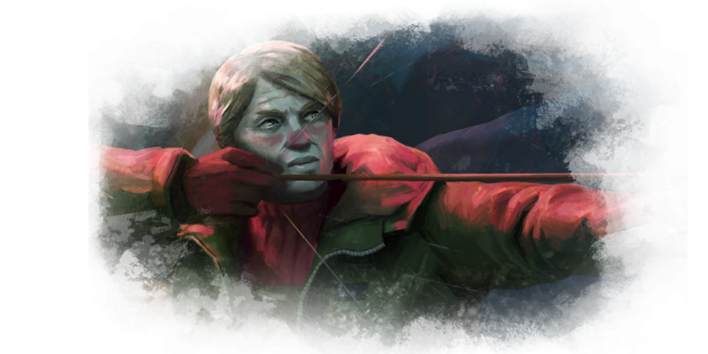
<figcaption>Missions_story_ep3_Trauma.png</figcaption>
</figure>

  
*Main article: <a href="./Trauma.md" class="wikilink" title="Trauma">Trauma</a>*

"*Molly rescued you from near death. As a local with deep knowledge of the Region, she might be key to surviving long enough to find a way to Perseverance Mills.*"

— In-game description

### Fallen Star

<figure>
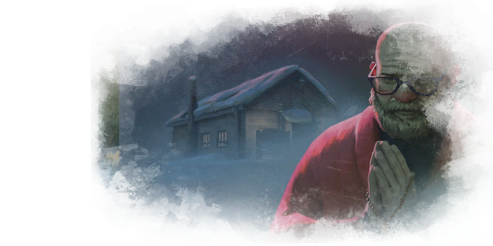
<figcaption>Missions_story_ep3_Triage.png</figcaption>
</figure>

  
*Main article: <a href="./Fallen%20Star.md" class="wikilink" title="Fallen Star">Fallen Star</a>*

"*Survivors of an airline crash in the mountains have found their way to the Community Hall in Thomson's Crossing. There might be others out there in need of help. Can you save them?*"

— In-game description

### Coming Storm

<figure>
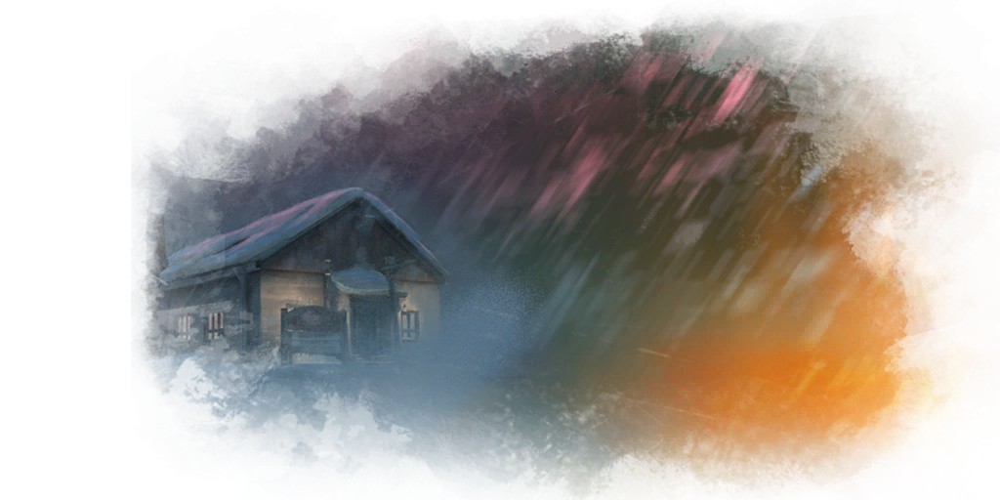
<figcaption>Missions_story_ep3_Coming_Storm.png</figcaption>
</figure>

  
*Main article: <a href="./Coming%20Storm.md" class="wikilink" title="Coming Storm">Coming Storm</a>*

"*A whiteout blizzard is on the way. Find the three missing Survivors and collect enough supplies in the Hall kitchen to keep everyone alive until the storm passes.*"

— In-game description

### Aftermath

<figure>
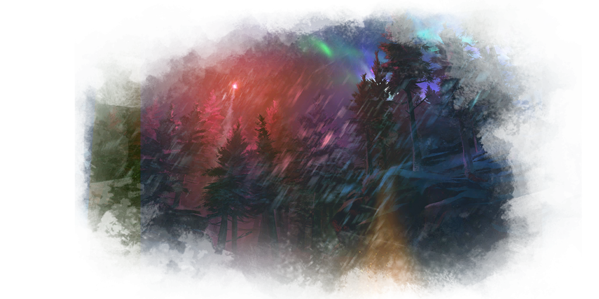
<figcaption>Missions_story_ep3_Aftermath.png</figcaption>
</figure>

  
*Main article: <a href="./Aftermath.md" class="wikilink" title="Aftermath">Aftermath</a>*

"*You've brought healing and respite to the people at Thomson's Crossing. Your work at the Community Hall is complete. Do what you need to do before leaving Pleasant Valley.*"

— In-game description

## Side Missions

### Blackrock

<figure>

<figcaption>Missions_story_ep3_Side.png</figcaption>
</figure>

  
*Main article: <a href="./Blackrock%20%28mission%29.md" class="wikilink" title="Blackrock (mission)">Blackrock (mission)</a>*

"*Investigate the Black Rock Penitentiary guards and their abandoned road block.*"

— In-game description

### Forest Talkers

<figure>
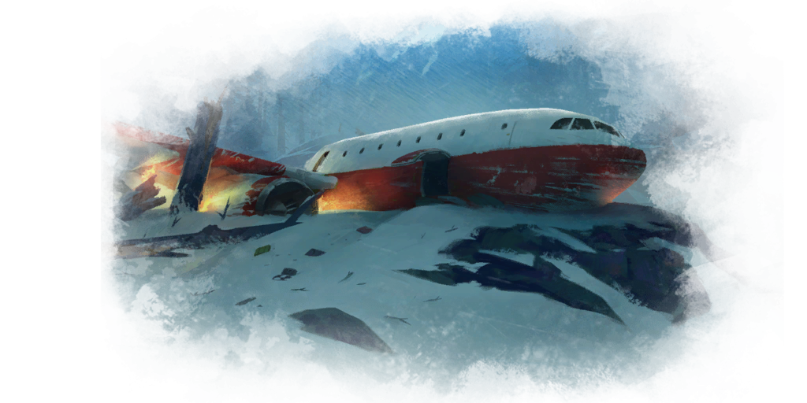
<figcaption>Missions_story_ep3_Fallen_Star.png</figcaption>
</figure>

  
*Main article: <a href="./Forest%20Talkers%20%28side%20mission%29.md" class="wikilink" title="Forest Talkers (side mission)">Forest Talkers (side mission)</a>*

"*The Forest Talkers seem to be wrapped up in the local politics and history of Pleasant Valley. Search for more information about their activity in the Region.*"

— In-game description

### Tall Tales

  
*Main article: <a href="./Tall%20Tales.md" class="wikilink" title="Tall Tales">Tall Tales</a>*

"*Books describing odd or mysterious events in Pleasant Valley. Investigate to find out more about the life and character of people in the Region.*"

— In-game description

### Molly's Gift

  
*Main article: <a href="./Molly%27s%20Gift.md" class="wikilink" title="Molly&#39;s Gift">Molly's Gift</a>*

"*More help from Astrid's mysterious rescuer. As a local, Molly's help could be vital to surviving the harsh wilderness in Pleasant Valley.*"

— In-game description

### Joplin's Bunker Raid

  
*Main article: <a href="./Joplin%27s%20Bunker%20Raid.md" class="wikilink" title="Joplin&#39;s Bunker Raid">Joplin's Bunker Raid</a>*

"*The Forest Talkers have been raiding Joplin's prepper caches. Whatever supplies remain could help you survive Pleasant Valley long enough to find a way out. Search the caches to see what's left.*"

— In-game description

### Church Artifact

  
*Main article: <a href="./Church%20Artifact.md" class="wikilink" title="Church Artifact">Church Artifact</a>*

"*A thief has stolen an Artifact from the Church at Thomson's Crossing. In a remote town, it's likely the Artifact has great value to the residents. See what you can do to locate the item and return it home.*"

— In-game description

## Cast

### Major Characters

- <a href="./Astrid%20Greenwood.md" class="wikilink" title="Astrid Greenwood">Astrid Greenwood</a>- (playable character) Jennifer Hale
- <a href="./Molly.md" class="wikilink" title="Molly">Molly</a> - Jennifer Kitchen
- <a href="./Father%20Thomas.md" class="wikilink" title="Father Thomas">Father Thomas</a> - Alec Willows

### Minor Characters

- <a href="./Jane%20Yang.md" class="wikilink" title="Astrid&#39;s Friend">Astrid's Friend</a> - (flashback) Rita Yee
- <a href="./Molly%27s%20Husband.md" class="wikilink" title="Molly&#39;s Husband">Molly's Husband</a>
- Crash Survivor Gwen - Paula Hoffman
- Lost Crash Survivor, Logan - Ross Huguet
- Lost Crash Survivor, Wade - Adam Trask
- Lost Crash Survivor, Ava - Aimee Ayottee
- Radio Voice - (man on the radio calling from Perseverance Mills) - Noel Johansen

## Affliction Availability

### Positive Benefit

- <a href="./Well%20Fed.md" class="wikilink" title="Well Fed">Well Fed</a>/<a href="./Fatigue%20Reduced.md" class="wikilink" title="Fatigue Reduced">Fatigue Reduced</a>/<a href="./Restore%20Condition.md" class="wikilink" title="Restore Condition">Restore Condition</a>/<a href="./Improved%20Rest.md" class="wikilink" title="Improved Rest">Improved Rest</a>/<a href="./Energy%20Boost.md" class="wikilink" title="Energy Boost">Energy Boost</a>/<a href="./Warming%20Up.md" class="wikilink" title="Warming Up">Warming Up</a>

### Negative Affliction

- <a href="./Torn%20Clothing.md" class="wikilink" title="Torn Clothing">Torn Clothing</a>/<a href="./Minor%20Bruising.md" class="wikilink" title="Minor Bruising">Minor Bruising</a>/<a href="./Major%20Bruising.md" class="wikilink" title="Major Bruising">Major Bruising</a>/<a href="./Laceration.md" class="wikilink" title="Laceration">Laceration</a>
- <a href="./Blood%20Loss.md" class="wikilink" title="Blood Loss">Blood Loss</a>/<a href="./Infection.md" class="wikilink" title="Infection">Infection</a>/Infection Risk
- <a href="./Food%20Poisoning.md" class="wikilink" title="Food Poisoning">Food Poisoning</a>/<a href="./Headache.md" class="wikilink" title="Headache">Headache</a>/<a href="./Burns.md" class="wikilink" title="Burns">Burns</a>/<a href="./Dysentery.md" class="wikilink" title="Dysentery">Dysentery</a>
- <a href="./Intestinal%20Parasites.md" class="wikilink" title="Intestinal Parasites">Intestinal Parasites</a> (Hardened Survivor only)
- <a href="./Hypothermia.md" class="wikilink" title="Hypothermia">Hypothermia</a> / Hypothermia Risk / <a href="./Frostbite.md" class="wikilink" title="Frostbite">Frostbite</a> /Frostbite Risk
- <a href="./Sprained%20Ankle.md" class="wikilink" title="Sprained Ankle">Sprained Ankle</a> / <a href="./Sprained%20Wrist.md" class="wikilink" title="Sprained Wrist">Sprained Wrist</a> / Sprain Risk / <a href="./Pain.md" class="wikilink" title="Pain">Pain</a>

## Craft-able Unlocks

- <a href="./Wolfskin%20Coat.md" class="wikilink" title="Wolfskin Coat">Wolfskin Coat</a>

## Achievements

- 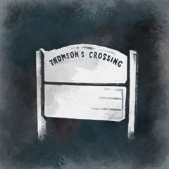 <a href="./Community%20Service.md" class="wikilink" title="Community Service">Community Service</a>
-  <a href="./Save%20Our%20Souls.md" class="wikilink" title="Save Our Souls">Save Our Souls</a>
-  <a href="./Hippocratic%20Oath.md" class="wikilink" title="Hippocratic Oath">Hippocratic Oath</a>
-  <a href="./He%20Lives.md" class="wikilink" title="He Lives">He Lives</a>
-  <a href="./The%20Crossroads%20Elegy.md" class="wikilink" title="The Crossroads Elegy">The Crossroads Elegy</a>
-  <a href="./Tall%20Tales%20%28Achievement%29.md" class="wikilink" title="Tall Tales (Achievement)">Tall Tales (Achievement)</a>
- 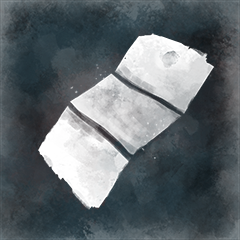 <a href="./Every%20Last%20One.md" class="wikilink" title="Every Last One">Every Last One</a>
- 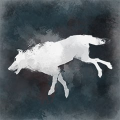 <a href="./There%20Will%20Be%20Blood.md" class="wikilink" title="There Will Be Blood">There Will Be Blood</a>

## Gallery

<table class="gallery">
<colgroup>
<col style="width: 25%" />
<col style="width: 25%" />
<col style="width: 25%" />
<col style="width: 25%" />
</colgroup>
<tbody>
<tr>
<td><figure>
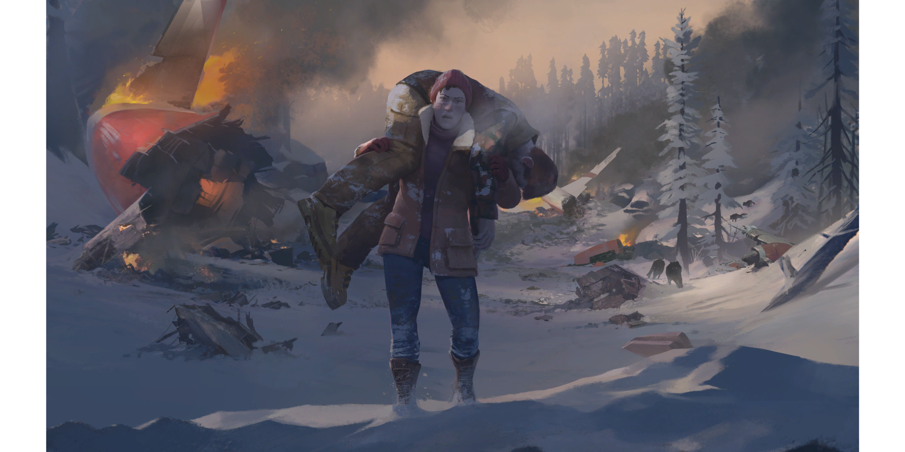
<figcaption>The Episode 3 Menu Background</figcaption>
</figure></td>
<td><figure>
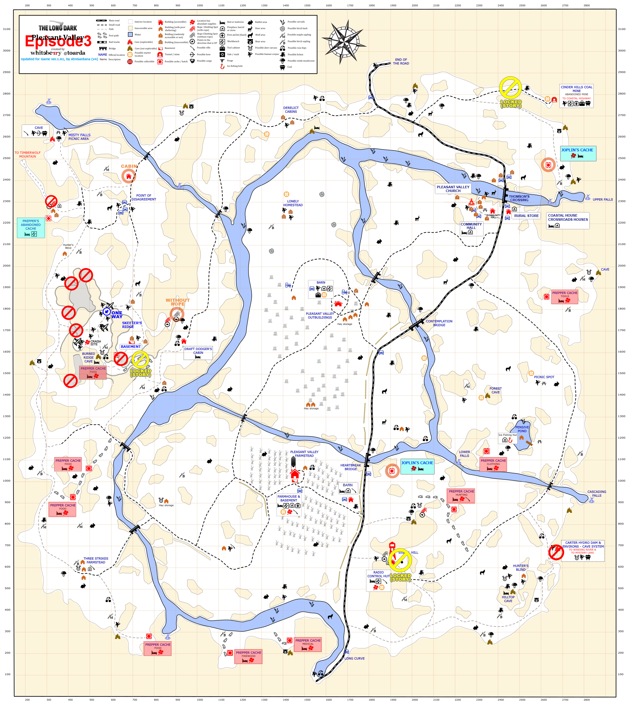
<figcaption>As of 1.92. The in-game map is this map but rotated 90 degrees clockwise</figcaption>
</figure></td>
<td><figure>
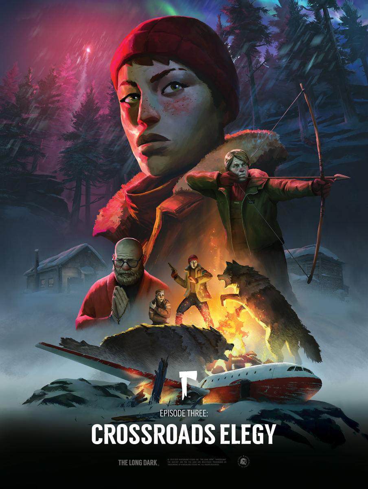
<figcaption>Elegy_poster.png</figcaption>
</figure></td>
<td><figure>
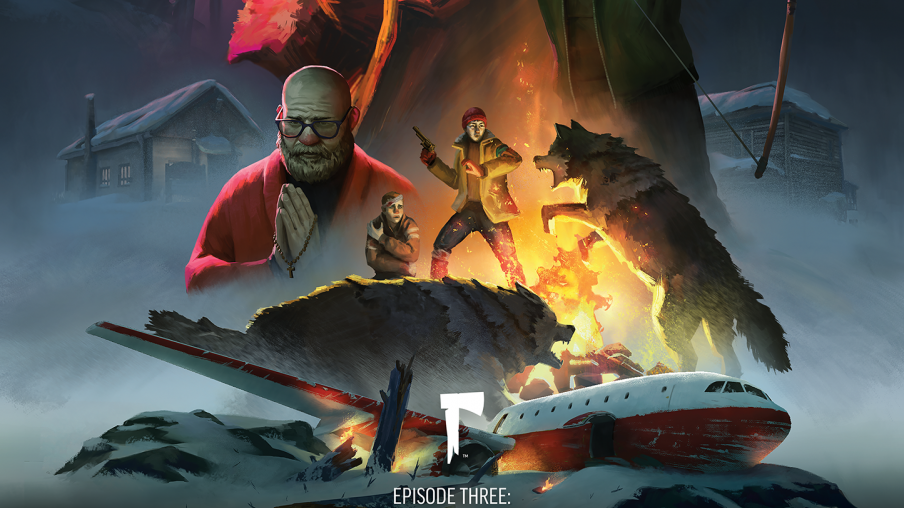
<figcaption>Crossroads Elegy Poster</figcaption>
</figure></td>
</tr>
<tr>
<td><figure>
[Missing image: The_Long_Dark_--_Episode_Three_CROSSROADS_ELEGY_--_Launch_Trailer]
<figcaption>The_Long_Dark_--_Episode_Three_CROSSROADS_ELEGY_--_Launch_Trailer</figcaption>
</figure></td>
<td></td>
<td></td>
<td></td>
</tr>
</tbody>
</table>

**Lua execution error in Module:Navbox function navbox** <a href="ru:%D0%A0%D0%B5%D0%B6%D0%B8%D0%BC_%D0%B8%D1%81%D1%82%D0%BE%D1%80%D0%B8%D0%B8:_%D1%8D%D0%BF%D0%B8%D0%B7%D0%BE%D0%B4_3" class="wikilink" title="ru:Режим истории: эпизод 3">ru:Режим истории: эпизод 3</a>

