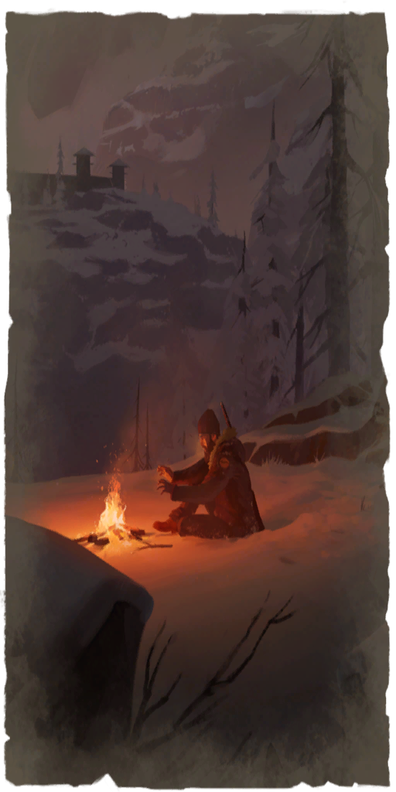
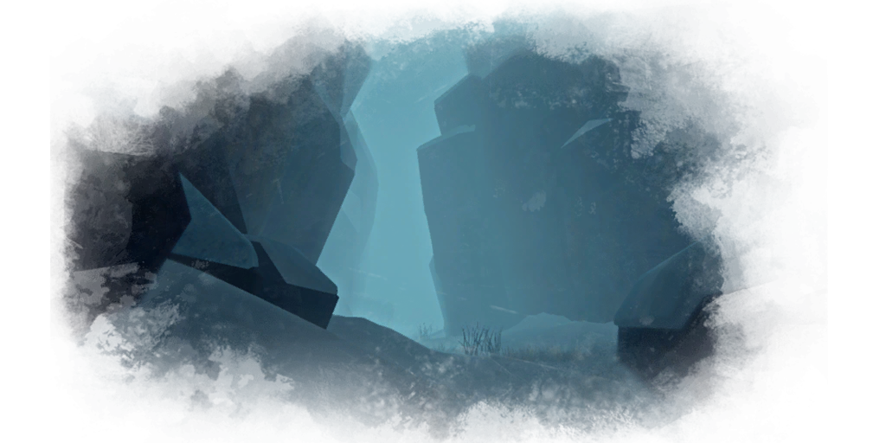
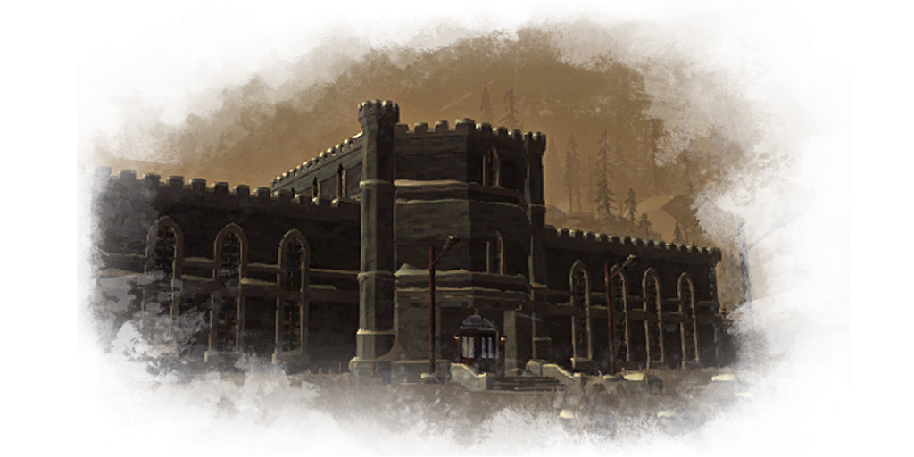
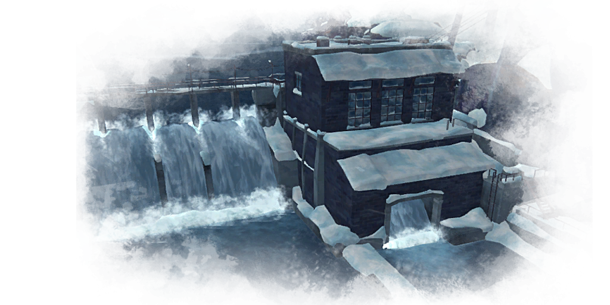
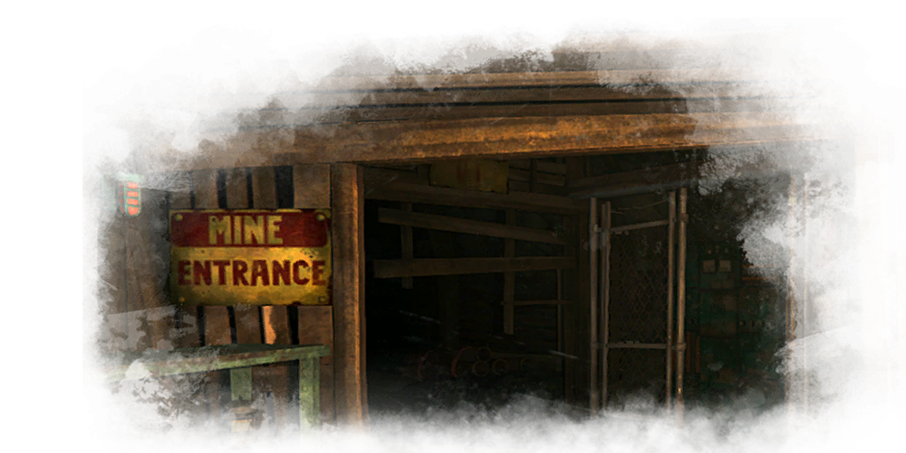
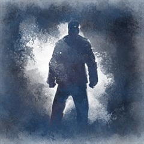
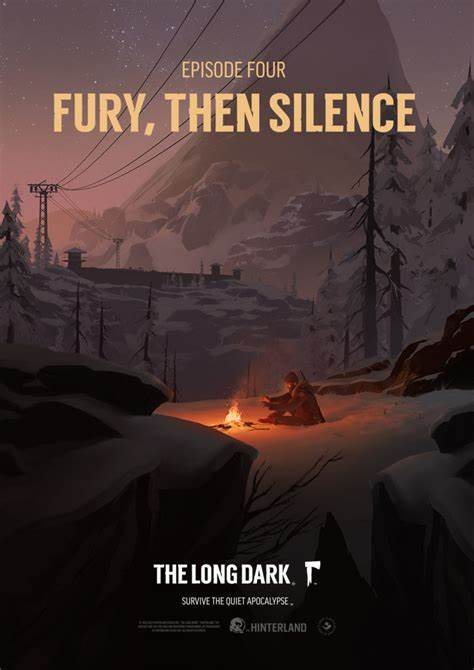
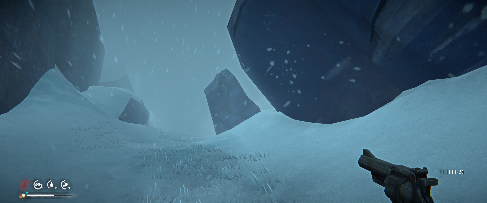
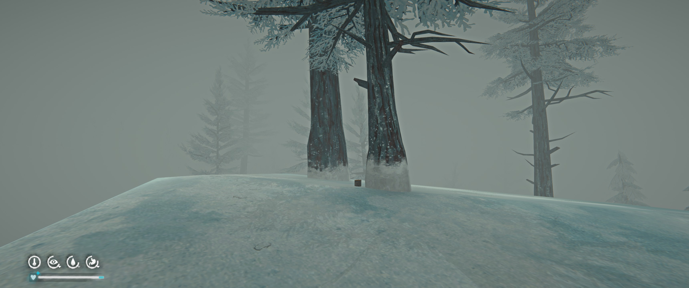
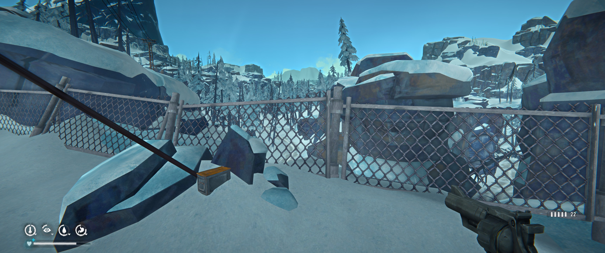

# Episode 4: Fury, Then Silence

**Categories:** Episode 4, Episodes · **Source:** [Fandom](https://thelongdark.fandom.com/wiki/Episode_4%3A_Fury%2C_Then_Silence)

**Contents**

- [Overview](#overview)
- [Missions](#missions)
- [Prologue](#prologue)
- [Blackrock Blues](#blackrock-blues)
- [The Power Plant](#the-power-plant)
- [The Detonators](#the-detonators)
- [Donner](#donner)
- [Side Missions](#side-missions)
- [Blackrock Lockers](#blackrock-lockers)
- [Blackrock Rumours](#blackrock-rumours)
- [Convict Caches](#convict-caches)
- [Dark Star](#dark-star)
- [Lost Power Workers](#lost-power-workers)
- [A Riddle Among the Shadows](#a-riddle-among-the-shadows)
- [Cast](#cast)
- [Major Characters](#major-characters)
- [Minor Characters](#minor-characters)
- [Affliction Availability](#affliction-availability)
- [Positive Benefit](#positive-benefit)
- [Negative Affliction](#negative-affliction)
- [Craft-able Unlocks](#craft-able-unlocks)
- [Achievements](#achievements)
- [Gallery](#gallery)

**Template:spoiler** _"A murderous gang of convicts has captured Mackenzie. Desperate to escape one of the darkest corners of Great Bear Island, he must somehow survive his fiercest enemy yet. Can Mackenzie recover the Hardcase, continue his search for Astrid, and also save the innocents caught up in this deadly confrontation?"_

## Overview

**_Fury, Then Silence_** is the fourth episode in the [story](./Wintermute.md) of [The Long Dark](./The%20Long%20Dark.md), following [Episode 3: Crossroads Elegy](./Episode%203%20-%20Crossroads%20Elegy.md). The episode takes place entirely within the [Blackrock Mountain](./Blackrock%20Mountain.md) region with [Will Mackenzie](./Will%20Mackenzie.md) as the protagonist, and precedes [Episode 5: The Light At The End Of All Things](./Episode%205%20-%20The%20Light%20At%20The%20End%20Of%20All%20Things.md): the conclusion to the story of Wintermute. [Mathis](./Mathis.md) serves as the episode's main antagonist.

The Episode 4 was released on October 6th, 2021.

## Missions

### Prologue

_Main article: [Prologue](./Prologue.md)_

"_Mackenzie seizes his chance to escape Mathis._"

— In-game description

### Blackrock Blues

_Main article: [Blackrock Blues](./Blackrock%20Blues.md)_

"_Learn all you can about Blackrock Penitentiary._"

— In-game description

### The Power Plant

_Main article: [The Power Plant](./The%20Power%20Plant.md)_

"_Mathis orders you to find the old Power Plant and look for a way to restore power to solitary._"

— In-game description

### The Detonators

_Main article: [The Detonators](./The%20Detonators.md)_

"_Travel to the Mine and locate the Detonators for Mathis._"

— In-game description

### Donner

_Main article: [Donner (mission)](./Donner%20%28mission%29.md)_

"_An explosion has turned the tables on Mathis. Make your escape._"

— In-game description

## Side Missions

### Blackrock Lockers

_Main article: [Blackrock Lockers](./Blackrock%20Lockers.md)_

"_Locate and use the keys that unlock Lockers found at the Blackrock Penitentiary._"

— In-game description

### Blackrock Rumours

_Main article: [Blackrock Rumours](./Blackrock%20Rumours.md)_

"_Security memos describing unusual activity in the Blackrock area._"

— In-game description

### Convict Caches

_Main article: [Convict Caches](./Convict%20Caches.md)_

"_An escaping convict left some hidden caches to help the other convicts following him._"

— In-game description

### Dark Star

_Main article: [Dark Star](./Dark%20Star.md)_

"_Records from Blackrock's official archive have escaped their vault. Find and read the bloody pages to learn more about the notorious maximum security prison._"

— In-game description

### Lost Power Workers

_Main article: [Lost Power Workers](./Lost%20Power%20Workers.md)_

"_Find out what happened to the lost power workers. Search their last noted work locations._"

— In-game description

### A Riddle Among the Shadows

_Main article: [A Riddle Among the Shadows](./A%20Riddle%20Among%20the%20Shadows.md)_

"_Open and search the Forest Talker Supply Cache._"

— In-game description

## Cast

### Major Characters

- [Will Mackenzie](./Will%20Mackenzie.md) - (Playable Character) Mark Meer
- [Mathis](./Mathis.md) - Elias Toufexis
- [Franklin](./Franklin.md) - Laurie McGinnis
- [Jace](./Jace.md) - Tina Grant

### Minor Characters

- [Astrid Greenwood](./Astrid%20Greenwood.md) (ending cameo) - Jennifer Hale
- [Donner](./Donner.md) (unseen)
- [Vachon](./Vachon.md) - Jacques Lalonde
- [Heller](./Heller.md) - Jordan Waunch
- [Jane Yang](./Jane%20Yang.md) (ending cameo) - Rita Yee
- [Atwood](./Atwood.md) (mentioned)
- Townsperson One (ending cameo) - Jeff Cooper
- Townsperson Two (ending cameo) - Jason McKinnon
- [Convicts](./Convicts.md) - Jordan Waunch and Jacques Lalonde

## Affliction Availability

### Positive Benefit

- [Well Fed](./Well%20Fed.md)/[Fatigue Reduced](./Fatigue%20Reduced.md)/[Restore Condition](./Restore%20Condition.md)/[Improved Rest](./Improved%20Rest.md)/[Energy Boost](./Energy%20Boost.md)/[Warming Up](./Warming%20Up.md)

### Negative Affliction

- [Torn Clothing](./Torn%20Clothing.md)/[Minor Bruising](./Minor%20Bruising.md)/[Major Bruising](./Major%20Bruising.md)/[Laceration](./Laceration.md)
- [Blood Loss](./Blood%20Loss.md)/[Infection](./Infection.md)/Infection Risk
- [Food Poisoning](./Food%20Poisoning.md)/[Headache](./Headache.md)/[Burns](./Burns.md)/[Dysentery](./Dysentery.md)
- [Broken Ribs](./Broken%20Ribs.md)/[Suffocation](./Suffocation.md)
- [Intestinal Parasites](./Intestinal%20Parasites.md) (Hardened Survivor only)
- [Hypothermia](./Hypothermia.md) / Hypothermia Risk / [Frostbite](./Frostbite.md) /Frostbite Risk
- [Sprained Ankle](./Sprained%20Ankle.md) / [Sprained Wrist](./Sprained%20Wrist.md) / Sprain Risk / [Pain](./Pain.md)

## Achievements

-  [Welcome to the S\**t Show](./Welcome%20to%20the%20S%2A%2At%20Show.md)
-  [Just Like New](./Just%20Like%20New.md)
-  [Something Stinks](./Something%20Stinks.md)
-  [Enemy For Life](./Enemy%20For%20Life.md)
-  [Leap of Faith](./Leap%20of%20Faith.md)
-  [Black Black Heart](./Black%20Black%20Heart.md)
-  [Hard Times](./Hard%20Times.md)
-  [No Half-Measures](./No%20Half-Measures.md)

## Gallery

