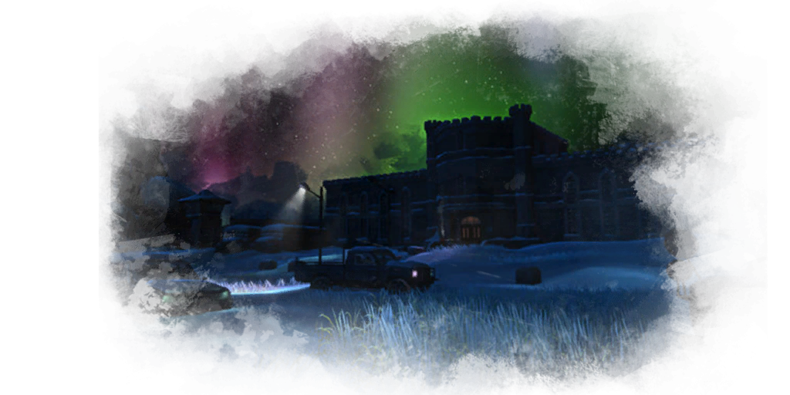
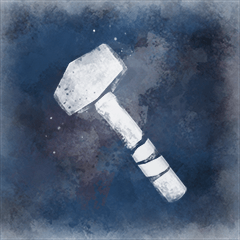
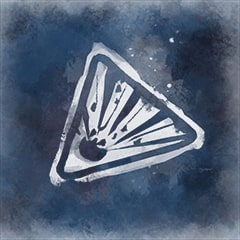
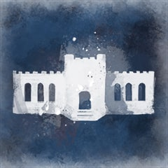
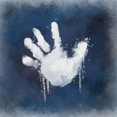
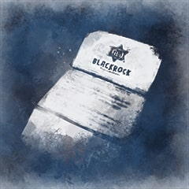
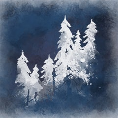
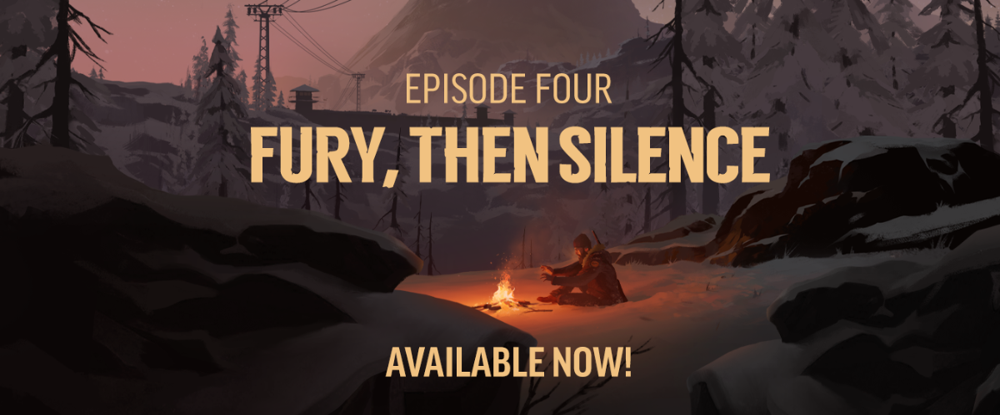
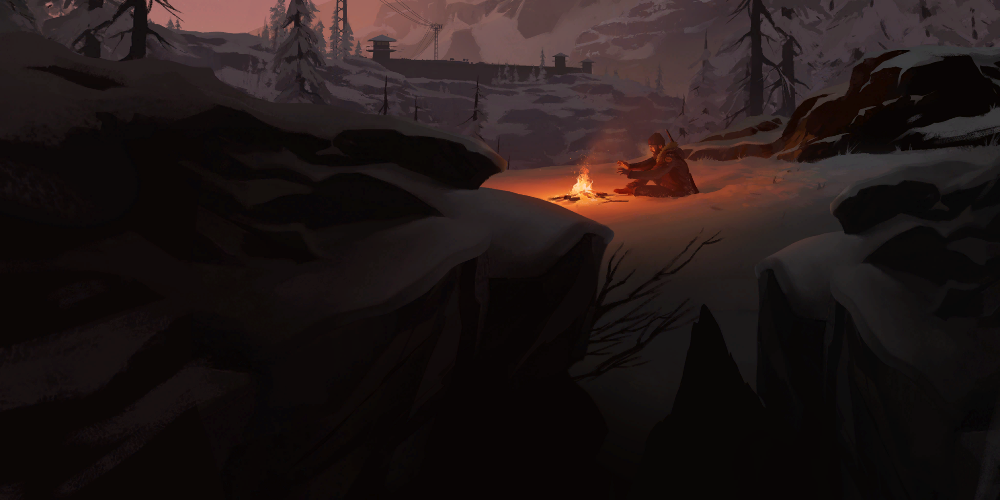

# Episode 4: Fury, Then Silence

**Contents**

- [Overview](#Overview)
- [Missions](#Missions)
- [Prologue](#Prologue)
- [Blackrock Blues](#Blackrock_Blues)
- [The Power Plant](#The_Power_Plant)
- [The Detonators](#The_Detonators)
- [Donner](#Donner)
- [Side Missions](#Side_Missions)
- [Blackrock Lockers](#Blackrock_Lockers)
- [Blackrock Rumours](#Blackrock_Rumours)
- [Convict Caches](#Convict_Caches)
- [Dark Star](#Dark_Star)
- [Lost Power Workers](#Lost_Power_Workers)
- [A Riddle Among the Shadows](#A_Riddle_Among_the_Shadows)
- [Cast](#Cast)
- [Major Characters](#Major_Characters)
- [Minor Characters](#Minor_Characters)
- [Affliction Availability](#Affliction_Availability)
- [Positive Benefit](#Positive_Benefit)
- [Negative Affliction](#Negative_Affliction)
- [Craft-able Unlocks](#Craft-able_Unlocks)
- [Achievements](#Achievements)
- [Gallery](#Gallery)

**Template:spoiler** *"A murderous gang of convicts has captured Mackenzie. Desperate to escape one of the darkest corners of Great Bear Island, he must somehow survive his fiercest enemy yet. Can Mackenzie recover the Hardcase, continue his search for Astrid, and also save the innocents caught up in this deadly confrontation?"*

## Overview

***Fury, Then Silence*** is the fourth episode in the <a href="./Wintermute.md" class="wikilink" title="story">story</a> of <a href="./The%20Long%20Dark.md" class="wikilink" title="The Long Dark">The Long Dark</a>, following <a href="./Episode%203%20-%20Crossroads%20Elegy.md" class="wikilink" title="Episode 3: Crossroads Elegy">Episode 3: Crossroads Elegy</a>. The episode takes place entirely within the <a href="./Blackrock%20Mountain.md" class="wikilink" title="Blackrock Mountain">Blackrock Mountain</a> region with <a href="./Will%20Mackenzie.md" class="wikilink" title="Will Mackenzie">Will Mackenzie</a> as the protagonist, and precedes <a href="./Episode%205%20-%20The%20Light%20At%20The%20End%20Of%20All%20Things.md" class="wikilink" title="Episode 5: The Light At The End Of All Things">Episode 5: The Light At The End Of All Things</a>: the conclusion to the story of Wintermute. <a href="./Mathis.md" class="wikilink" title="Mathis">Mathis</a> serves as the episode's main antagonist.

The Episode 4 was released on October 6th, 2021.

## Missions

### Prologue

  
*Main article: <a href="./Prologue.md" class="wikilink" title="Prologue">Prologue</a>*

<figure>

<figcaption>Prologue.png</figcaption>
</figure>

  
"*Mackenzie seizes his chance to escape Mathis.*"

— In-game description

### Blackrock Blues

  
*Main article: <a href="./Blackrock%20Blues.md" class="wikilink" title="Blackrock Blues">Blackrock Blues</a>*

<figure>

<figcaption>Blackrock_Blues.png</figcaption>
</figure>

  
"*Learn all you can about Blackrock Penitentiary.*"

— In-game description

### The Power Plant

  
*Main article: <a href="./The%20Power%20Plant.md" class="wikilink" title="The Power Plant">The Power Plant</a>*

<figure>

<figcaption>The_Power_Plant.png</figcaption>
</figure>

  
"*Mathis orders you to find the old Power Plant and look for a way to restore power to solitary.*"

— In-game description

### The Detonators

  
*Main article: <a href="./The%20Detonators.md" class="wikilink" title="The Detonators">The Detonators</a>*

<figure>

<figcaption>The_Detonators.png</figcaption>
</figure>

  
"*Travel to the Mine and locate the Detonators for Mathis.*"

— In-game description

### Donner

  
*Main article: <a href="./Donner%20%28mission%29.md" class="wikilink" title="Donner (mission)">Donner (mission)</a>*

<!-- -->

  
"*An explosion has turned the tables on Mathis. Make your escape.*"

— In-game description

## Side Missions

### Blackrock Lockers

  
*Main article: <a href="./Blackrock%20Lockers.md" class="wikilink" title="Blackrock Lockers">Blackrock Lockers</a>*

<figure>

<figcaption>Missions_story_ep4_Side.png</figcaption>
</figure>

  
"*Locate and use the keys that unlock Lockers found at the Blackrock Penitentiary.*"

— In-game description

### Blackrock Rumours

  
*Main article: <a href="./Blackrock%20Rumours.md" class="wikilink" title="Blackrock Rumours">Blackrock Rumours</a>*

<!-- -->

  
"*Security memos describing unusual activity in the Blackrock area.*"

— In-game description

### Convict Caches

  
*Main article: <a href="./Convict%20Caches.md" class="wikilink" title="Convict Caches">Convict Caches</a>*

<!-- -->

  
"*An escaping convict left some hidden caches to help the other convicts following him.*"

— In-game description

### Dark Star

  
*Main article: <a href="./Dark%20Star.md" class="wikilink" title="Dark Star">Dark Star</a>*

<!-- -->

  
"*Records from Blackrock's official archive have escaped their vault. Find and read the bloody pages to learn more about the notorious maximum security prison.*"

— In-game description

### Lost Power Workers

  
*Main article: <a href="./Lost%20Power%20Workers.md" class="wikilink" title="Lost Power Workers">Lost Power Workers</a>*

<!-- -->

  
"*Find out what happened to the lost power workers. Search their last noted work locations.*"

— In-game description

### A Riddle Among the Shadows

  
*Main article: <a href="./A%20Riddle%20Among%20the%20Shadows.md" class="wikilink" title="A Riddle Among the Shadows">A Riddle Among the Shadows</a>*

<!-- -->

  
"*Open and search the Forest Talker Supply Cache.*"

— In-game description

## Cast

### Major Characters

- <a href="./Will%20Mackenzie.md" class="wikilink" title="Will Mackenzie">Will Mackenzie</a> - (Playable Character) Mark Meer
- <a href="./Mathis.md" class="wikilink" title="Mathis">Mathis</a> - Elias Toufexis
- <a href="./Franklin.md" class="wikilink" title="Franklin">Franklin</a> - Laurie McGinnis
- <a href="./Jace.md" class="wikilink" title="Jace">Jace</a> - Tina Grant

### Minor Characters

- <a href="./Astrid%20Greenwood.md" class="wikilink" title="Astrid Greenwood">Astrid Greenwood</a> (ending cameo) - Jennifer Hale
- <a href="./Donner.md" class="wikilink" title="Donner">Donner</a> (unseen)
- <a href="./Vachon.md" class="wikilink" title="Vachon">Vachon</a> - Jacques Lalonde
- <a href="./Heller.md" class="wikilink" title="Heller">Heller</a> - Jordan Waunch
- <a href="./Jane%20Yang.md" class="wikilink" title="Jane Yang">Jane Yang</a> (ending cameo) - Rita Yee
- <a href="./Atwood.md" class="wikilink" title="Atwood">Atwood</a> (mentioned)
- Townsperson One (ending cameo) - Jeff Cooper
- Townsperson Two (ending cameo) - Jason McKinnon
- <a href="./Convicts.md" class="wikilink" title="Convicts">Convicts</a> - Jordan Waunch and Jacques Lalonde

## Affliction Availability

### Positive Benefit

- <a href="./Well%20Fed.md" class="wikilink" title="Well Fed">Well Fed</a>/<a href="./Fatigue%20Reduced.md" class="wikilink" title="Fatigue Reduced">Fatigue Reduced</a>/<a href="./Restore%20Condition.md" class="wikilink" title="Restore Condition">Restore Condition</a>/<a href="./Improved%20Rest.md" class="wikilink" title="Improved Rest">Improved Rest</a>/<a href="./Energy%20Boost.md" class="wikilink" title="Energy Boost">Energy Boost</a>/<a href="./Warming%20Up.md" class="wikilink" title="Warming Up">Warming Up</a>

### Negative Affliction

- <a href="./Torn%20Clothing.md" class="wikilink" title="Torn Clothing">Torn Clothing</a>/<a href="./Minor%20Bruising.md" class="wikilink" title="Minor Bruising">Minor Bruising</a>/<a href="./Major%20Bruising.md" class="wikilink" title="Major Bruising">Major Bruising</a>/<a href="./Laceration.md" class="wikilink" title="Laceration">Laceration</a>
- <a href="./Blood%20Loss.md" class="wikilink" title="Blood Loss">Blood Loss</a>/<a href="./Infection.md" class="wikilink" title="Infection">Infection</a>/Infection Risk
- <a href="./Food%20Poisoning.md" class="wikilink" title="Food Poisoning">Food Poisoning</a>/<a href="./Headache.md" class="wikilink" title="Headache">Headache</a>/<a href="./Burns.md" class="wikilink" title="Burns">Burns</a>/<a href="./Dysentery.md" class="wikilink" title="Dysentery">Dysentery</a>
- <a href="./Broken%20Ribs.md" class="wikilink" title="Broken Ribs">Broken Ribs</a>/<a href="./Suffocation.md" class="wikilink" title="Suffocation">Suffocation</a>
- <a href="./Intestinal%20Parasites.md" class="wikilink" title="Intestinal Parasites">Intestinal Parasites</a> (Hardened Survivor only)
- <a href="./Hypothermia.md" class="wikilink" title="Hypothermia">Hypothermia</a> / Hypothermia Risk / <a href="./Frostbite.md" class="wikilink" title="Frostbite">Frostbite</a> /Frostbite Risk
- <a href="./Sprained%20Ankle.md" class="wikilink" title="Sprained Ankle">Sprained Ankle</a> / <a href="./Sprained%20Wrist.md" class="wikilink" title="Sprained Wrist">Sprained Wrist</a> / Sprain Risk / <a href="./Pain.md" class="wikilink" title="Pain">Pain</a>

## Craft-able Unlocks

## Achievements

-  <a href="./Welcome%20to%20the%20S%2A%2At%20Show.md" class="wikilink" title="Welcome to the S**t Show">Welcome to the S**t Show</a>
-  <a href="./Just%20Like%20New.md" class="wikilink" title="Just Like New">Just Like New</a>
-  <a href="./Something%20Stinks.md" class="wikilink" title="Something Stinks">Something Stinks</a>
-  <a href="./Enemy%20For%20Life.md" class="wikilink" title="Enemy For Life">Enemy For Life</a>
-  <a href="./Leap%20of%20Faith.md" class="wikilink" title="Leap of Faith">Leap of Faith</a>
-  <a href="./Black%20Black%20Heart.md" class="wikilink" title="Black Black Heart">Black Black Heart</a>
-  <a href="./Hard%20Times.md" class="wikilink" title="Hard Times">Hard Times</a>
-  <a href="./No%20Half-Measures.md" class="wikilink" title="No Half-Measures">No Half-Measures</a>

## Gallery

<table class="gallery">
<colgroup>
<col style="width: 25%" />
<col style="width: 25%" />
<col style="width: 25%" />
<col style="width: 25%" />
</colgroup>
<tbody>
<tr>
<td><figure>

<figcaption>poster</figcaption>
</figure></td>
<td><figure>
[Missing image: Episode_4.jpg]
<figcaption>Poster</figcaption>
</figure></td>
<td><figure>
[Missing image: Valley_cache.jpg]
<figcaption>One of the convict caches.</figcaption>
</figure></td>
<td><figure>
[Missing image: Small_mountain_cache.jpg]
<figcaption>Convict cache located at a mountain on the map.</figcaption>
</figure></td>
</tr>
<tr>
<td><figure>
[Missing image: Radio_tower_cache.jpg]
<figcaption>Radio tower convict cache.</figcaption>
</figure></td>
<td><figure>

<figcaption>Episode 4's Menu Background</figcaption>
</figure></td>
<td></td>
<td></td>
</tr>
</tbody>
</table>

**Lua execution error in Module:Navbox function navbox**

