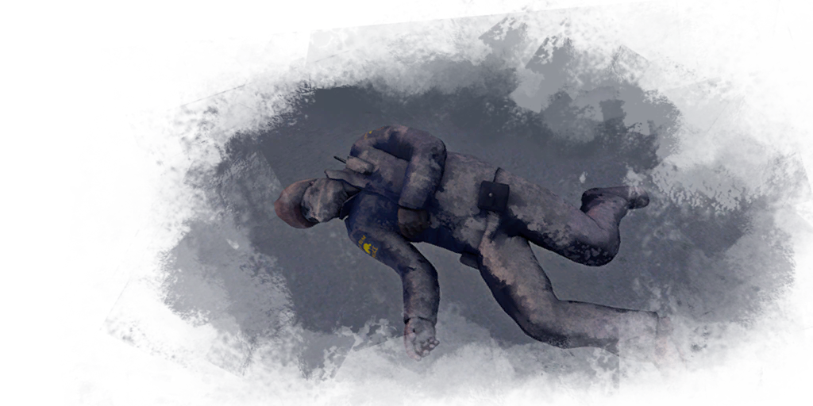
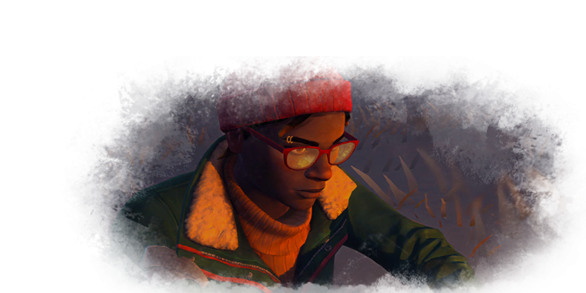
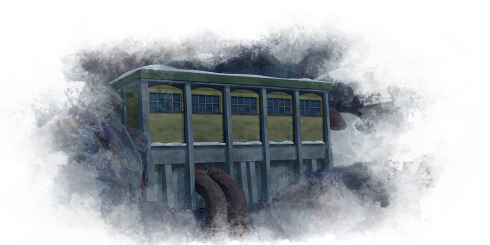
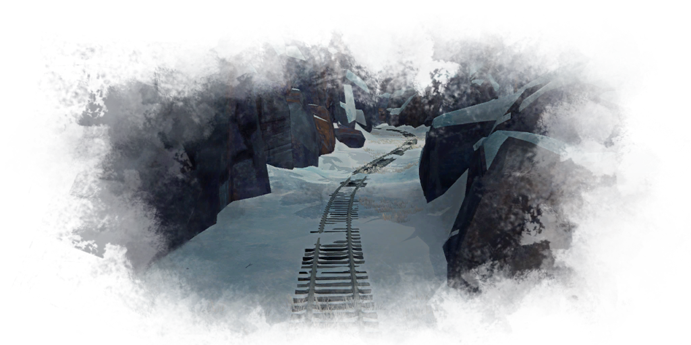

# Episode 5: The Light At The End Of All Things

**Contents**

- [Overview](#Overview)
- [Missions](#Missions)
- [Part One: Perseverance](#Part_One%3A_Perseverance)
- [Perseverance](#Perseverance)
- [To Those Who Are Missing](#To_Those_Who_Are_Missing)
- [A Cry For Help](#A_Cry_For_Help)
- [Part Two: Strange History](#Part_Two%3A_Strange_History)
- [The Cold, Broken Road](#The_Cold%2C_Broken_Road)
- [High Energy](#High_Energy)
- [Part Three: Do No Harm](#Part_Three%3A_Do_No_Harm)
- [To SAR And Back](#To_SAR_And_Back)
- [Part Four: Terminus](#Part_Four%3A_Terminus)
- [Conflagration](#Conflagration)
- [Side Missions](#Side_Missions)
- [Cast](#Cast)
- [Major Characters](#Major_Characters)
- [Minor Characters](#Minor_Characters)
- [Affliction Availability](#Affliction_Availability)
- [Achievements](#Achievements)
- [Gallery](#Gallery)
- [Trivia](#Trivia)

\[Missing image: Episode_5_Poster.jpg\]*"Separated by events on Great Bear Island, Astrid and Mackenzie struggle to make sense of The Quiet Apocalypse. In Perseverance Mills, Astrid investigates the quarantine established in the remote town. Lost in the wilderness with Jace, Mackenzie pushes on to deliver the WINTERMUTE message to Dr. Atwood.*

*Will they finally uncover the mystery of the Aurora, and what it means for the world?"*

**Spoiler Warning:***This page may contain spoilers from the <a href="./Wintermute.md" class="wikilink" title="story">story</a> of The Long Dark.*

***The Light At The End Of All Things*** is the 5th and final chapter of the <a href="./Wintermute.md" class="wikilink" title="Wintermute">Wintermute</a> story of *<a href="./The%20Long%20Dark.md" class="wikilink" title="The Long Dark">The Long Dark</a>*. It is preceded by <a href="./Episode%204%20-%20Fury%2C%20Then%20Silence.md" class="wikilink" title="Episode 4: Fury, Then Silence">Episode 4: Fury, Then Silence</a>.

Hinterland released Episode 5 of *The Long Dark* for free to all current owners on March 31, 2026. It takes place in both the mysterious <a href="./Perseverance%20Mills.md" class="wikilink" title="Perseverance Mills">Perseverance Mills</a> and <a href="./Suzuki%20Radio%20Telescope.md" class="wikilink" title="Suzuki Radio Telescope">Suzuki Radio Telescope</a> and completes the story of Mackenzie and Astrid, while also tying up most of the loose threads left within the story (including the conflict involving <a href="./Mathis.md" class="wikilink" title="Mathis">Mathis</a> and his gang of <a href="./Convicts.md" class="wikilink" title="Convicts">Convicts</a>, the contents of <a href="./Astrid%27s%20Hardcase.md" class="wikilink" title="Astrid&#39;s Hardcase">Astrid's Hardcase</a>, what caused the <a href="./First%20Flare.md" class="wikilink" title="First Flare">First Flare</a>, and the message Mackenzie must carry to <a href="./Atwood.md" class="wikilink" title="Atwood">Atwood</a>, "Wintermute").

Both Mackenzie and Astrid are playable characters in the Episode, switching perspectives between multiple parts of the story between missions.

## Overview

## Missions

### Part One: Perseverance

Perseverance is the first chapter of Episode 5. <a href="./Astrid%20Greenwood.md" class="wikilink" title="Astrid Greenwood">Astrid Greenwood</a> is the only playable character in this chapter. The chapter takes place at <a href="./Perseverance%20Mills.md" class="wikilink" title="Perseverance Mills">Perseverance Mills</a> and in the surrounding Perseverance Countryside. It contains 3 different missions. 

#### Perseverance

  
*Main article: <a href="./Perseverance.md" class="wikilink" title="Perseverance">Perseverance</a>*

"*A strange illness has taken hold in Perseverance Mils. People are missing. Investigate the town and see what you can find out.*"

— In-game description

It is the first mission of the game. This mission starts with a conversation between <a href="./Astrid%20Greenwood.md" class="wikilink" title="Astrid">Astrid</a> and <a href="./Jane%20Yang.md" class="wikilink" title="Jane Yang">Jane Yang</a>. Jane states there are some missing people of the town. Hence, in order to find out what happened to these missing people, Astrid goes to the Cooper's Blind and Dr. Larson's clinic. 

#### To Those Who Are Missing

  
*Main article: <a href="./To%20Those%20Who%20Are%20Missing.md" class="wikilink" title="To Those Who Are Missing">To Those Who Are Missing</a>*

"*Find the Constable along the river in Perseverance Wilds.*"

— In-game description

<figure>

<figcaption>Missions_story_ep5_ACryforHelp.png</figcaption>
</figure>

#### A Cry For Help

  
*Main article: <a href="./A%20Cry%20For%20Help.md" class="wikilink" title="A Cry For Help">A Cry For Help</a>*

"*Investigate the strange transmission Terry intercepted.*"

— In-game description

### Part Two: Strange History

The player plays as <a href="./Will%20Mackenzie.md" class="wikilink" title="Will Mackenzie">Will Mackenzie</a> while accompanying <a href="./Jace.md" class="wikilink" title="Jace">Jace</a> to the <a href="./Suzuki%20Radio%20Telescope.md" class="wikilink" title="Suzuki Radio Telescope">Suzuki Radio Telescope</a>, containing 2 missions. 

#### The Cold, Broken Road

  
*Main article: <a href="./The%20Cold%2C%20Broken%20Road.md" class="wikilink" title="The Cold, Broken Road">The Cold, Broken Road</a>*

"*Find Atwood.*"

— In-game description

<figure>

<figcaption>Missions_story_ep5_HighEnergy.png</figcaption>
</figure>

#### High Energy

  
*Main article: <a href="./High%20Energy.md" class="wikilink" title="High Energy">High Energy</a>*

"*Activate each Substation before the aurora returns.*"

— In-game description

### Part Three: Do No Harm

 The player takes control of Astrid again for a single mission.

#### To SAR And Back

  
*Main article: <a href="./To%20SAR%20And%20Back.md" class="wikilink" title="To SAR And Back">To SAR And Back</a>*

"*Save Donner to save the townsfolk.*"

— In-game description

### Part Four: Terminus

The player takes control of Mackenzie again for the last mission. 

#### Conflagration

  
*Main article: <a href="./Conflagration.md" class="wikilink" title="Conflagration">Conflagration</a>*

"*Prepare for the Quiet Apocalypse.*"

— In-game description

## Side Missions

This is the only Episode to not contain any Side Missions.

## Cast

### Major Characters

- <a href="./Will%20Mackenzie.md" class="wikilink" title="Will Mackenzie">Will Mackenzie</a> - Mark Meer
- <a href="./Astrid%20Greenwood.md" class="wikilink" title="Astrid Greenwood">Astrid Greenwood</a> - Jennifer Hale
- <a href="./Mathis.md" class="wikilink" title="Mathis">Mathis</a> - Elias Toufexis
- <a href="./Jane%20Yang.md" class="wikilink" title="Jane Yang">Jane Yang</a> - Jessica Wong
- <a href="./Atwood.md" class="wikilink" title="Atwood">Atwood</a> - Mayumi Yoshida
- <a href="./Jace.md" class="wikilink" title="Jace">Jace</a> - Tina Grant

### Minor Characters

- <a href="./Cooper.md" class="wikilink" title="Cooper">Cooper</a> - Shawn Youngchief
- <a href="./Terry.md" class="wikilink" title="Terry">Terry</a> - Nick Wolfhard
- <a href="./Donner.md" class="wikilink" title="Donner">Donner</a> - Vincent Tong
- <a href="./Methuselah.md" class="wikilink" title="Methuselah">Methuselah</a> - Richard Newman
- <a href="./Molly.md" class="wikilink" title="Molly">Molly</a> - Jennifer Kitchen
- <a href="./Jeremiah.md" class="wikilink" title="Jeremiah">Jeremiah</a> - David Hayter
- <a href="./Vachon.md" class="wikilink" title="Vachon">Vachon</a> - Jacques Lalonde
- <a href="./Heller.md" class="wikilink" title="Heller">Heller</a> - Jordan Waunch
- Freya
- Mill Workers -Joe Allard, Michael Daingerfield
- Bar Patron - Ashley O'Connell, Caitlyn Bairstow, Ceara Morgana, Joe Allard, Shawn Youngchief, Victor Hunter
- Dr. Larsen - Jordan Waunch
- Ship Cargo Captain - Jacques Lalonde
- Medical Officer - Vincent Tong
- <a href="./Convicts.md" class="wikilink" title="Convicts">Convicts</a>/Sentries - Michael Daingerfield, Victor Hunter / Joe Allard, Victor Hunter

## Affliction Availability

## Achievements

- \[Missing image: Quarantine_icon.png\] <a href="./Quarantine.md" class="wikilink" title="Quarantine">Quarantine</a>
- \[Missing image: Search_Party_icon.png\] <a href="./Search%20Party.md" class="wikilink" title="Search Party">Search Party</a>
- \[Missing image: To_The_Bone_icon.png\] <a href="./To%20The%20Bone.md" class="wikilink" title="To The Bone">To The Bone</a>
- \[Missing image: Adrift_icon.png\] <a href="./Adrift.md" class="wikilink" title="Adrift">Adrift</a>
- \[Missing image: Dead_Wake_icon.png\] <a href="./Dead%20Wake.md" class="wikilink" title="Dead Wake">Dead Wake</a>
- \[Missing image: The_Hard_Sciences_icon.png\] <a href="./The%20Hard%20Sciences.md" class="wikilink" title="The Hard Sciences">The Hard Sciences</a>
- \[Missing image: Song_of_the_Earth_icon.png\] <a href="./Song%20of%20the%20Earth.md" class="wikilink" title="Song of the Earth">Song of the Earth</a>
- \[Missing image: Wild_At_Heart_icon.png\] <a href="./Wild%20At%20Heart.md" class="wikilink" title="Wild At Heart">Wild At Heart</a>
- \[Missing image: Finely_Tuned_icon.png\] <a href="./Finely%20Tuned.md" class="wikilink" title="Finely Tuned">Finely Tuned</a>
- \[Missing image: Bending_The_Rail_icon.png\] <a href="./Bending%20The%20Rail.md" class="wikilink" title="Bending The Rail">Bending The Rail</a>
- \[Missing image: The_Last_Light_icon.png\] <a href="./The%20Last%20Light.md" class="wikilink" title="The Last Light">The Last Light</a>
- \[Missing image: The_New_World_icon.png\] <a href="./The%20New%20World.md" class="wikilink" title="The New World">The New World</a>

## Gallery

<table class="gallery">
<colgroup>
<col style="width: 25%" />
<col style="width: 25%" />
<col style="width: 25%" />
<col style="width: 25%" />
</colgroup>
<tbody>
<tr>
<td><figure>
[Missing image: Episode_Five_Poster.jpg]
<figcaption>Announcement poster for Episode 5</figcaption>
</figure></td>
<td><figure>
[Missing image: Tld-april-dev-diary-lighthouse.jpg]
<figcaption>Tld-april-dev-diary-lighthouse.jpg</figcaption>
</figure></td>
<td><figure>
[Missing image: Tld-april-dev-diary-bar-counter-view.jpg]
<figcaption>Tld-april-dev-diary-bar-counter-view.jpg</figcaption>
</figure></td>
<td><figure>
[Missing image: Tld-april-dev-diary-balcony-view-res-resized.jpg]
<figcaption>Tld-april-dev-diary-balcony-view-res-resized.jpg</figcaption>
</figure></td>
</tr>
</tbody>
</table>

## Trivia

- In an interview with the popular YouTuber Zaknafein, Raphael van Lierop said in response to player criticisms that "Episode 5 was made for people who like Wintermute."
  - Of all five episodes, this one focuses the least on <a href="./Survival%20Mode.md" class="wikilink" title="survival">survival</a>, and the most on storytelling.

**Lua execution error in Module:Navbox function navbox**

<a href="ru:%D0%A0%D0%B5%D0%B6%D0%B8%D0%BC_%D0%B8%D1%81%D1%82%D0%BE%D1%80%D0%B8%D0%B8:_%D1%8D%D0%BF%D0%B8%D0%B7%D0%BE%D0%B4_5" class="wikilink" title="ru:Режим истории: эпизод 5">ru:Режим истории: эпизод 5</a>

