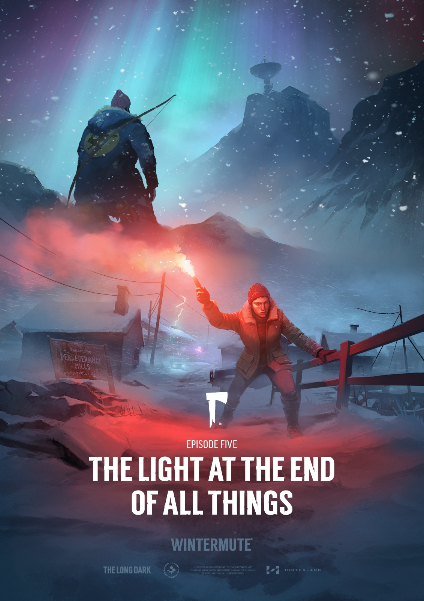
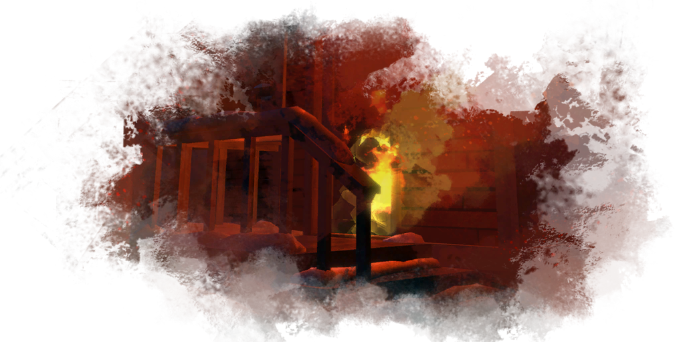
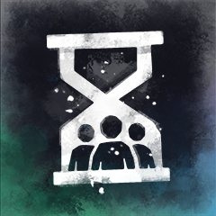
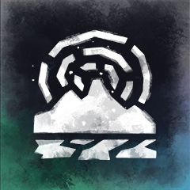
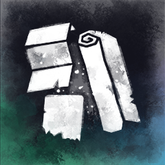

# Episode 5: The Light At The End Of All Things

**Categories:** Episode 5, Episodes · **Source:** [Fandom](https://thelongdark.fandom.com/wiki/Episode_5%3A_The_Light_At_The_End_Of_All_Things)

**Contents**

- [Overview](#overview)
- [Missions](#missions)
- [Part One: Perseverance](#part-one-perseverance)
- [Perseverance](#perseverance)
- [To Those Who Are Missing](#to-those-who-are-missing)
- [A Cry For Help](#a-cry-for-help)
- [Part Two: Strange History](#part-two-strange-history)
- [The Cold, Broken Road](#the-cold-broken-road)
- [High Energy](#high-energy)
- [Part Three: Do No Harm](#part-three-do-no-harm)
- [To SAR And Back](#to-sar-and-back)
- [Part Four: Terminus](#part-four-terminus)
- [Conflagration](#conflagration)
- [Side Missions](#side-missions)
- [Cast](#cast)
- [Major Characters](#major-characters)
- [Minor Characters](#minor-characters)
- [Affliction Availability](#affliction-availability)
- [Achievements](#achievements)
- [Gallery](#gallery)
- [Trivia](#trivia)

_"Separated by events on Great Bear Island, Astrid and Mackenzie struggle to make sense of The Quiet Apocalypse. In Perseverance Mills, Astrid investigates the quarantine established in the remote town. Lost in the wilderness with Jace, Mackenzie pushes on to deliver the WINTERMUTE message to Dr. Atwood._

_Will they finally uncover the mystery of the Aurora, and what it means for the world?"_

**Spoiler Warning:**__This page may contain spoilers from the [story](./Wintermute.md) of The Long Dark.__

**_The Light At The End Of All Things_** is the 5th and final chapter of the [Wintermute](./Wintermute.md) story of _[The Long Dark](./The%20Long%20Dark.md)_. It is preceded by [Episode 4: Fury, Then Silence](./Episode%204%20-%20Fury%2C%20Then%20Silence.md).

Hinterland released Episode 5 of _The Long Dark_ for free to all current owners on March 31, 2026. It takes place in both the mysterious [Perseverance Mills](./Perseverance%20Mills.md) and [Suzuki Radio Telescope](./Suzuki%20Radio%20Telescope.md) and completes the story of Mackenzie and Astrid, while also tying up most of the loose threads left within the story (including the conflict involving [Mathis](./Mathis.md) and his gang of [Convicts](./Convicts.md), the contents of [Astrid's Hardcase](./Astrid%27s%20Hardcase.md), what caused the [First Flare](./First%20Flare.md), and the message Mackenzie must carry to [Atwood](./Atwood.md), "Wintermute").

Both Mackenzie and Astrid are playable characters in the Episode, switching perspectives between multiple parts of the story between missions.

## Overview

## Missions

### Part One: Perseverance

Perseverance is the first chapter of Episode 5. [Astrid Greenwood](./Astrid%20Greenwood.md) is the only playable character in this chapter. The chapter takes place at [Perseverance Mills](./Perseverance%20Mills.md) and in the surrounding Perseverance Countryside. It contains 3 different missions. 

#### Perseverance

_Main article: [Perseverance](./Perseverance.md)_

"_A strange illness has taken hold in Perseverance Mils. People are missing. Investigate the town and see what you can find out._"

— In-game description

It is the first mission of the game. This mission starts with a conversation between [Astrid](./Astrid%20Greenwood.md) and [Jane Yang](./Jane%20Yang.md). Jane states there are some missing people of the town. Hence, in order to find out what happened to these missing people, Astrid goes to the Cooper's Blind and Dr. Larson's clinic. 

#### To Those Who Are Missing

_Main article: [To Those Who Are Missing](./To%20Those%20Who%20Are%20Missing.md)_

"_Find the Constable along the river in Perseverance Wilds._"

— In-game description

_Missions\_story\_ep5\_ACryforHelp.png_

#### A Cry For Help

_Main article: [A Cry For Help](./A%20Cry%20For%20Help.md)_

"_Investigate the strange transmission Terry intercepted._"

— In-game description

### Part Two: Strange History

The player plays as [Will Mackenzie](./Will%20Mackenzie.md) while accompanying [Jace](./Jace.md) to the [Suzuki Radio Telescope](./Suzuki%20Radio%20Telescope.md), containing 2 missions. 

#### The Cold, Broken Road

_Main article: [The Cold, Broken Road](./The%20Cold%2C%20Broken%20Road.md)_

"_Find Atwood._"

— In-game description

_Missions\_story\_ep5\_HighEnergy.png_

#### High Energy

_Main article: [High Energy](./High%20Energy.md)_

"_Activate each Substation before the aurora returns._"

— In-game description

### Part Three: Do No Harm

 The player takes control of Astrid again for a single mission.

#### To SAR And Back

_Main article: [To SAR And Back](./To%20SAR%20And%20Back.md)_

"_Save Donner to save the townsfolk._"

— In-game description

### Part Four: Terminus

The player takes control of Mackenzie again for the last mission. 

#### Conflagration

_Main article: [Conflagration](./Conflagration.md)_

"_Prepare for the Quiet Apocalypse._"

— In-game description

## Side Missions

This is the only Episode to not contain any Side Missions.

## Cast

### Major Characters

- [Will Mackenzie](./Will%20Mackenzie.md) - Mark Meer
- [Astrid Greenwood](./Astrid%20Greenwood.md) - Jennifer Hale
- [Mathis](./Mathis.md) - Elias Toufexis
- [Jane Yang](./Jane%20Yang.md) - Jessica Wong
- [Atwood](./Atwood.md) - Mayumi Yoshida
- [Jace](./Jace.md) - Tina Grant

### Minor Characters

- [Cooper](./Cooper.md) - Shawn Youngchief
- [Terry](./Terry.md) - Nick Wolfhard
- [Donner](./Donner.md) - Vincent Tong
- [Methuselah](./Methuselah.md) - Richard Newman
- [Molly](./Molly.md) - Jennifer Kitchen
- [Jeremiah](./Jeremiah.md) - David Hayter
- [Vachon](./Vachon.md) - Jacques Lalonde
- [Heller](./Heller.md) - Jordan Waunch
- Freya
- Mill Workers -Joe Allard, Michael Daingerfield
- Bar Patron - Ashley O'Connell, Caitlyn Bairstow, Ceara Morgana, Joe Allard, Shawn Youngchief, Victor Hunter
- Dr. Larsen - Jordan Waunch
- Ship Cargo Captain - Jacques Lalonde
- Medical Officer - Vincent Tong
- [Convicts](./Convicts.md)/Sentries - Michael Daingerfield, Victor Hunter / Joe Allard, Victor Hunter

## Affliction Availability

## Achievements

-  [Quarantine](./Quarantine.md)
-  [Search Party](./Search%20Party.md)
-  [To The Bone](./To%20The%20Bone.md)
-  [Adrift](./Adrift.md)
-  [Dead Wake](./Dead%20Wake.md)
-  [The Hard Sciences](./The%20Hard%20Sciences.md)
-  [Song of the Earth](./Song%20of%20the%20Earth.md)
-  [Wild At Heart](./Wild%20At%20Heart.md)
-  [Finely Tuned](./Finely%20Tuned.md)
-  [Bending The Rail](./Bending%20The%20Rail.md)
-  [The Last Light](./The%20Last%20Light.md)
-  [The New World](./The%20New%20World.md)

## Gallery

_Announcement poster for Episode 5_

_Tld-april-dev-diary-lighthouse.jpg_

_Tld-april-dev-diary-bar-counter-view.jpg_

_Tld-april-dev-diary-balcony-view-res-resized.jpg_

## Trivia

- In an interview with the popular YouTuber Zaknafein, Raphael van Lierop said in response to player criticisms that "Episode 5 was made for people who like Wintermute."
  - Of all five episodes, this one focuses the least on [survival](./Survival%20Mode.md), and the most on storytelling.

[ru:Режим истории: эпизод 5](ru:%D0%A0%D0%B5%D0%B6%D0%B8%D0%BC_%D0%B8%D1%81%D1%82%D0%BE%D1%80%D0%B8%D0%B8:_%D1%8D%D0%BF%D0%B8%D0%B7%D0%BE%D0%B4_5)
