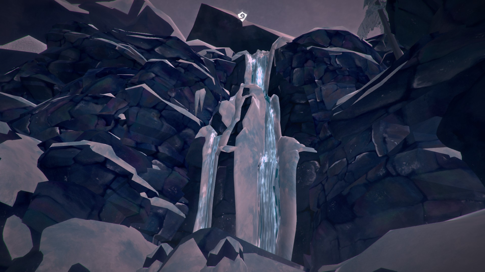
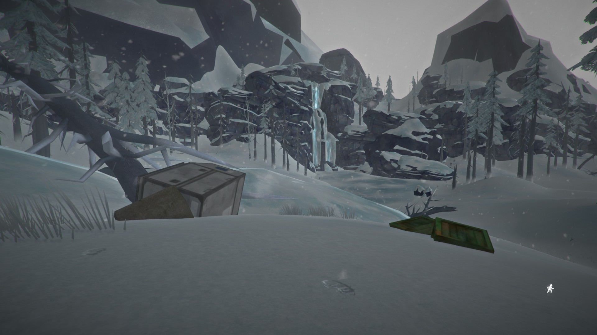
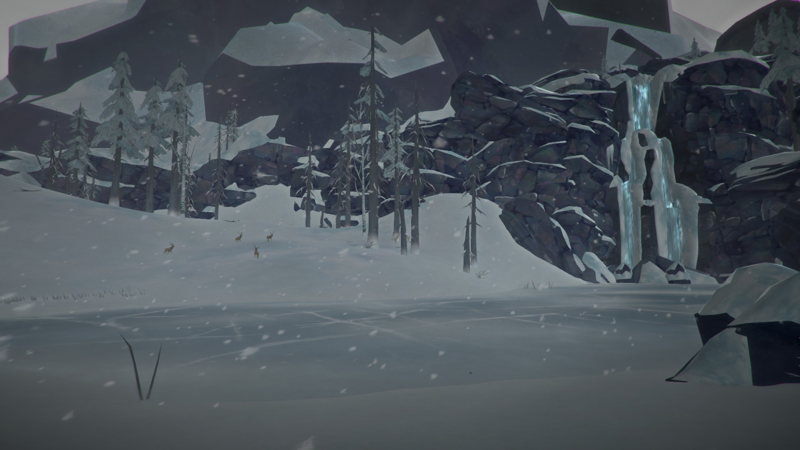
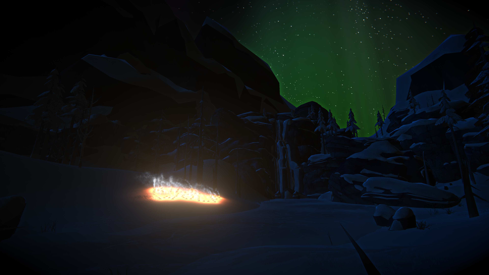
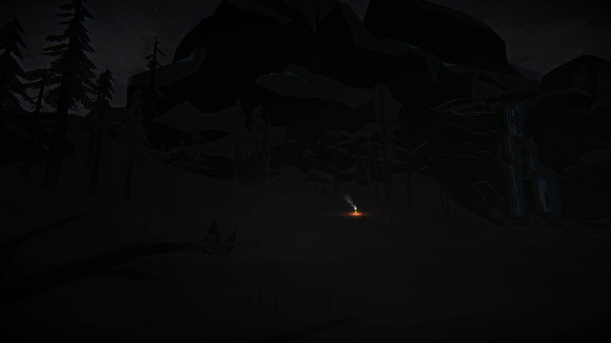

# Eric's Falls

**Categories:** Locations, Locations in Timberwolf Mountain, Waterfalls · **Source:** [Fandom](https://thelongdark.fandom.com/wiki/Eric's_Falls)

**Eric's Falls**

| Property | Details |
| --- | --- |
|  | [Erics falls](../assets/Erics_falls.jpg) |
| **Location** |  |
|  | [Eric's Falls Location](../assets/Eric%27s_Falls_Location.png) |
| Region |  |
| **General** |  |
| Type |  |

**Eric's Falls** is located below the [Summit](./Summit.md) on [Timberwolf Mountain](./Timberwolf%20Mountain.md). The location consists of a large waterfall and is adjacent to the [Waterfall Cave](./Waterfall%20Cave.md).

## Overview

With the exception of Waterfall Cave immediately to the right, Eric's Falls is the sole named location in the area. [Cat tails](./Cat%20Tail.md), [Green Maple Saplings](./Green%20Maple%20Sapling.md) and [Green Birch Saplings](./Green%20Birch%20Sapling.md) as well as some [Old Man's Beard Lichen](./Old%20Man%27s%20Beard%20Lichen.md) are in the area. [Wolves](./Wolf.md) and a [bear](./Bear.md) may patrol nearby.

The cave can be a possible base location as it provides a 10°C degree bonus, and because there is a lot of [wildlife](./Wildlife.md) in the area including [deer](./Deer.md), plenty of [rabbits](./Rabbit.md), [wolves](./Wolf.md) and a [bear](./Bear.md), provided the player knows how to deal with the latter two effectively. Since Part 6 (December 2024) DLC patch, there is a possible [Timberwolf](./Timberwolf.md) spawn on the ice in front of the falls which would make locating a base in the cave problematic. The player must return to the [Mountaineer's Hut](./Mountaineer%27s%20Hut.md) at [Crystal Lake](./Crystal%20Lake.md) to fix or craft [arrows](./Simple%20Arrow.md) since that is the only location on Timberwolf Mountain containing a [workbench](./Work%20Bench.md).

There is a [Cargo Container](./Cargo%20Container.md) along the river. (Does not spawn in Interloper):

- Upper door: [Airline Food - Chicken](./Airline%20Food%20-%20Chicken.md), [Airline Food - Vegetarian](./Airline%20Food%20-%20Vegetarian.md) and [pinnacle peaches](./Pinnacle%20Peaches.md)
- Lower door: [antibiotics](./Antibiotics.md), [antiseptics](./Antiseptic.md), [bandages](./Bandage.md) and [painkillers](./Painkillers.md)

## Access

Eric's Falls can be reached by walking through the cave at [Secluded Shelf](./Secluded%20Shelf.md) and climbing down the [rope](./Rope%20Climbing.md) to the left, or by following the path from [Deer Clearing](./Deer%20Clearing.md).

If the player places a [climbing rope](./Mountaineering%20Rope.md) at the spot on the level of Eric's Falls, the player can descend to the [Engine](./Engine%20%28East%29.md) area. Placing a rope here will significantly decrease the time needed to get from the [Mountaineer's Hut](./Mountaineer%27s%20Hut.md) to the [Summit](./Summit.md), since the player will no longer have to walk all the way around through Deer Clearing.

## Gallery

_The falls with the [Waterfall Cave](./Waterfall%20Cave.md) to the right_

