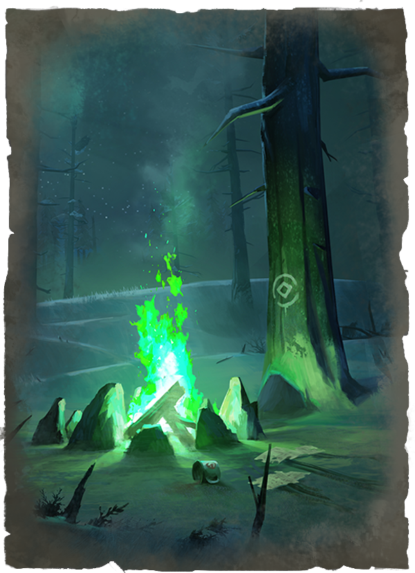
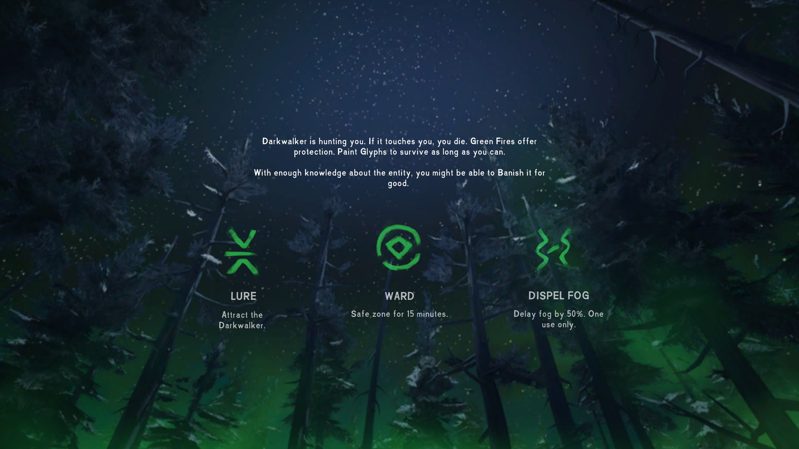
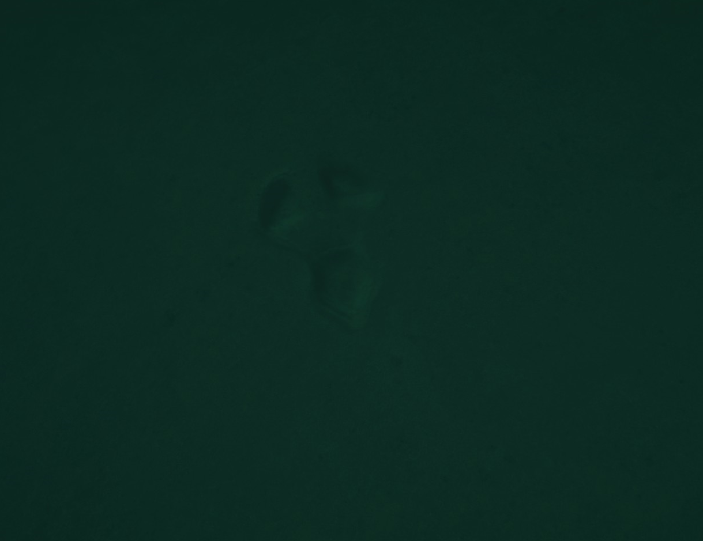
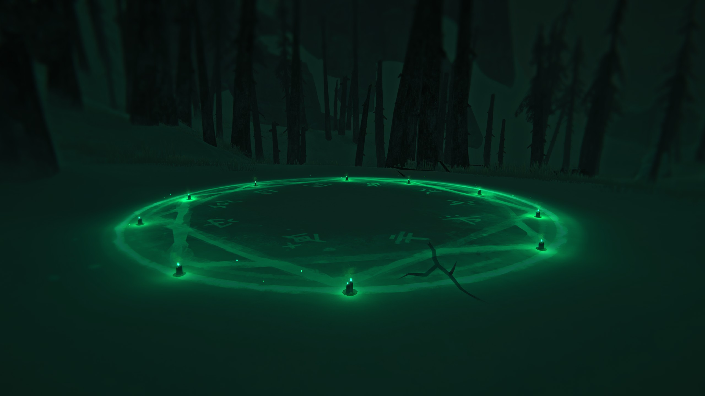
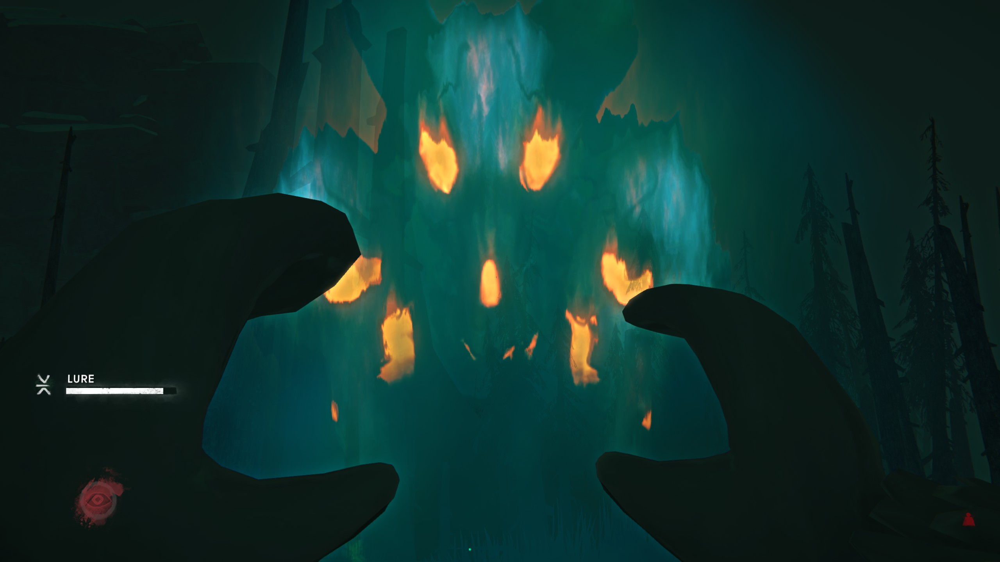
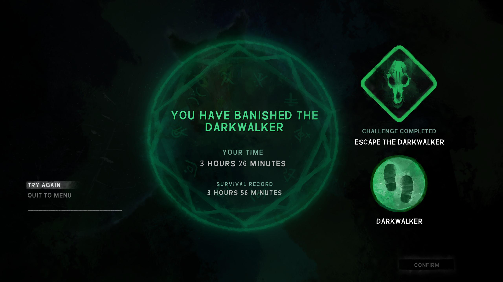

# Escape the Darkwalker

**Categories:** Challenges, Event, Events · **Source:** [Fandom](https://thelongdark.fandom.com/wiki/Escape_the_Darkwalker)

**Contents**

- [Overview](#overview)
- [Gameplay &amp; Strategy](#gameplay-strategy)
- [The Darkwalker](#the-darkwalker)
- [Toxic Fog](#toxic-fog)
- [Green Campfires](#green-campfires)
- [Glyph Spray Paint](#glyph-spray-paint)
- [Misc.](#misc)
- [Tips](#tips)
- [Starting Location](#starting-location)
- [Regions](#regions)
- [The Darkwalker](#the-darkwalker-1)
- [Glyphs](#glyphs)
- [Misc.](#misc-1)
- [Rewards](#rewards)
- [List of Diary Page Contents and Loot Next to Each Green Campfire](#list-of-diary-page-contents-and-loot-next-to-each-green-campfire)
- [Gallery](#gallery)
- [Trivia](#trivia)
- [References](#references)

**Escape the Darkwalker**

**Details**

**Regions:** All

**Difficulty:** 6

**Date Added:** 9 Dec 2020

> “__The Darkwalker is hunting you. Paint Glyphs to survive as long as you can.  
 Search for the Green Fires. Learn all you can about the Darkwalker. Knowledge will help you find a way to defeat the entity.__”
>
> — Main Menu description

**Escape the Darkwalker** is a [Challenge](./Challenge.md) in _[The Long Dark](./The%20Long%20Dark.md)_.

_Escape the Darkwalker_ was initially launched as a Halloween-themed event for 2 weeks (October 29, 2020 to November 12, 2020), to replace _[4 Days of Night](./4%20Days%20of%20Night%20Event.md)_ of previous years. It was later added as a permanent gameplay mode and updated with an endgame goal.[¹](#fn1)

## Overview

> “__1. Use the time before the Darkwalker arrives to prepare yourself for the hunt.  
 2. The Darkwalker is hunting you. Survive until it devours you, or you are overwhelmed by Toxic Fog. Seek out the Diary Pages.  
 3. Go to Ash Canyon and use the Banish glyph at the Ritual Circle marked on the Map.  
 4. Stay in the Ritual Circle to Lure and Banish the Darkwalker.__”
>
> — Journal Objectives

In Escape the Darkwalker, the time is permanently set to dusk and the player is stalked by an invisible entity known as The Darkwalker which will try to devour them. To win, all 10 diary pages ([On the Nature of Darkwalkers](./On%20the%20Nature%20of%20Darkwalkers.md)) must be collected and the entity banished in [Ash Canyon](./Ash%20Canyon.md). The Darkwalker cannot be hurt or killed, merely avoided or slowed by painting glyphs to lure or ward it away.

Any [Region](./Region.md) may be selected to start, but after ~30 real-time minutes the current region will fill with [Toxic Fog](./Toxic%20Fog.md), forcing the player to leave (smaller regions have less time until they are enveloped in Toxic Fog). Toxic Fog ruins food and water and damages [Condition](./Condition.md). Strategy will be required to plan how one travels through the world.

Completing Escape the Darkwalker rewards the player with 2 [Badges](./Badges.md), the [Feat](./Feats.md) "Darkwalker," and the "Endless Night" option for [Custom](./Custom.md) [Survival Mode](./Survival%20Mode.md).

## Gameplay &amp; Strategy

 Upon starting _Escape The Darkwalker_ an extinguished campfire and supplies can be found close by, along with an introductory note called [On the Nature of Darkwalkers](./On%20the%20Nature%20of%20Darkwalkers.md). There are ten [Diary Pages](./Diary%20Page%20%28Darkwalker%29.md) to be collected, one in each major region (excluding [Ash Canyon](./Ash%20Canyon.md)) beside a green campfire. All region maps are fully revealed and display the locations of each Green Campfire. The Blackrock, [Keeper's Pass South](./Keeper%27s%20Pass%20South.md), and [Keeper's Pass North](./Keeper%27s%20Pass%20North.md) regions cannot be explored in this challenge.

Once all notes are collected, the player must head to Ash Canyon to complete the challenge in the Ritual Circle located on the map and wait for the Darkwalker. The [On the Nature of Darkwalkers](./On%20the%20Nature%20of%20Darkwalkers.md) note does not need to be collected to complete the Challenge.

### The Darkwalker

The Darkwalker is indestructible and intangible. It moves through terrain and buildings irrespective of elevation. It constantly chases the player across all regions, indoors, vehicles, mines, and caves. Audio cues and music will play based on its current distance. The Darkwalker moves at 2 meters (~6.56 feet) per second, increasing for each collected diary note (up to to 4m/s).

- The Darkwalker's speed is not tied to real-time movement. Care should be taken with time-accelerating tasks such as [sleeping](./Sleep.md) or [harvesting](./Harvesting.md), especially with many notes collected.
- The first 15 minutes of a game are a 'grace period' before The Darkwalker will spawn and it is not tied to real-time; one hour of a time-accelerated task equals 30 seconds on the timer.
- Within 200 meters (~656 feet), The Darkwalker's exact distance is shown, and the player is afflicted by "[Anxiety](./Anxiety.md)" (preventing [Sleep](./Sleep.md) and passing time) unless a Ward glyph is present. If a Ward expires and The Darkwalker is/enters within 200m, the player will immediately wake up.
- Within 50 meters (~164 feet), the Anxiety affliction is replaced by [Fear](./Fear.md), which causes a constant, heavy [Condition](./Condition.md) loss (approximately 50% per minute in real time). The Darkwalker's footprints also become visible.
- At 0 meters, The Darkwalker becomes visible and devours the player, killing them instantly.

### Toxic Fog

[Toxic Fog](./Toxic%20Fog.md) fills an entire region after ~30 real-world minutes within in; larger/smaller regions have their toxic fog timers adjusted accordingly.

- Toxic Fog [spoils](./Decay.md) all food and drink (even normally non-spoiling items like [cup of coffee](./Cup%20of%20Coffee.md)) and causes constant [condition](./Condition.md) loss.
- Current Toxic Fog progress is shown for each region by viewing it on the map. A UI element will appear if less than half of the region's timer remains, turning red below 2 minutes remaining.
- Toxic Fog in a region also RUINs all food in your backpack, indoors, outdoors, and animal carcasses. Instantly kills all wildlife.
- **The toxic fog timer considers mines/caves as part of their parent-region.** (e.g. "[Cinder Hills Coal Mine](./Cinder%20Hills%20Coal%20Mine.md)" is considered [Coastal Highway](./Coastal%20Highway.md)). Toxic Fog will fill these regions when they or their parent region's timer is met.

### Green Campfires

Each of the 10 major zones (excluding [Ash Canyon](./Ash%20Canyon.md)) contain one 'green campfire', with unlimited fuel and a ward glyph lasting 5 hours (in-game). Once this glyph's time is spent, the fire will be extinguished. Each green campfire has one unique Diary page, a Can of Glyph Spray Paint, a [Cup of Coffee](./Cup%20of%20Coffee.md), and high quality loot nearby.

### Glyph Spray Paint

[Spray Paint](./Spray%20Paint.md) is replaced with green [Spray Paint - Glyph](./Spray%20Paint%20-%20Glyph.md), which makes anti-Darkwalker glyphs instead of informational markings. Cans of Glyph Spray Paint are found sporadically in the game world as loot, contain 4 sprays, and can always be found near a Green Campfire.

- _Lure -_ Draws the Darkwalker to a location. Lasts 1 hour in-game, or until reached by The Darkwalker. Only one Lure can be placed per region at one time.
- _Ward -_ Fortifies a small area (200m), preventing The Darkwalker from approaching for up to 2 hours (in-game). Wards are only active if the player is nearby. Only one Ward can be placed per region at one time.
- _Dispel Fog -_ The progress of one region's toxic fog is reduced by 50% of current progress (most effective just before Toxic Fog appears). **Useable o_nce per playthrough._**
- _Banish - (**unlocks once all 10 diary pages are collected**)_ Must be used inside the banishing circle of [Ash Canyon](./Ash%20Canyon.md) to complete the challenge.

### Misc.

Difficulty is set to [Voyageur](./Voyageur.md) and [Feats](./Feats.md) cannot be selected. All [Wildlife](./Wildlife.md) spawn, including a 24 hour (in-game) grace period before predators can spawn.

- Time of day is permanently dusk, making the world colder and darker. [Auroras](./Aurora.md) and [blizzards](./Weather.md) are disabled, but Toxic Fog will slowly develop over time in a region, making traveling difficult.
- The player begins with a [Bedroll](./Bedroll.md), random clothes, food and other supplies.
- The spawn rate of all animals is heavily reduced. Although bears and wolves can still spawn, they are much less common compared to normal survival saves.
- All maps are fully revealed with the location of both the player and each green campfire shown, similar to [Wintermute](./Wintermute.md).
- [Rope Climbing](./Rope%20Climbing.md) is dangerous since The Darkwalker can move faster than a climbing player. Wards only protect the first few meters of a climb, so a head start (or Lure glyph) is highly recommended.
- Currently, both the Challenge [Badge](./Badges.md) _"Escape the Darkwalker_ and _Deadly Dreamer Badge (2020)"_ and the feat _"Darkwalker"_ have the same requirements: collect 6 diary pages in a single run and are earned simultaneously. Originally the _Escape the Darkwalker_ Badge (previously called Escape the Darkwalker Umbra\] required the player to survive for 60 real world minutes.
- Facing the Darkwalker in the Ritual Circle should be done cautiously, as the Darkwalker's Fear and Anxiety can still cause Condition to drain, potentially killing the player.

## Tips

### **Starting Location**

The route taken greatly affects the difficulty of _Escape the Darkwalker_. It can be beneficial to start in a western region, leaving [Timberwolf Mountain](./Timberwolf%20Mountain.md) and [Ash Canyon](./Ash%20Canyon.md) for last. Some starting location benefits are listed below:

Dead end regions (One region entrance/exit available)

- _Bleak Inlet_: Allows 24 hours to collect its diary page and escape before [Timberwolves](./Timberwolf.md) may spawn, and a Moose-Hide Satchel from the fire.
- _Hushed River Valley:_ Yields a revolver and completing two mandatory rope climbs to the fire before The Darkwalker can spawn. It also grants easier access to two rope climbs from Mountain Town to Forlorn Muskeg/Mystery Lake easier with a slower Darkwalker.
- _Desolation Point_: Abundant loot at [Hibernia Processing](./Hibernia%20Processing.md), [The Riken](./The%20Riken.md), and [Lonely Lighthouse](./Lonely%20Lighthouse.md) and safe passage through the mines and Crumbling Highway.
- _Broken Railroad_: Abundant loot at [Maintenance Yard](./Maintenance%20Yard.md) and [Hunting Lodge](./Hunting%20Lodge.md), and 24 hours before wolves may spawn in the narrow region.

Open Regions (Multiple region entrances/exits)

- _Coastal Highway_: Abundant loot at [Coastal Townsite](./Coastal%20Townsite.md) and access to the narrow regions of [Crumbling Highway](./Crumbling%20Highway.md) and [Desolation Point](./Desolation%20Point.md) with a slow Darkwalker and potentially no wolves.
- _Forlorn Muskeg_: Poor loot but easy access to multiple zones: Broken Railroad, Bleak Inlet and Mountain Town.
- _Mountain Town_: Abundant loot in [Milton](./Milton.md) (especially clothing) and the two rope climbs in Hushed River Valley with a relatively slow Darkwalker.
- _Mystery Lake_: Good loot at [Lake Cabins](./Lake%20Cabins.md) and [Carter Hydro Dam](./Carter%20Hydro%20Dam.md), and flexibility between Mountain Town, Forlorn Muskeg and Coastal Highway.
- _Pleasant Valley_: Good loot at [Signal Hill](./Signal%20Hill.md) and [Thomson's Crossing](./Thomson%27s%20Crossing.md) early on. Requires considerable backtracking late in the game.
- _Timberwolf Mountain_: Access to [Cargo Containers](./Cargo%20Container.md) before the Darkwalker arrives, if a hacksaw can be found.

### Regions

- Large open regions ([Pleasant Valley](./Pleasant%20Valley.md), [Mystery Lake](./Mystery%20Lake%20%28region%29.md)) are safer, while smaller regions ([Desolation Point](./Desolation%20Point.md), [Broken Railroad](./Broken%20Railroad.md)) and transition regions/caves/mines are more dangerous due to a lack of maneuverability.
- Fog is a serious threat primarily when backtracking through a region ([Forlorn Muskeg](./Forlorn%20Muskeg.md), [Mountain Town](./Mountain%20Town.md), [Coastal Highway](./Coastal%20Highway.md)). Plan for this when traveling, and avoid running out the timer unless you are close to the exit and not returning.
- If moving through a transition region/cave/mine, check the map to see what region the fog timer counts towards.
- When retrieving the page from [Desolation Point](./Desolation%20Point.md) or [Broken Railroad](./Broken%20Railroad.md) (depending on how far you are in your run) consider putting a lure deep in the region and waiting for the Darkwalker to pass you as it moves to the lure. This can make passing through the narrow entrances to these regions much safer.

### The Darkwalker

- The Darkwalker's initial speed is slower than a player in all scenarios, but with all notes it is faster than you if you are encumbered, making sprinting mandatory at points and sleep difficult.
- As long as you are not encumbered or injured (i.e. sprained ankle), _you are always faster than the Darkwalker_, even at empty fatigue and ten notes collected.
- Entering a different region causes The Darkwalker to follow at the same relative distance and direction. For example if you enter a new area with the Darkwalker 300 meters behind you, it will be 300 meters behind you in the new region. Note that since your orientation in the new map might be different than when exiting the old map, placing down a lure at at the start will maximize the distance required for the darkwalker to reach you.
- The Darkwalker moves in a straight line through terrain, with Lure glyphs taking priority over the player.
- If trapped in a narrow locations with The Darkwalker blocking the exit (e.g. inside "[Carter Hydro Dam and Environs](./Carter%20Hydro%20Dam.md)"), place a Ward and sleep/pass time. The Darkwalker will often move out of the way (while keeping the same distance), allowing one to proceed.

### Glyphs

- Green Fires come with an innate Ward glyph.
- Wards are useful to grant more time to loot, repair or cook if The Darkwalker is nearby. They are only active if the player is nearby (draining their duration).
- Only one Ward may be present per region at a time. To place another Ward, the previous must be fully depleted.
- If the Darkwalker is within 200 meters of the player, placing a Ward glyph will NOT make it retreat, it will only halt the Darkwalker from closing in. Wards should only be placed when the player is more than 200 meters away.
- Lure glyphs are useful in narrow spaces ([Desolation Point](./Desolation%20Point.md) and [Broken Railroad](./Broken%20Railroad.md)) to bypass The Darkwalker.
- When entering a new region, Lures can grant a lead on The Darkwalker.
- If both a Lure and a Ward are active, The Darkwalker will ignore the Ward to chase the Lure.

### Misc.

- Minimize weight: less weight means faster movement. Drop unnecessary clothes, tools, and food. Fatigue affects movement, so stay rested.
- Keeping weight below the encumbrance threshold for zero fatigue will allow you to always outrun the Darkwalker in a linear direction. This is 15 kg/33 lbs for a player with no capacity buffs, but will increase to 20 kg/44 lbs after acquiring the satchel and again to 25 kg/55 lbs after receiving the Well Fed buff.
- Balance time between travel and sleep. Sleep is usually safe if the Darkwalker is not nearby.
- Looting is generally unnecessary for this challenge since every green campfire has high-tier loot. If you need to supplement this, stick to containers and structures along the shortest path through a region; Voyageur settings mean you will likely find more than enough to sustain yourself.
- Avoid time consuming tasks such as [hunting](./Hunting.md), [harvesting](./Harvesting.md) and [mending](./Mending.md) clothes.
- [Flares](./Flare.md) and [Torches](./Torch.md) and [Storm Lanterns](./Storm%20Lantern.md) are useful for traversing caves and mines.
- [Flares](./Flare.md) and [firearms](./Revolver.md) are effective at frightening [predators](./Wolf.md).
- [Cup of Coffee](./Cup%20of%20Coffee.md), [Go! Energy Drink](./Go!%20Energy%20Drink.md), and [Emergency Stim](./Emergency%20Stim.md) allow more sprinting and rope climbing with less rest, or bursts of speed during emergencies.
- [Bandages](./Bandage.md) are useful for treating [Sprained Ankle](./Sprained%20Ankle.md), which prevent [sprinting](./Stamina.md) and [Rope Climbing](./Rope%20Climbing.md).
- You can usually ignore sprained wrists; as long as only one is sprained, you can still use revolvers, flares/flare pistols, and the lantern. You will need to bandage it or sleep if you are making a rope climb, however.

## Rewards

| Icon | Name | Requirements | Benefit |
| --- | --- | --- | --- |
|  | Escape the Darkwalker - Umbra Badge (2020) | Complete the Escape the Darkwalker challenge. _(Previously: Survive for 60 minutes (real-time) in a single Escape the Darkwalker game.)_ | Unlocks challenge badge. |
|  | Escape the Darkwalker - Deadly Dreamer Badge (2020) | Collect 6 'Escape the Darkwalker Diary Pages' in a single game. | Unlocks challenge badge. |
|  | Darkwalker | Complete the Escape the Darkwalker Challenge (2021) | Unlocks feat. Less fatigued at night, more fatigued during the day. |

## List of Diary Page Contents and Loot Next to Each Green Campfire

**Diary Notes &amp; Loot**

| Location | Diary page contents | Loot |
| --- | --- | --- |
| Starting [Region](./Region.md) Campfire | _"Glyphs of Power and their Uses:_ / _Lure -- Attract the Darkwalker_ / _Ward -- A shield, if only for a little while._ / _Dispel -- Push back the choking fog. But only once._ / _Darkwalkers spread fear and feed on oblivion - knowledge_ _will help you defeat the entity for good."_ | [Wool Toque](./Wool%20Toque.md), [Flare](./Flare.md), [Energy Bar](./Energy%20Bar.md), A Bottle of [Water](./Water%20%28Potable%29.md), [Sewing Kit](./Sewing%20Kit.md). |
| [Bleak Inlet](./Bleak%20Inlet.md) Event Camp | _"...do I give in to its will? That may be the only way back. But not yet, not yet. As long as I paint, I live..."_ | [Moose-Hide Satchel](./Moose-Hide%20Satchel.md), [Wool Longjohns](./Wool%20Longjohns.md), [Can Opener](./Can%20Opener.md), [Go! Energy Drink](./Go!%20Energy%20Drink.md), 2 [Condensed Milk](./Condensed%20Milk.md). |
| [Broken Railroad](./Broken%20Railroad.md) Event Camp | _"...the signs hold it at bay, or lead it away from me...but who is the Glyph-maker?"_ | [Revolver](./Revolver.md), 2 [Rifle Ammunition](./Rifle%20Ammunition.md), 4 [Flare Shells](./Flare%20Shell.md), Food, Go! Energy Drink. |
| [Coastal Highway](./Coastal%20Highway.md) Event Camp | _"The gnashing, the grinding, a thing from the stars. But no beauty sets down from that endless void..."_ | [Mukluks](./Mukluks.md), [Rabbitskin Mitts](./Rabbitskin%20Mitts.md), [Lantern Fuel](./Lantern%20Fuel.md), 2 [Marine Flare](./Marine%20Flare.md), [Energy Bar](./Energy%20Bar.md), [Tin of Coffee](./Tin%20of%20Coffee.md). |
| [Desolation Point](./Desolation%20Point.md) Event Camp | _"I climbed the tall mountain, but it wormed in the earth below me. There was no escape, not even high above...my delirium has become its feeding ground."_ | [Knife](./Hunting%20Knife.md), [Balaclava](./Balaclava.md), [Fleece Cowl](./Fleece%20Cowl.md), Lantern Fuel, Emergency Flare, Go! Energy Drink. |
| [Forlorn Muskeg](./Forlorn%20Muskeg.md) Event Camp | _"The poison in my blood draws it closer...and now that poison fills the air...the formless hunting a form."_ | [Bearskin Bedroll](./Bear%20Skin%20Bedroll.md), [Climbing Socks](./Climbing%20Socks.md), [Cooking Pot](./Cooking%20Pot.md), [Accelerant](./Accelerant.md), Flare, [Salty Crackers](./Salty%20Crackers.md). |
| [Hushed River Valley](./Hushed%20River%20Valley.md) Event Camp | _"I crept upon the nameless city, stars in my eyes. But those eyes no longer see the world...just a choking mist. Over the horizon, that is where I escape."_ | Revolver, 10 [Revolver Ammunition](./Revolver%20Ammunition.md), [Wool Ear Wrap](./Wool%20Ear%20Wrap.md), [Emergency Stim](./Emergency%20Stim.md), [Water](./Water%20%28Potable%29.md), [Maple Syrup](./Maple%20Syrup.md) |
| [Mountain Town](./Mountain%20Town.md) Event Camp | _"...dead and dreaming, my only friend, the faceless moon who won't look away. There is no sunrise on Ganymede..."_ | [Fisherman's Sweater](./Fisherman%27s%20Sweater.md), [Storm Lantern](./Storm%20Lantern.md), [Firestriker](./Firestriker.md), Accelerant, Maple Syrup. |
| [Mystery Lake](./Mystery%20Lake%20%28region%29.md) Event Camp | _"...can't see it, can't fight it...only running. My heart, a black echo in the forest, always hunting for a green fire..."_ | [Hunting Rifle](./Hunting%20Rifle.md), 10 [Rifle Ammunition](./Rifle%20Ammunition.md), [Combat Pants](./Combat%20Pants.md), [Marine Flare](./Marine%20Flare.md), [MRE](./Military-Grade%20MRE.md). |
| [Pleasant Valley](./Pleasant%20Valley.md) Event Camp | _"...a pale river, turned in on itself, a rush of blood to my head. Only the crooked path leads me away..."_ | Revolver, 10 Revolver Ammunition, [Flare Shell](./Flare%20Shell.md), 2 Rifle Ammunition, [Mackinaw Jacket](./Mackinaw%20Jacket.md), [Rabbitskin Hat](./Rabbitskin%20Hat.md), Accelerant, Maple Syrup. |
| [Timberwolf Mountain](./Timberwolf%20Mountain.md) Event Camp | _"I discarded the farsighted mask, and only bone remains. The gate is closed. Will it come for me now?"_ | Flare Gun, 7 Flare Shells, Emergency Stim, [Antiseptic](./Antiseptic.md), [Antibiotics](./Antibiotics.md), [Sewing Kit](./Sewing%20Kit.md), MRE, [Painkillers](./Painkillers.md). |

## Gallery

## Trivia

- Raphael Van Lierop (lead designer of _The Long Dark_) gave insight to the design of _Escape the Darkwalker_ and its predecessor [_4 Days of Night_](./4%20Days%20of%20Night%20Event.md); stating that fans were unhappy with 4DoN: those who missed the timed event missed content and [Badges](./Badges.md), and those who played felt the mode was too simplistic. Thus Escape the Darkwalker was made as a more polished, feature-rich, and permanent game mode.
- All wildlife flee The Darkwalker (&gt;50m).
- The Darkwalker is invisible during most gameplay, but can be seen when killing the player/banishing it as well as in official "[ESCAPE THE DARKWALKER](https://www.thelongdark.com/news/darkwalker/)" media. It is a vaguely humanoid entity of black smoke, green light, and three wolf skulls.
- Escape the Darkwalker bears many similarities to the works of horror writer [H.P. Lovecraft](https://en.wikipedia.org/wiki/H._P._Lovecraft)—particularly esoteric journal writings, [invisible and malevolent monsters](https://en.wikipedia.org/wiki/The_Horror_at_Martin%27s_Beach), and creation of [magical glyphs](https://en.wikipedia.org/wiki/Elements_of_the_Cthulhu_Mythos#Signs_and_symbols) to ward monsters away. "[The Nameless City](https://en.wikipedia.org/wiki/The_Nameless_City)" in one such journal note is a direct reference to his work of the same name.
- Users on the official Hinterlands Forums and reveal streams regularly joked that The Darkwalker was the ghost of "[Fluffy](./Wolf.md)", a fan-favorite unique wolf 'killed' in previous versions of _The Long Dark_.
- With Auroras disabled, the [Flashlight](./Flashlight.md) is useless. The [ammunition workbenches](./Ammunition%20Work%20Bench.md) present within the [Workshop](./Workshop.md) and the [Blackrock Prison](./Blackrock%20Prison.md) are locked behind electronic doors and cannot be opened, thus making [Gunsmithing](./Gunsmithing.md) impossible. The elevator that gives access to the middle level of the [Cinder Hills Coal Mine](./Cinder%20Hills%20Coal%20Mine.md) is also inaccessible without the Aurora.
- With Endless Night enabled, the [Magnifying Lens](./Magnifying%20Lens.md) and [Charcoal](./Charcoal.md) are useless. Ignoring the The Darkwalker and Toxic Fog, this makes "Endless Night" mode (including for Custom Sandboxes) lethal from dehydration, since matches/firestrikers are a infinite resources and potable water is non-renewable.
- If The Darkwalker reaches (kills) the player while climbing a rope but before the player dies from [Fear](./Afflictions.md), the death cutscene will play as a hybrid of being devoured by The Darkwalker while falling from the rope.
- A glitch makes it possible to get the Darkwalker feat currently. This can also happen with getting the Escape the Darkwalker badge without getting the pages.

## References

## Notes

---

1. [https://www.thelongdark.com/news/escape-the-darkwalker-event-update-for-switch-and-december-release/](https://www.thelongdark.com/news/escape-the-darkwalker-event-update-for-switch-and-december-release/)[↩︎](#fnref1)
