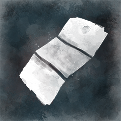

# Every Last One

**Contents**

- [Guide](#Guide)
- [Locations of Notes](#Locations_of_Notes)
- [Forest Talkers](#Forest_Talkers)
- [Locals](#Locals)
- [Game History](#Game_History)

<table class="infobox">
<caption>Every Last One</caption>
<colgroup>
<col style="width: 50%" />
<col style="width: 50%" />
</colgroup>
<tbody>
<tr>
<td colspan="2"><figure>

<figcaption>Every_Last_One_icon.png</figcaption>
</figure></td>
</tr>
<tr>
<td>
Description
</td>
<td>
Collect all six Notes with details on Forest Talker activity in Pleasant Valley.
</td>
</tr>
</tbody>
</table>

**Every Last One** is a <a href="./Wintermute.md" class="wikilink" title="Wintermute">Wintermute</a> <a href="./The%20Long%20Dark%20%E2%80%94%20Achievements.md" class="wikilink" title="achievement">achievement</a> in <a href="./Episode%203%20-%20Crossroads%20Elegy.md" class="wikilink" title="Episode 3: Crossroads Elegy">Episode 3: Crossroads Elegy</a> of *<a href="./The%20Long%20Dark.md" class="wikilink" title="The Long Dark">The Long Dark</a>*.

## Guide

This achievement is earned after finding all 6 notes associated with the side mission <a href="./Forest%20Talkers%20%28side%20mission%29.md" class="wikilink" title="Forest Talkers (side mission)">Forest Talkers (side mission)</a>.

## Locations of Notes

### Forest Talkers

- <a href="./Forest%20Talker%20Collectible%2C%20Part%20One.md" class="wikilink" title="Forest Talker Collectible, Part One">Forest Talker Collectible, Part One</a> is in a barn with a deer carcass at the <a href="./Three%20Strikes%20Farmstead.md" class="wikilink" title="Three Strikes Farmstead">Three Strikes Farmstead</a>.
- <a href="./Forest%20Talker%20Collectible%2C%20Part%20Two.md" class="wikilink" title="Forest Talker Collectible, Part Two">Forest Talker Collectible, Part Two</a> is past the workbench near a metal container on the upper floor of the barn at <a href="./Pleasant%20Valley%20Outbuildings.md" class="wikilink" title="Pleasant Valley Outbuildings">Pleasant Valley Outbuildings</a>.
- <a href="./Forest%20Talker%20Collectible%2C%20Part%20Three.md" class="wikilink" title="Forest Talker Collectible, Part Three">Forest Talker Collectible, Part Three</a> is hidden in an air vent in one of <a href="./Joplin%27s%20Bunker%20Raid.md" class="wikilink" title="Joplin&#39;s caches">Joplin's caches</a>.

### Locals

- <a href="./Pleasant%20Valley%20Collectible%2C%20Part%20One.md" class="wikilink" title="Pleasant Valley Collectible, Part One">Pleasant Valley Collectible, Part One</a> is on the wall of the <a href="./Thomson%27s%20Crossing.md" class="wikilink" title="rural store at the crossroads">rural store at the crossroads</a>
- <a href="./Pleasant%20Valley%20Collectible%2C%20Part%20Two.md" class="wikilink" title="Pleasant Valley Collectible, Part Two">Pleasant Valley Collectible, Part Two</a> is in the office on a desk in the <a href="./Community%20Hall.md" class="wikilink" title="Community Hall">Community Hall</a>
- <a href="./Pleasant%20Valley%20Collectible%2C%20Part%20Three.md" class="wikilink" title="Pleasant Valley Collectible, Part Three">Pleasant Valley Collectible, Part Three</a> is in the control room for the radio tower on <a href="./Signal%20Hill.md" class="wikilink" title="Signal Hill">Signal Hill</a> which you go to <a href="./Aftermath.md" class="wikilink" title="later in the story">later in the story</a>.

## Game History

- UPDATE **22 October 2019 (<a href="./The%20Long%20Dark%20%E2%80%94%20Changelog.md#1.60" class="wikilink" title="Update">Update</a>):**
  - Added to game.

**Lua execution error in Module:Navbox function navbox**

