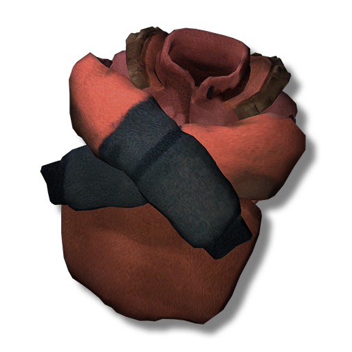
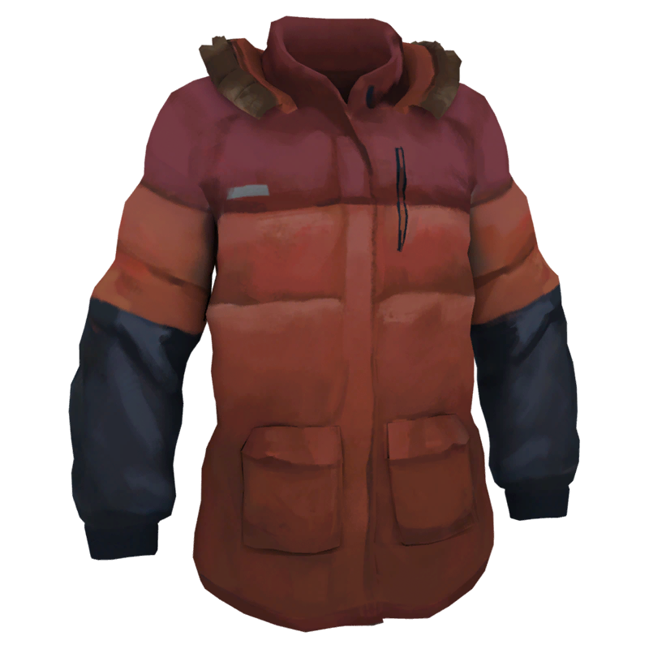
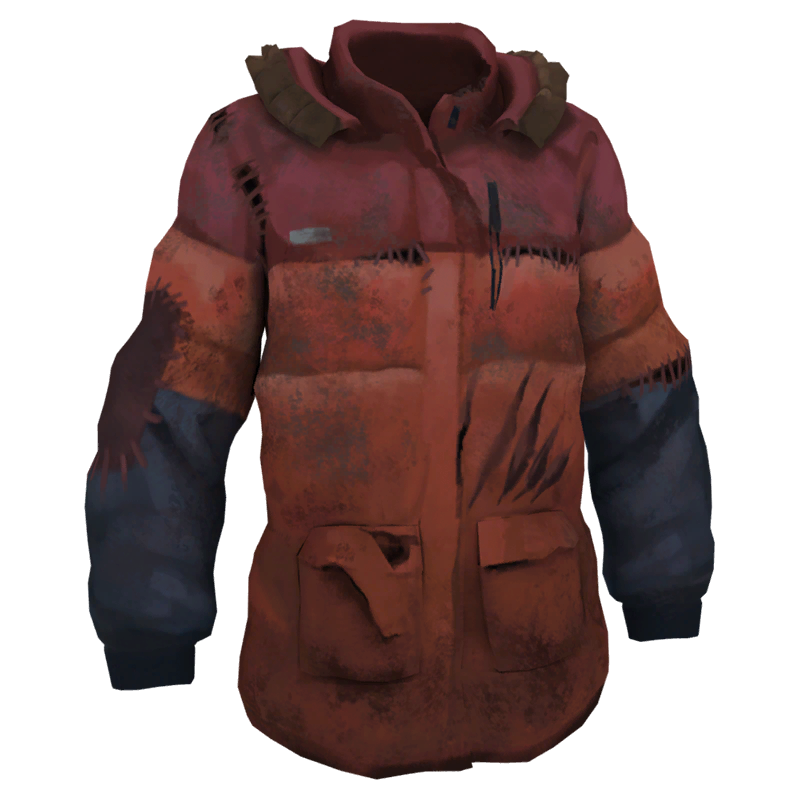

# Expedition Parka

**Contents**

- [Overview](#Overview)
- [Locations](#Locations)
- [Gallery](#Gallery)
- [Update history](#Update_history)

<table class="infobox">
<caption>Expedition Parka</caption>
<colgroup>
<col style="width: 50%" />
<col style="width: 50%" />
</colgroup>
<tbody>
<tr>
<td colspan="2"><figure>

<figcaption>Expedition_Parka_icon.png</figcaption>
</figure></td>
</tr>
<tr>
<td colspan="2" class="section">
<strong>General</strong>
</td>
</tr>
<tr>
<td>
Item Type
</td>
<td>
Clothing|-
</td>
</tr>
<tr>
<td>
Renewable
</td>
<td>
Yes (<a href="./Beachcombing.md" class="wikilink" title="Beachcombing">Beachcombing</a>)
</td>
</tr>
<tr>
<td>
Clothing Slot
</td>
<td>
Outer torso
</td>
</tr>
<tr>
<td colspan="2" class="section">
<strong>Statistics</strong>
</td>
</tr>
<tr>
<td>
Weight
</td>
<td>
1.50 kg(3.3 lbs)
</td>
</tr>
<tr>
<td>
Warmth bonus
</td>
<td>
4.0 °C(7.2 °F)
</td>
</tr>
<tr>
<td>
Windproof bonus
</td>
<td>
6.0 °C(10.8 °F)
</td>
</tr>
<tr>
<td>
Waterproof bonus
</td>
<td>
50%
</td>
</tr>
<tr>
<td>
Protection
</td>
<td>
6%
</td>
</tr>
<tr>
<td>
Mobility
</td>
<td>
-5%
</td>
</tr>
<tr>
<td>
Harvest
</td>
<td>
2 × <a href="./Cloth.md" class="wikilink" title="Cloth">Cloth</a> 
20 minutes
</td>
</tr>
<tr>
<td>
Repair
</td>
<td>
2 × <a href="./Cloth.md" class="wikilink" title="Cloth">Cloth</a> 
45 minutes 
30% condition
</td>
</tr>
</tbody>
</table>

<table>
<colgroup>
<col style="width: 33%" />
<col style="width: 33%" />
<col style="width: 33%" />
</colgroup>
<tbody>
<tr>
<td style="vertical-align: top; font-size: 3em; color: #5d5980; padding-right: 10px">
“
</td>
<td>
Heavy down-filled parka made using high-end materials. The kind of parka worn by people who know what they're doing.

&#10;

In-game description

</td>
<td style="vertical-align: bottom; font-size: 3em; color: #5d5980; padding-left: 10px">
”
</td>
</tr>
</tbody>
</table>

The **Expedition Parka** is a type of clothing in *The Long Dark*.

## Overview

Expedition Parkas are rare, warm and very lightweight clothing. It offers a warmth bonus of 4.0 °C and windproof bonus of 6.0 °C, with a small mobility penalty, protection bonus, and 50% waterproofing, all while weighing only 1.5 kg. The <a href="./Wolfskin%20Coat.md" class="wikilink" title="Wolfskin Coat">Wolfskin Coat</a> offers the same warmth bonus, a much bigger protection bonus, and slightly better waterproofing, however it is twice the weight of the Parka, offers less wind proofing, and has a much higher mobility penalty. The <a href="./Bearskin%20Coat.md" class="wikilink" title="Bearskin Coat">Bearskin Coat</a> offers more warmth, waterproofing, and protection, but weighs 5 kg, and has a high mobility penalty. This makes the Expedition Parka not only the best man-made coat in the game, but arguably the best coat in the game as well, due to its well-rounded stats.

The Expedition Parka is unavailable in <a href="./Interloper.md" class="wikilink" title="Interloper">Interloper</a> mode.

### Locations

An Expedition Parka is very likely to spawn inside one of the cargo containers in the <a href="./Tail%20Section.md" class="wikilink" title="Tail Section">Tail Section</a>, in <a href="./Timberwolf%20Mountain.md" class="wikilink" title="Timberwolf Mountain">Timberwolf Mountain</a> (except on Interloper). One is likely to spawn inside, but up to 5 may be present inside the <a href="./Cargo%20Container.md" class="wikilink" title="container">container</a>.

Elsewhere the parka is extremely rare, only appearing inside <a href="./Safe.md" class="wikilink" title="safes">safes</a>, and high loot locations such as <a href="./Signal%20Hill.md" class="wikilink" title="Signal Hill">Signal Hill</a>, <a href="./Concentrator.md" class="wikilink" title="Concentrator">Concentrator</a>, <a href="./Echo%20One%20Radio%20Tower.md" class="wikilink" title="Echo One Radio Tower">Echo One Radio Tower</a>, <a href="./Prepper%20Cache.md" class="wikilink" title="Prepper Caches">Prepper Caches</a>, or <a href="./Maintenance%20Yard.md" class="wikilink" title="Maintenance Yard">Maintenance Yard</a>.

The Expedition Parka is also known to spawn in the cabin of the first blue pickup truck on the <a href="./Spruce%20Falls%20Bridge.md" class="wikilink" title="Spruce Falls Bridge">Spruce Falls Bridge</a> in <a href="./Mountain%20Town.md" class="wikilink" title="Mountain Town">Mountain Town</a>, and <a href="./Brittle%20Cave.md" class="wikilink" title="Brittle Cave">Brittle Cave</a> in <a href="./Forsaken%20Airfield.md" class="wikilink" title="Forsaken Airfield">Forsaken Airfield</a>.

It can also spawn in the train car in the abandoned passenger rail car in the <a href="./Far%20Range%20Branch%20Line.md" class="wikilink" title="Far Range Branch Line">Far Range Branch Line</a>

## Gallery

<table class="gallery">
<colgroup>
<col style="width: 33%" />
<col style="width: 33%" />
<col style="width: 33%" />
</colgroup>
<tbody>
<tr>
<td><figure>

<figcaption>Old model.</figcaption>
</figure></td>
<td><figure>

<figcaption>Clothing model icon</figcaption>
</figure></td>
<td><figure>

<figcaption>Clothing model icon damaged</figcaption>
</figure></td>
</tr>
</tbody>
</table>

## Update history

- UPDATE **19 December 2016 (<a href="./The%20Long%20Dark%20%E2%80%94%20Early%20Access%20Changelog.md#0.386" class="wikilink" title="Update">Update</a>):**
  - Added to game

**Lua execution error in Module:Navbox function navbox** <a href="ru:%D0%9F%D0%BE%D1%85%D0%BE%D0%B4%D0%BD%D0%B0%D1%8F_%D0%BF%D0%B0%D1%80%D0%BA%D0%B0" class="wikilink" title="ru:Походная парка">ru:Походная парка</a>

