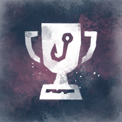

# Expert Angler

<table class="infobox">
<caption>Expert Angler</caption>
<colgroup>
<col style="width: 50%" />
<col style="width: 50%" />
</colgroup>
<tbody>
<tr>
<td colspan="2"><figure>

<figcaption>Expert_Angler_icon.png</figcaption>
</figure></td>
</tr>
<tr>
<td colspan="2"></td>
</tr>
<tr>
<td>
Description
</td>
<td>
Catch 4 different Rare Fish – Burbot, Goldeye, Red Irish Lord, and Rockfish (single game).
</td>
</tr>
</tbody>
</table>

**Expert Angler** is an <a href="./The%20Long%20Dark%20%E2%80%94%20Achievements.md" class="wikilink" title="achievement">achievement</a> in *<a href="./The%20Long%20Dark.md" class="wikilink" title="The Long Dark">The Long Dark</a>*.

## Guide

The player must catch a single <a href="./Burbot%20%28Raw%29.md" class="wikilink" title="Burbot (Raw)">Burbot (Raw)</a>, <a href="./Goldeye%20%28Raw%29.md" class="wikilink" title="Goldeye (Raw)">Goldeye (Raw)</a>, <a href="./Red%20Irish%20Lord%20%28Raw%29.md" class="wikilink" title="Red Irish Lord (Raw)">Red Irish Lord (Raw)</a>, and <a href="./Rockfish%20%28Raw%29.md" class="wikilink" title="Rockfish (Raw)">Rockfish (Raw)</a> in a single save file. Crafting a <a href="./Fishing%20Lure%20%28disambiguation%29.md" class="wikilink" title="Fishing Lure (disambiguation)">Fishing Lure (disambiguation)</a> can make it easier to catch rarer fish in different locations.

This achievement is easiest to unlock when playing on <a href="./Pilgrim.md" class="wikilink" title="Pilgrim">Pilgrim</a>.**Lua execution error in Module:Navbox function navbox**

