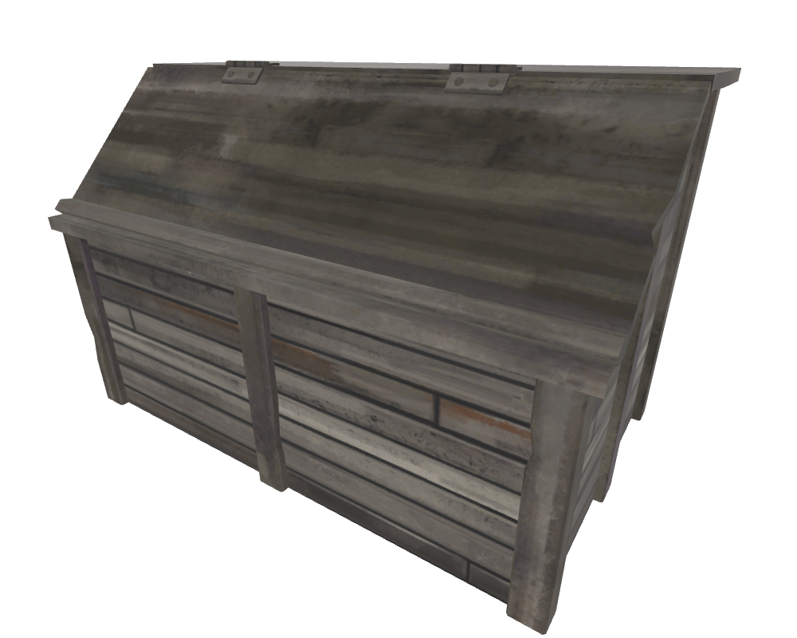

# Extra Supplies

**Contents**

- [Official description](#Official_description)
- [Overview](#Overview)
- [Locating additional supplies](#Locating_additional_supplies)
- [Food](#Food)
- [Fuel](#Fuel)
- [Rewards](#Rewards)
- [Update history](#Update_history)

<table class="infobox">
<caption>Extra Supplies</caption>
<colgroup>
<col style="width: 50%" />
<col style="width: 50%" />
</colgroup>
<tbody>
<tr>
<td colspan="2"><figure>

<figcaption>One of the rewards for this mission is a <a href="./Mackinaw%20Jacket.md" class="wikilink" title="Mackinaw Jacket">Mackinaw Jacket</a></figcaption>
</figure></td>
</tr>
<tr>
<td>
Episode
</td>
<td>
<a href="./Episode%201%20-%20Do%20Not%20Go%20Gentle.md" class="wikilink" title="Episode 1">Episode 1</a>|-
</td>
</tr>
<tr>
<td>
Current
</td>
<td>
Extra Supplies
</td>
</tr>
<tr>
<td>
Region
</td>
<td>
<a href="./Mountain%20Town.md" class="wikilink" title="Mountain Town">Mountain Town</a>
</td>
</tr>
</tbody>
</table>

**Spoiler Warning:***This page may contain spoilers from the <a href="./Wintermute.md" class="wikilink" title="story">story</a> of The Long Dark.*

**Extra Supplies** is a side mission started in <a href="./Episode%201%20-%20Do%20Not%20Go%20Gentle.md" class="wikilink" title="Episode 1">Episode 1</a> of the <a href="./Wintermute.md" class="wikilink" title="story">story</a>. In the mission, the survivor gathers extra supplies for <a href="./Grey%20Mother.md" class="wikilink" title="Grey Mother">Grey Mother</a> to help her survive the upcoming record low temperatures and heavy snowfall. The mission can only be completed in <a href="./Episode%201%20-%20Do%20Not%20Go%20Gentle.md" class="wikilink" title="Episode 1">Episode 1</a>, prior to the survivor <a href="./Paradise%20Lost.md" class="wikilink" title="leaving Milton">leaving Milton</a>.

## Official description

|  |  |  |
|----|----|----|
| “ | Grey Mother will need extra food and fuel if she is to survive alone for much longer. | ” |

## Overview

To start the mission, the survivor can find the below note at <a href="./Milton%20House%20%28Grey%20Mother%27s%29.md" class="wikilink" title="Milton House (Grey Mother&#39;s)">Milton House (Grey Mother's)</a> after completion of the main mission <a href="./The%20Grey%20Mother.md" class="wikilink" title="The Grey Mother">The Grey Mother</a>:

- <a href="./Winter%20Forecast.md" class="wikilink" title="Winter Forecast">Winter Forecast</a>

Once the <a href="./Winter%20Forecast.md" class="wikilink" title="note">note</a> is found, Mackenzie can start gathering additional materials.

## Locating additional supplies

### Food

During the course of the main mission, Mackenzie explores the houses around the town of <a href="./Milton.md" class="wikilink" title="Milton">Milton</a>, the <a href="./Orca%20Gas%20Station.md" class="wikilink" title="Orca Gas Station">Orca Gas Station</a>, and <a href="./Paradise%20Meadows%20Farm.md" class="wikilink" title="Paradise Meadows Farm">Paradise Meadows Farm</a>. Supplies can be gathered from these locations and delivered to Milton House to meet the objective. Supply caches containing food can also be found by completing the side missions <a href="./Milton%20Supply%20Caches.md" class="wikilink" title="Milton Supply Caches">Milton Supply Caches</a> and <a href="./Highway%20Robbery%20%28mission%29.md" class="wikilink" title="Highway Robbery">Highway Robbery</a>.

If additional food is needed, <a href="./Deer%20Carcass.md" class="wikilink" title="Deer Carcass">Deer Carcasses</a> can be harvested for <a href="./Venison%20%28Raw%29.md" class="wikilink" title="Venison (Raw)">Venison (Raw)</a> and <a href="./Rabbit.md" class="wikilink" title="Rabbit">Rabbits</a> can be <a href="./Snare.md" class="wikilink" title="snare">snared</a> at Paradise Meadows Farm or at the pond behind the <a href="./Radio%20Tower.md" class="wikilink" title="Radio Tower">Radio Tower</a>. The meat can then be cooked at the fire at Milton House.

### Fuel

The Firewood Bin located outside Grey Mother's House where fuel can be deposited to complete the mission Firewood can be gathered at the <a href="./Wood%20Lot.md" class="wikilink" title="Wood Lot">Wood Lot</a> on either side of the town. <a href="./Coal.md" class="wikilink" title="Coal">Coal</a> can be found in the cave behind the <a href="./Radio%20Tower.md" class="wikilink" title="Radio Tower">Radio Tower</a>, as well as in front of the school house. Additionally, furniture and crates within the houses around the town of <a href="./Milton.md" class="wikilink" title="Milton">Milton</a> can be broken down for additional <a href="./Reclaimed%20Wood.md" class="wikilink" title="Reclaimed Wood">Reclaimed Wood</a>.

## Rewards

After finishing the side mission tasks, a <a href="./Mackinaw%20Jacket.md" class="wikilink" title="Mackinaw Jacket">Mackinaw Jacket</a> can be found on the bench where the Winter Forecast note was originally found, presumably left there as a silent thank you from Grey Mother.

## Update history

\* UPDATE **17 December 2018 (<a href="./The%20Long%20Dark%20%E2%80%94%20Changelog.md#1.41" class="wikilink" title="Update">Update</a>):**

- Added to game.

**Lua execution error in Module:Navbox function navbox**

