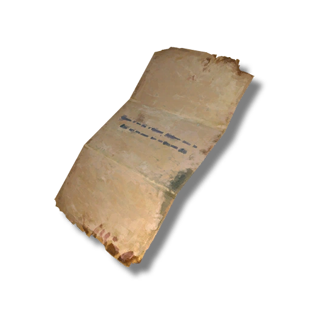

# Faded Notebook Paper

**Faded Notebook Paper**

| Property | Details |
| --- | --- |
|  |  / *Faded\_Notebook\_Paper\_icon.png* |
| **Properties** |  |
| Item type | [Collectibles](./Collectibles.md)\|- |
| Stackable | No |
| Examine | A page from a notebook with a few handwritten lines. |
| **Values** |  |
| Weight | 0.00 kg (0 lbs) |
| **Actions** |  |
| Backpack | Examine |
| On ground | Take It, Leave It |

**Faded Notebook Paper** is a [Collectible](./Collectibles.md) item found in the [Wintermute](./Wintermute.md) game files. It currently unknown if this is considered [Cut/Discontinued Content](./Cut%20%E2%80%94%20Discontinued%20Content.md), or if it is in one of the episodes.

## Transcript

*The following text is transcribed from **Faded Notebook Paper***

**All I see are wolves. Not sure what happened.

I don't like it, but if this keeps up I'll do what I gotta do, like always.

Wolves do the same, anyways. Got to keep movin'. Can't get backed into a corner again.**

## Update history

**Lua execution error in Module:Navbox function navbox**
