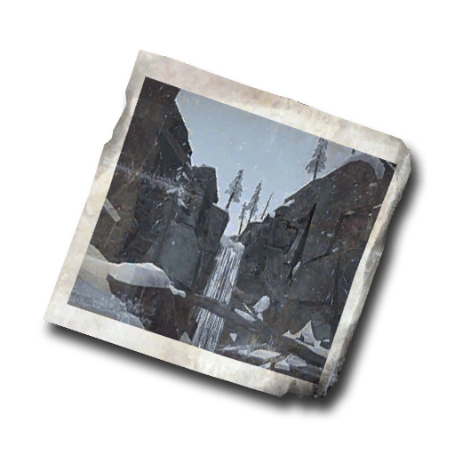

# Faded Photograph

<table class="infobox">
<caption>Faded Photograph</caption>
<colgroup>
<col style="width: 50%" />
<col style="width: 50%" />
</colgroup>
<tbody>
<tr>
<td colspan="2"><figure>

<figcaption>Faded_Photograph_icon.png</figcaption>
</figure></td>
</tr>
<tr>
<td>
Release
</td>
<td>
<a href="./The%20Long%20Dark%20%E2%80%94%20Changelog.md#2.25" class="wikilink" title="5 December 2023">5 December 2023</a>
</td>
</tr>
<tr>
<td>
Wintermute
</td>
<td>
No
</td>
</tr>
<tr>
<td colspan="2" class="section">
<strong>Properties</strong>
</td>
</tr>
<tr>
<td>
Item type
</td>
<td>
<a href="./Collectibles.md" class="wikilink" title="Collectibles">Collectibles</a>|-
</td>
</tr>
<tr>
<td>
Stackable
</td>
<td>
No
</td>
</tr>
<tr>
<td>
Examine
</td>
<td>
A Polaroid tucked into the Security Chief's logbook.
</td>
</tr>
<tr>
<td colspan="2" class="section">
<strong>Values</strong>
</td>
</tr>
<tr>
<td>
Weight
</td>
<td>
0 kg (0 lbs)
</td>
</tr>
<tr>
<td colspan="2" class="section">
<strong>Advanced data</strong>
</td>
</tr>
<tr>
<td>
Item key
</td>
<td>
GAMEPLAY_Tale2_ChiefPolaroid
</td>
</tr>
</tbody>
</table>

**Faded Photograph** is a <a href="./Collectibles.md" class="wikilink" title="Collectible">Collectible</a> found in <a href="./Survival%20Mode.md" class="wikilink" title="Survival Mode">Survival Mode</a> as part of the <a href="./Buried%20Echoes.md" class="wikilink" title="Buried Echoes">Buried Echoes</a> <a href="./Tales.md" class="wikilink" title="Tale">Tale</a>. It is found inside <a href="./Security%20Chief%27s%20Log%20%28illegible%29.md" class="wikilink" title="Security Chief&#39;s Log (illegible)">Security Chief's Log (illegible)</a> and provides a hint of where to bury the <a href="./The%20Security%20Chief%27s%20Remains.md" class="wikilink" title="The Security Chief&#39;s Remains">The Security Chief's Remains</a>. It points to <a href="./Enduring%20Waterfall.md" class="wikilink" title="Enduring Waterfall">Enduring Waterfall</a>. Despite being a <a href="./Polaroids.md" class="wikilink" title="Polaroid">Polaroid</a>, does not offer a Vista point at the falls, and is merely a story item.

## Transcript

The following text is transcribed from the note **Faded photograph**

The locals call this the Enduring Waterfall. Wanted to capture the view from my usual spot.

## Update history

- UPDATE **5 December 2023 (<a href="./The%20Long%20Dark%20%E2%80%94%20Changelog.md#2.25" class="wikilink" title="Update">Update</a>):**
  - Added to game.

**Lua execution error in Module:Navbox function navbox**

