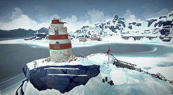
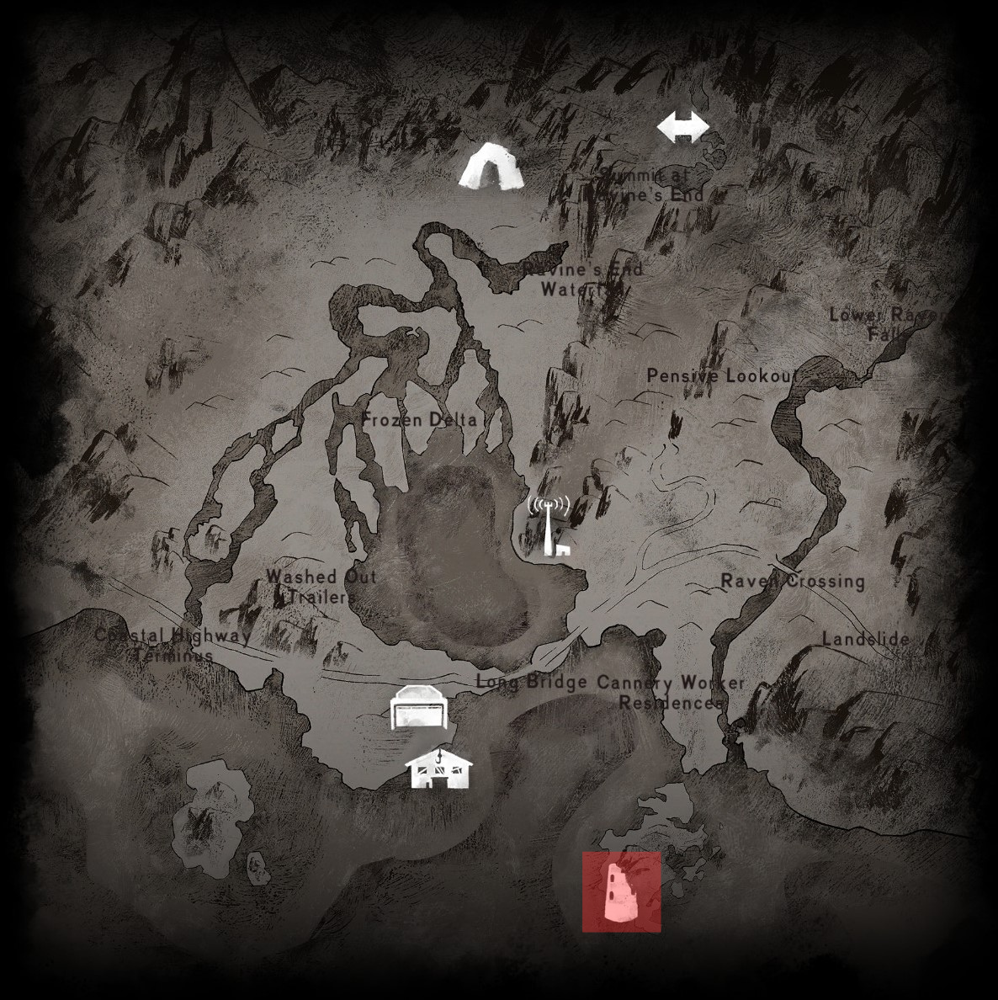
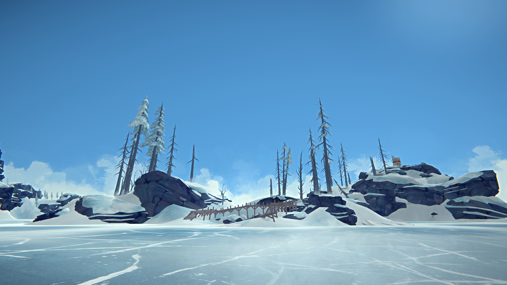

# Fallen Lighthouse

**Categories:** Islands, Locations, Locations in Bleak Inlet, Military/Sporting locations, Outdoor locations, Sheltered locations · **Source:** [Fandom](https://thelongdark.fandom.com/wiki/Fallen_Lighthouse)

**Fallen Lighthouse**

_The Fallen Lighthouse, with the cannery in the background_

**Location**

_Fallen\_Lighthouse\_Location.png_

**Region:** [Bleak Inlet](./Bleak%20Inlet.md)

**Description:** The crumbling remains of a once-standing lighthouse

**General**

**Type:** OutdoorsMilitary/Sporting

_bed\_icon.png_

_SS-BI-FallenLighthouse02.jpg_

_SS-BI-FallenLighthouse01.jpg_

_SS-BI-FallenLighthouse03.jpg_

_Behind\_the\_Fallen\_Lighthouse.png_

_Concept of the Lighthouse_
