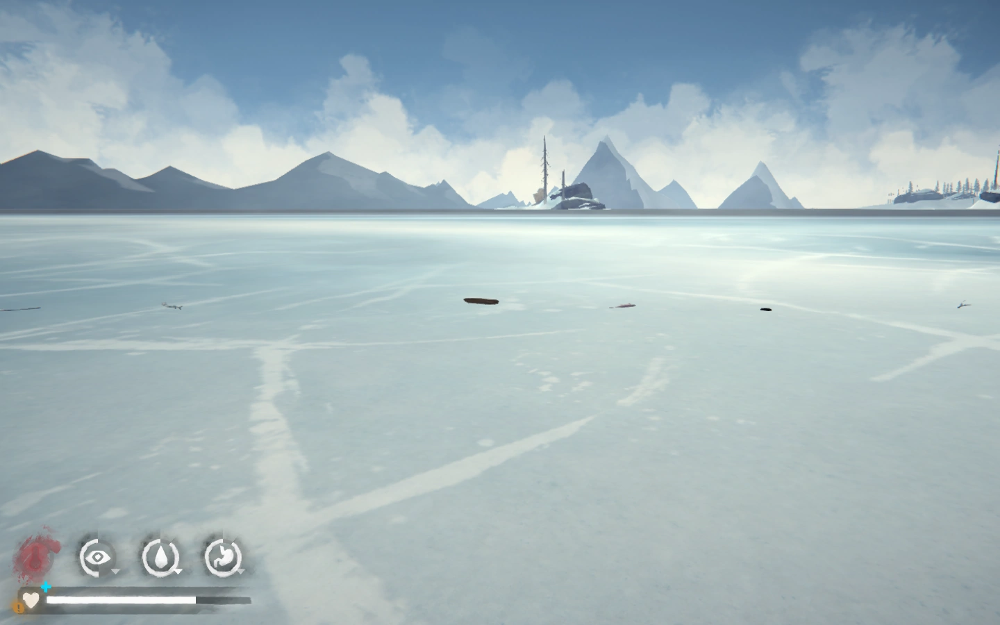
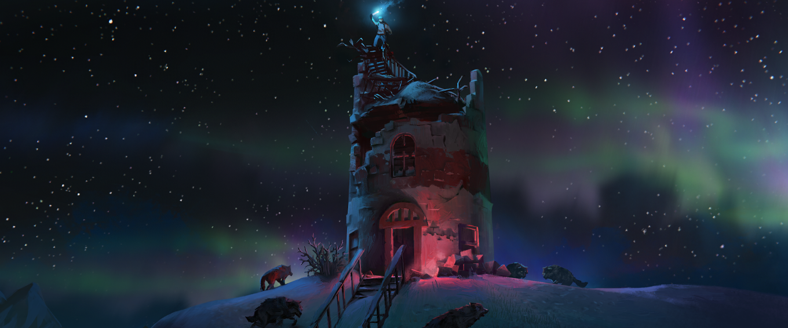

# Fallen Lighthouse

<table class="infobox">
<caption>Fallen Lighthouse</caption>
<colgroup>
<col style="width: 50%" />
<col style="width: 50%" />
</colgroup>
<tbody>
<tr>
<td colspan="2"><figure>

<figcaption>The Fallen Lighthouse, with the cannery in the background</figcaption>
</figure></td>
</tr>
<tr>
<td colspan="2" class="section">
<strong>Location</strong>
</td>
</tr>
<tr>
<td colspan="2"><figure>
[Missing image: Fallen_Lighthouse_Location.png]
<figcaption>Fallen_Lighthouse_Location.png</figcaption>
</figure></td>
</tr>
<tr>
<td>
Region
</td>
<td>
<a href="./Bleak%20Inlet.md" class="wikilink" title="Bleak Inlet">Bleak Inlet</a>|-
</td>
</tr>
<tr>
<td>
Description
</td>
<td>
The crumbling remains of a once-standing lighthouse
</td>
</tr>
<tr>
<td colspan="2" class="section">
<strong>General</strong>
</td>
</tr>
<tr>
<td>
Type
</td>
<td>
OutdoorsMilitary/Sporting|-
</td>
</tr>
<tr>
<td><figure>

<figcaption>bed_icon.png</figcaption>
</figure></td>
<td></td>
</tr>
<tr>
<td></td>
<td>
Provides some shelter|} <strong>Fallen Lighthouse</strong> is the collapsed ruin of a former lighthouse, similar to the intact building in <a href="./Desolation%20Point.md" class="wikilink" title="Desolation Point">Desolation Point</a>, in <a href="./Bleak%20Inlet.md" class="wikilink" title="Bleak Inlet">Bleak Inlet</a>. It is an iconic landmark used associated with the region.

<h2 id="Overview">Overview</h2>

The remnants of the tower sit on the top of a hill, with frequent rabbit and deer spawns nearby. Inside the lighthouse, the player will find a six-burner <a href="./Stove.md" class="wikilink" title="stove">stove</a>, <a href="./Dusting%20Sulfur.md" class="wikilink" title="dusting sulfur">dusting sulfur</a> or a <a href="./Sewing%20Kit.md" class="wikilink" title="sewing kit">sewing kit</a>, a plastic container, as well as some firewood. If the player climbs the lighthouse stairs to the top, they can find an <a href="./Emergency%20Kit.md" class="wikilink" title="Emergency Kit">Emergency Kit</a>.

Despite its notoriety, the lighthouse does not serve as a good safehouse, as it leaves the player exposed to the cold and unable to cure hides, guts, or saplings. It also lacks a bed, workbench, and other useful features.

Despite these Imitations, it can make a good temporary camp for those well-supplied with firewood and/or warm clothing. It is conveniently positioned near the <a href="./Cannery%20Worker%20Residences.md" class="wikilink" title="Cannery Worker Residences">Cannery Worker Residences</a> (a better safehouse option), and its outdoor six-burner stove makes it an optimal location for efficient cooking and for cooking skill improvement. Nearby, deer and rabbit spawns can be found, in addition to ice fishing huts. It is a good place to spend a day or three, while probably spending the night somewhere else.

The lighthouse is also notable for being the spawn location for <a href="./As%20the%20Dead%20Sleep.md" class="wikilink" title="As the Dead Sleep">As the Dead Sleep</a>.

<h2 id="Strategy">Strategy</h2>

The Fallen Lighthouse provides a good view of the player's surroundings, only bested by the radio hut on the mountain; on a clear day, it's possible to see most of the major locations in Bleak Inlet from its top. Although the aspects of the location and terrain around it would make for a good safehouse, it might be challenging for the player to make it through a night there, as the nights can get very cold and timberwolf attacks are possible.  The shores around the lighthouse are also the only place in Bleak Inlet where <a href="./Beachcombing.md" class="wikilink" title="Beachcombing">Beachcombing</a> is possible, potentially making it vital to a long-term strategy for surviving in the region.

Aside from this, it makes a somewhat good location for a base of operations, only sleeping somewhere else might be required.

<h2 id="Gallery">Gallery</h2>
<table class="gallery">
<colgroup>
<col style="width: 25%" />
<col style="width: 25%" />
<col style="width: 25%" />
<col style="width: 25%" />
</colgroup>
<tbody>
<tr>
<td><figure>
[Missing image: SS-BI-FallenLighthouse02.jpg]
<figcaption>SS-BI-FallenLighthouse02.jpg</figcaption>
</figure></td>
<td><figure>
[Missing image: SS-BI-FallenLighthouse01.jpg]
<figcaption>SS-BI-FallenLighthouse01.jpg</figcaption>
</figure></td>
<td><figure>
[Missing image: SS-BI-FallenLighthouse03.jpg]
<figcaption>SS-BI-FallenLighthouse03.jpg</figcaption>
</figure></td>
<td><figure>

<figcaption>Behind_the_Fallen_Lighthouse.png</figcaption>
</figure></td>
</tr>
<tr>
<td><figure>

<figcaption>Concept of the Lighthouse</figcaption>
</figure></td>
<td></td>
<td></td>
<td></td>
</tr>
</tbody>
</table>

<strong>Lua execution error in Module:Navbox function navbox</strong>

<a href="es:Faro_derrumbado" class="wikilink" title="es:Faro derrumbado">es:Faro derrumbado</a> <a href="ru:%D0%A3%D0%BF%D0%B0%D0%B2%D1%88%D0%B8%D0%B9_%D0%BC%D0%B0%D1%8F%D0%BA" class="wikilink" title="ru:Упавший_маяк">ru:Упавший_маяк</a>
</td>
</tr>
</tbody>
</table>

