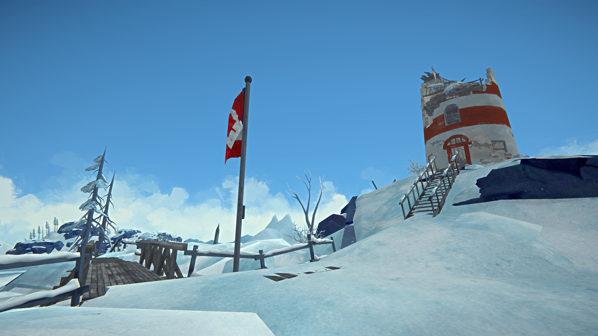
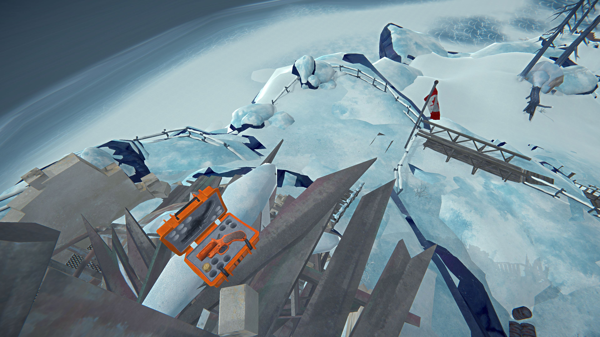

# Fallen Lighthouse

**Categories:** Islands, Locations, Locations in Bleak Inlet, Military/Sporting locations, Outdoor locations, Sheltered locations · **Source:** [Fandom](https://thelongdark.fandom.com/wiki/Fallen_Lighthouse)

**Fallen Lighthouse**

| Property | Details |
| --- | --- |
|  | [The Fallen Lighthouse, with the cannery in the background](../assets/Crique_lugubre_over.png) |
| **Location** |  |
|  | [Fallen Lighthouse Location](../assets/Fallen_Lighthouse_Location.png) |
| Region | [Bleak Inlet](./Bleak%20Inlet.md) |
| Location | South of the cannery worker residences |
| Description | The crumbling remains of a once-standing lighthouse |
| **General** |  |
| Type | OutdoorsMilitary/Sporting |
| Firebox | [Stove](./Stove.md) |
| [Bed icon](../assets/Bed_icon.png) |  |
|  | Provides some shelter |

**Fallen Lighthouse** is the collapsed ruin of a former lighthouse, similar to the intact building in [Desolation Point](./Desolation%20Point.md), in [Bleak Inlet](./Bleak%20Inlet.md). It is an iconic landmark used associated with the region.

## Overview

The remnants of the tower sit on the top of a hill, with frequent rabbit and deer spawns nearby. Inside the lighthouse, the player will find a six-burner [stove](./Stove.md), [dusting sulfur](./Dusting%20Sulfur.md) or a [sewing kit](./Sewing%20Kit.md), a plastic container, as well as some firewood. If the player climbs the lighthouse stairs to the top, they can find an [Emergency Kit](./Emergency%20Kit.md).

Despite its notoriety, the lighthouse does not serve as a good safehouse, as it leaves the player exposed to the cold and unable to cure hides, guts, or saplings. It also lacks a bed, workbench, and other useful features.

Despite these Imitations, it can make a good temporary camp for those well-supplied with firewood and/or warm clothing. It is conveniently positioned near the [Cannery Worker Residences](./Cannery%20Worker%20Residences.md) (a better safehouse option), and its outdoor six-burner stove makes it an optimal location for efficient cooking and for cooking skill improvement. Nearby, deer and rabbit spawns can be found, in addition to ice fishing huts. It is a good place to spend a day or three, while probably spending the night somewhere else.

The lighthouse is also notable for being the spawn location for [As the Dead Sleep](./As%20the%20Dead%20Sleep.md).

## Strategy

The Fallen Lighthouse provides a good view of the player's surroundings, only bested by the radio hut on the mountain; on a clear day, it's possible to see most of the major locations in Bleak Inlet from its top. Although the aspects of the location and terrain around it would make for a good safehouse, it might be challenging for the player to make it through a night there, as the nights can get very cold and timberwolf attacks are possible. The shores around the lighthouse are also the only place in Bleak Inlet where [Beachcombing](./Beachcombing.md) is possible, potentially making it vital to a long-term strategy for surviving in the region.

Aside from this, it makes a somewhat good location for a base of operations, only sleeping somewhere else might be required.

## Gallery

[es:Faro derrumbado](https://es.wikipedia.org/wiki/Faro_derrumbado) [ru:Упавший\_маяк](https://ru.wikipedia.org/wiki/%D0%A3%D0%BF%D0%B0%D0%B2%D1%88%D0%B8%D0%B9_%D0%BC%D0%B0%D1%8F%D0%BA)
