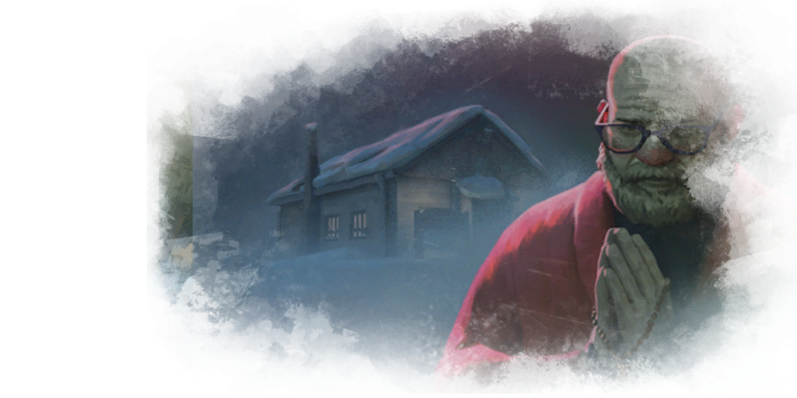

# Fallen Star

<table class="infobox">
<caption>Fallen Star</caption>
<colgroup>
<col style="width: 50%" />
<col style="width: 50%" />
</colgroup>
<tbody>
<tr>
<td colspan="2"><figure>

<figcaption>Missions_story_ep3_Triage.png</figcaption>
</figure></td>
</tr>
<tr>
<td>
Episode
</td>
<td>
<a href="./Episode%203%20-%20Crossroads%20Elegy.md" class="wikilink" title="Episode 3">Episode 3</a>|-
</td>
</tr>
<tr>
<td>
Previous
</td>
<td>
<a href="./Trauma.md" class="wikilink" title="Trauma">Trauma</a>
</td>
</tr>
<tr>
<td>
Current
</td>
<td>
Fallen Star
</td>
</tr>
<tr>
<td>
Next
</td>
<td>
<a href="./Coming%20Storm.md" class="wikilink" title="Coming Storm">Coming Storm</a>
</td>
</tr>
<tr>
<td>
Region
</td>
<td>
<a href="./Pleasant%20Valley.md" class="wikilink" title="Pleasant Valley">Pleasant Valley</a>
</td>
</tr>
<tr>
<td>
Characters
</td>
<td>
<a href="./Astrid%20Greenwood.md" class="wikilink" title="Astrid Greenwood">Astrid Greenwood</a> <a href="./Father%20Thomas.md" class="wikilink" title="Father Thomas">Father Thomas</a> 
<a href="./Crash%20Survivor.md" class="wikilink" title="Crash Survivor">Crash Survivor</a> 
<a href="./Molly.md" class="wikilink" title="Molly">Molly</a> 
<a href="./Jane%20Yang.md" class="wikilink" title="Jane Yang">Jane Yang</a> (flashback)
</td>
</tr>
</tbody>
</table>

**Spoiler Warning:***This page may contain spoilers from the <a href="./Wintermute.md" class="wikilink" title="story">story</a> of The Long Dark.*

|  |  |  |
|----|----|----|
| “ | Survivors of an airline crash in the mountains have found their way to the Community Hall in Thomson's Crossing. There might be others out there in need of help. Can you save them? | ” |

**Fallen Star** is the second mission in <a href="./Episode%203%20-%20Crossroads%20Elegy.md" class="wikilink" title="Episode 3">Episode 3</a> of the <a href="./Wintermute.md" class="wikilink" title="story">story</a>. In this mission, <a href="./Astrid%20Greenwood.md" class="wikilink" title="Astrid">Astrid</a> meets <a href="./Father%20Thomas.md" class="wikilink" title="Father Thomas">Father Thomas</a> and learns about her predicament.

## Objectives

- Check on the plane crash survivors in the hall. \[0/6\]
- Talk to Father Thomas.
- Locate the downed airliner.
- Find Insulin for Dimitri.
- Find the passenger IDs. \[0/10\]
- Help any passengers found near the plane.
- Bring Gwen to the Community Hall.
- Place Gwen in an unoccupied bed.
- Administer Insulin to Dimitri.
- Return IDs \[0/10\].
- Talk to Father Thomas.

## Walkthrough

<table>
<thead>
<tr>
<th colspan="2">
Mission details
</th>
</tr>
</thead>
<tbody>
<tr>
<td></td>
<td></td>
</tr>
</tbody>
</table>

The mission starts in the <a href="./Community%20Hall.md" class="wikilink" title="Community Hall">Community Hall</a>. Walk to each survivor in the hall and diagnose them.

- Chloe has <a href="./Hypothermia.md" class="wikilink" title="Hypothermia">Hypothermia</a>, no treatment needed
- Winston has Hypothermia, no treatment needed
- Franklin has a <a href="./Concussion.md" class="wikilink" title="Concussion">Concussion</a>, no treatment needed
- Bennett has a Concussion, no treatment needed
- Eric has <a href="./Dehydration%20Risk.md" class="wikilink" title="Dehydration Risk">Dehydration Risk</a> and needs 0.50 L of <a href="./Water%20%28Potable%29.md" class="wikilink" title="Water (Potable)">Water (Potable)</a>
- Dimitri has a Diabetes wristband and has a <a href="./Hyperglycemic%20Risk.md" class="wikilink" title="Hyperglycemic Risk">Hyperglycemic Risk</a>. He needs <a href="./Insulin.md" class="wikilink" title="Insulin">Insulin</a>, which is not here

Most survivors will have hypothermia or concussions and won't require treatment. Others can be treated using medical supplies from the player's inventory. Talk to <a href="./Father%20Thomas.md" class="wikilink" title="Father Thomas">Father Thomas</a> after diagnosing all six survivors.

Leave Community Hall and head to the <a href="./Crash%20Site%20%28Pleasant%20Valley%29.md" class="wikilink" title="Crash Site">Crash Site</a> to find Insulin. The most straightforward way to reach it is to follow the road which runs up the right side of the in-game map. Upon reaching the plane, enter the plane through the door on the left near the cockpit. Continue through the front section of the plane and drop out the back. Note that it is not possible to return once dropping off the front section.

There will be nine bodies scattered behind the front section. Search each body and take their IDs. Many of the other suitcases will have <a href="./Clothing.md" class="wikilink" title="Clothing">Clothing</a>. Frozen airline dinners are scattered around the ground, which will be useful if you can carry them back to the Community Hall later so take them if you can.

At the top of the hill, a survivor named Gwen is pinned beneath a seat. Remove the seat from on top of her and diagnose her injuries. Dimitri's Insulin will be inside one of the suitcases next to Gwen. Gwen has her own condition (health) as well as warmth and hydration needs. Her condition will go down if she is attacked by <a href="./Timberwolf.md" class="wikilink" title="timberwolves">timberwolves</a> or if either of her needs are entirely depleted. The player can address Gwen's warmth need by placing her near a fire or indoors, and can address her thirst need by using the "diagnose" interface to give her <a href="./Water%20%28Potable%29.md" class="wikilink" title="potable water">potable water</a>. Gwen's condition will improve as long as her needs are met and she will not contribute to the player's carrying capacity when held.

Head back down the hill, but turn towards the right. The path the player entered the area through—the plane—will be blocked. At the bottom of the hill on the right is a small cave which makes for a good place to sleep or build a <a href="./Campfire.md" class="wikilink" title="Campfire">Campfire</a>. Continuing to the right is the only way to exit the area. The player will cross a fallen-tree bridge and continue down a hill to a burned house. <a href="./Molly.md" class="wikilink" title="Molly">Molly</a> will call the phone at the house.

Be wary of Timberwolves along the way back to the Community Hall. Gwen must be placed on the ground to draw a weapon or interact with objects. Bring Gwen back to Community Hall and place her on the newly preplaced unoccupied bed. Give Dimitri his Insulin and then talk to the 12 survivors already in the hall to break the news of the missing/dead plane passengers, then talk to Father Thomas, and the mission will end.

### ID quantity clarifications

\[Missing image: Survivor_count.jpg\] Some confusion has been caused by the number of ID's required by the journal.

- At the plane crash, Astrid must obtain 10 ID cards:
  - 9 ID cards from the dead bodies scattered behind the plane.
  - 1 ID card is from Gwen. The ID card (G. Russell) will automatically be found after you find Gwen and the cutscene ends.
  - The ID cards can be obtained in any order.

<!-- -->

- After returning to Community Hall, the journal says to "return" 12 ID's. What this really means is that the player must talk to all 12 survivors in the hall. The 12 survivors are in sleeping bags. Of these 12 survivors:
  - Gwen's <a href="./ID%20-%20G.%20Russell.md" class="wikilink" title="ID - G. Russell">ID - G. Russell</a> will automatically disappear once she is placed on a bed.
  - 9 will be told their family member/friend didn't make it. (This corresponds to the 9 dead bodies Astrid took the IDs from at the crash)
    - \(1\) Dimitri will be given <a href="./ID%20-%20D.%20Belanger.md" class="wikilink" title="ID - D. Belanger">ID - D. Belanger</a>
    - \(2\) Chloe will be given <a href="./ID%20-%20F.%20Leblanc.md" class="wikilink" title="ID - F. Leblanc">ID - F. Leblanc</a>
    - \(3\) Bennett will be given <a href="./ID%20-%20K.%20Morrison.md" class="wikilink" title="ID - K. Morrison">ID - K. Morrison</a>
    - \(5\) Franklin will be given <a href="./ID%20-%20R.%20Tan.md" class="wikilink" title="ID - R. Tan">ID - R. Tan</a>
    - \(7\) Sadie will be given <a href="./ID%20-%20T.%20Chan.md" class="wikilink" title="ID - T. Chan">ID - T. Chan</a>
    - \(8\) Ruby will be given <a href="./ID%20-%20A.%20Lewis.md" class="wikilink" title="ID - A. Lewis">ID - A. Lewis</a>
    - \(9\) Winston will be given <a href="./ID%20-%20S.%20Gagne.md" class="wikilink" title="ID - S. Gagne">ID - S. Gagne</a>
    - \(10\) Sam will be given <a href="./ID%20-%20V.%20Singh.md" class="wikilink" title="ID - V. Singh">ID - V. Singh</a>
    - \(12\) Jake will be given <a href="./ID%20-%20O.%20Gould.md" class="wikilink" title="ID - O. Gould">ID - O. Gould</a>
  - 3 will be told their family member/friend couldn't be found (This corresponds to the 3 names unaccounted for on the passenger manifest).
    - \(6\) Nolan, (4) Eric, and (11) Maude will be told that their friend could not be found, and they will plead to Astrid to keep looking.

**Lua execution error in Module:Navbox function navboxLua execution error in Module:Navbox function navbox**

 

